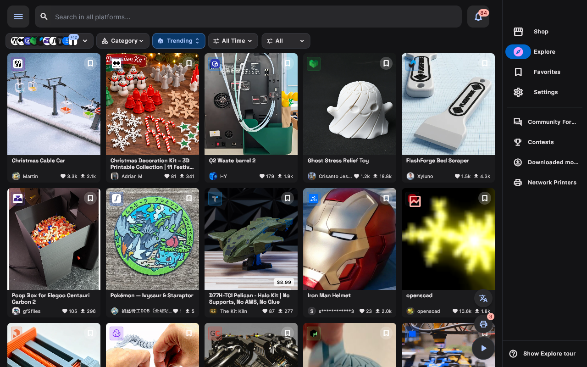
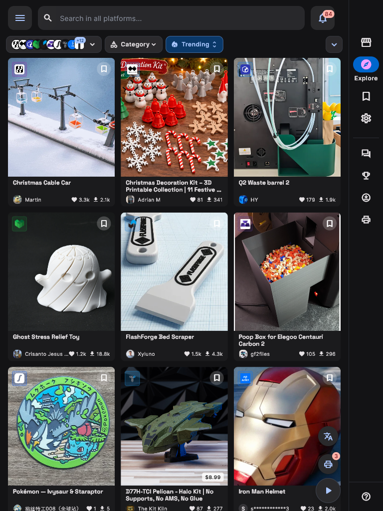
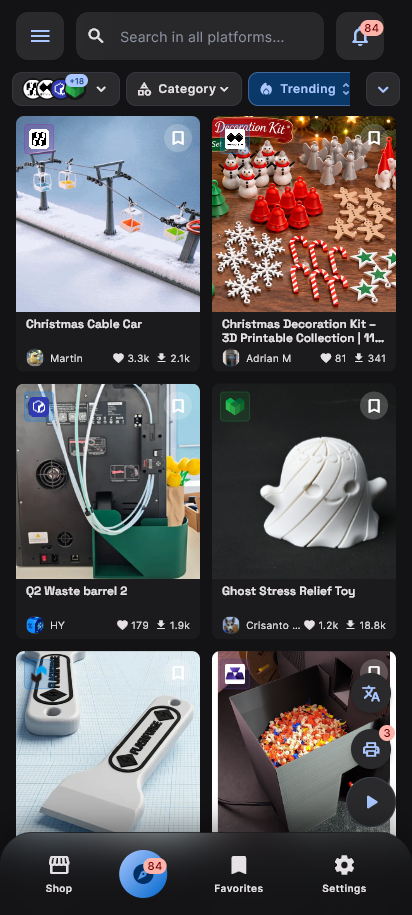

# MakerSpell Desktop & Mobile App User Guide

The MakerSpell desktop (Windows, macOS, Linux) and mobile (Android, iOS) client—**MakerSync**—is a unified control cockpit designed to connect, manage, and monitor all your 3D printers, slice models, and stream G-code directly over your local network.

---

## Responsive Multi-Platform Interface

MakerSpell adapts its interface to your screen geometry. Pick a form factor to compare:

<input class="dv-input" type="radio" name="dv-overview" id="dv-overview-desktop" checked>
<input class="dv-input" type="radio" name="dv-overview" id="dv-overview-tablet">
<input class="dv-input" type="radio" name="dv-overview" id="dv-overview-mobile">

<label for="dv-overview-desktop"><svg width="16" height="16" aria-hidden="true" focusable="false" viewBox="0 0 24 24" fill="none" stroke="currentColor" stroke-width="1.8" stroke-linecap="round" stroke-linejoin="round" aria-hidden="true"><rect x="2" y="3" width="20" height="14" rx="2"/><path d="M8 21h8"/><path d="M12 17v4"/></svg>Desktop1280 px</label>
<label for="dv-overview-tablet"><svg width="16" height="16" aria-hidden="true" focusable="false" viewBox="0 0 24 24" fill="none" stroke="currentColor" stroke-width="1.8" stroke-linecap="round" stroke-linejoin="round" aria-hidden="true"><rect x="4" y="2" width="16" height="20" rx="2"/><path d="M12 18h.01"/></svg>Tablet768 px</label>
<label for="dv-overview-mobile"><svg width="16" height="16" aria-hidden="true" focusable="false" viewBox="0 0 24 24" fill="none" stroke="currentColor" stroke-width="1.8" stroke-linecap="round" stroke-linejoin="round" aria-hidden="true"><rect x="7" y="2" width="10" height="20" rx="2.5"/><path d="M11 18h2"/></svg>Mobile412 px</label>

<figure class="dv-panel">

<figcaption><strong>Desktop</strong> — Multi-column model discovery with the full navigation rail and live fleet telemetry.</figcaption>
</figure>
<figure class="dv-panel">

<figcaption><strong>Tablet</strong> — Touch-first navigation rail with a responsive three-column discovery grid.</figcaption>
</figure>
<figure class="dv-panel">

<figcaption><strong>Mobile</strong> — Single-hand layout: bottom navigation bar and compact cards for workshop mobility.</figcaption>
</figure>

Layouts captured at 1280 px, 768 px and 412 px width.

---

## Key Capabilities

- **🔍 Automatic Local Discovery:** Instantly discovers Creality K1, Snapmaker U1, Voron, Ender (Klipper/Moonraker), and OctoPrint devices on your local Wi-Fi or Ethernet.
- **🗂️ Print Center:** Real-time multi-printer dashboard showing active prints, stage progress, and time estimates at a single glance.
- **🚀 One-Click G-code Streaming:** Sends sliced 3D models wirelessly to printer onboard storage or triggers remote execution.
- **📹 Low-Latency Live Camera:** Low-lag webcam feed to inspect first layer adhesion and monitor prints from anywhere in your shop.
- **🎨 Multi-Color Printing (CFS / AMS):** Automatically reads slot status, filament colors, and materials for Creality CFS and Snapmaker AMS units.
- **🕹️ Complete Motion & Temperature Controls:** Set hotend and bed temperatures, adjust cooling fans, and jog XYZ axes with built-in safety interlocks.

---

## Guide Navigation

1. [Connecting & Discovering Network Printers](connecting-printers.md)
2. [Print Center & Multi-Printer Monitoring](print-center-guide.md)
3. [G-code Transfer & Slicing Integration](gcode-sending.md)
4. [Device Control Panel (Camera, Temps, Axes)](printer-controls.md)
5. [Multi-Color Printing & Material Management](multicolor-printing.md)
6. [3D Model Viewer, Plate Layout & Color Painting](model-viewer.md)
7. [OrcaSlicer Settings, Infill & Tree Supports](slicing-and-preferences.md)
8. [Model Library & Download Manager](library-and-downloads.md)
9. [Shop Hub & E-Commerce Production Orders](shop-hub-orders.md)
10. [Community Printer Profiles & Custom Driver Editor](printer-profiles-manager.md)
11. [App Preferences, Alerts & Account Management](settings-and-accounts.md)
