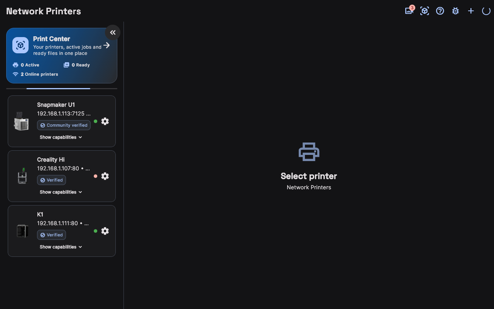
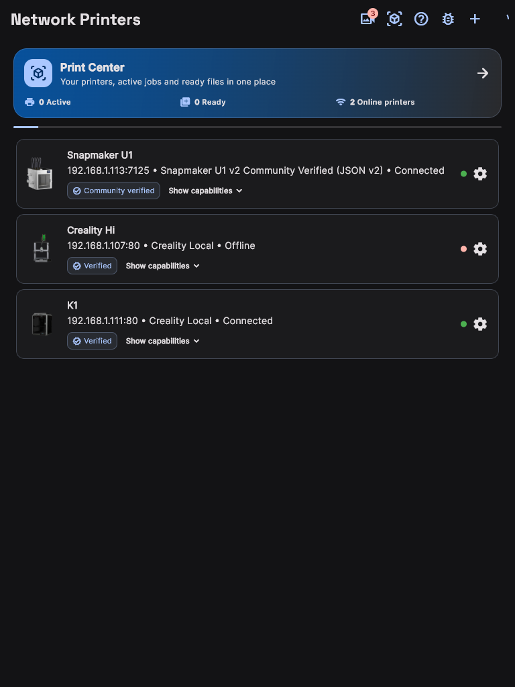
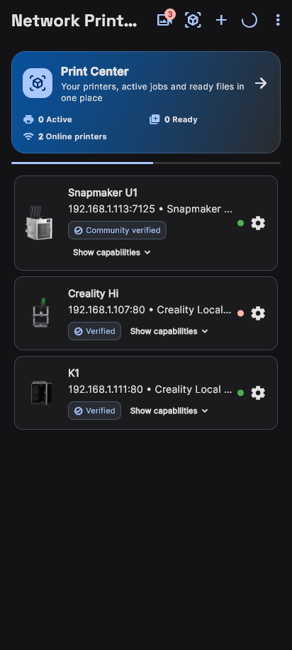

# Connecting & Discovering Network Printers

MakerSpell leverages zero-configuration local network discovery to automatically find your 3D printers without tedious manual setup.

---

## 1. Automatic Discovery

### Network Printers on Every Screen

The same discovered printer fleet adapts to the screen you are holding. Pick a form factor to compare:

<input class="dv-input" type="radio" name="dv-printers" id="dv-printers-desktop" checked>
<input class="dv-input" type="radio" name="dv-printers" id="dv-printers-tablet">
<input class="dv-input" type="radio" name="dv-printers" id="dv-printers-mobile">

<label for="dv-printers-desktop"><svg width="16" height="16" aria-hidden="true" focusable="false" viewBox="0 0 24 24" fill="none" stroke="currentColor" stroke-width="1.8" stroke-linecap="round" stroke-linejoin="round" aria-hidden="true"><rect x="2" y="3" width="20" height="14" rx="2"/><path d="M8 21h8"/><path d="M12 17v4"/></svg>Desktop1280 px</label>
<label for="dv-printers-tablet"><svg width="16" height="16" aria-hidden="true" focusable="false" viewBox="0 0 24 24" fill="none" stroke="currentColor" stroke-width="1.8" stroke-linecap="round" stroke-linejoin="round" aria-hidden="true"><rect x="4" y="2" width="16" height="20" rx="2"/><path d="M12 18h.01"/></svg>Tablet768 px</label>
<label for="dv-printers-mobile"><svg width="16" height="16" aria-hidden="true" focusable="false" viewBox="0 0 24 24" fill="none" stroke="currentColor" stroke-width="1.8" stroke-linecap="round" stroke-linejoin="round" aria-hidden="true"><rect x="7" y="2" width="10" height="20" rx="2.5"/><path d="M11 18h2"/></svg>Mobile412 px</label>

<figure class="dv-panel">

<figcaption><strong>Desktop</strong> — Discovered network printers fill the full width of the window.</figcaption>
</figure>
<figure class="dv-panel">

<figcaption><strong>Tablet</strong> — Each printer row keeps its status button within easy thumb reach.</figcaption>
</figure>
<figure class="dv-panel">

<figcaption><strong>Mobile</strong> — The list becomes full-width cards you can scan while walking to the machine.</figcaption>
</figure>

Layouts captured at 1280 px, 768 px and 412 px width.

---

1. Ensure your 3D printer is powered on and connected to the **same Wi-Fi or Ethernet network** as your computer or smartphone.
2. In MakerSpell, open the **"Network Printers"** screen from the navigation menu.
3. Click the **"Scan / Refresh"** button in the top-right corner.
4. MakerSpell scans local mDNS (Zeroconf), CrealityOS, and Moonraker ports across your subnet.
5. Within seconds, your printer (e.g. *Creality K1*, *Snapmaker U1*, *Klipper/Moonraker*) will appear in the fleet list.
6. When the connection indicator turns green, the printer is online and ready to operate.

---

## 2. Adding a Printer Manually via IP

If your router blocks multicast traffic (mDNS) or your printer is on a different subnet:

1. Click the **"Add Printer" (+)** button on the Network Printers screen.
2. Enter the device parameters:
   - **Display Name:** A friendly label (e.g., *Workshop K1 Max*).
   - **IP Address:** The local IPv4 address shown on your printer display (e.g., `192.168.1.105`).
   - **Port:**
     - Klipper / Moonraker default: `7125`
     - CrealityOS (K1, Ender-3 V3, Hi): `80`
     - OctoPrint: `80` or `5000`
   - **Driver / Protocol:** Select the matching driver (e.g. *Creality Local v2*, *Moonraker*, *OctoPrint*).
3. Click **"Test Connection & Save"**. Once confirmed, your printer is saved permanently.

---

## 3. Dynamic IP Changes (DHCP Stability)

If your router reassigns IP addresses after a reboot, MakerSpell’s **Stable Hardware ID** architecture retains your printer configuration. The app tracks the hardware identity (MAC/UUID) in the background and transparently reconnects as soon as the printer appears on its new IP address.
