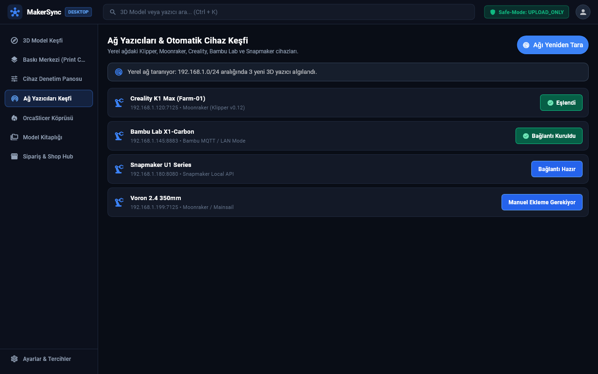

# Connecting & Discovering Network Printers

MakerSpell leverages zero-configuration local network discovery to automatically find your 3D printers without tedious manual setup.

---

## 1. Automatic Discovery

1. Ensure your 3D printer is powered on and connected to the **same Wi-Fi or Ethernet network** as your computer or smartphone.
2. In MakerSpell, open the **"Network Printers"** screen from the navigation menu.
3. Click the **"Scan / Refresh"** button in the top-right corner.
4. MakerSpell scans local mDNS (Zeroconf), CrealityOS, and Moonraker ports across your subnet.
5. Within seconds, your printer (e.g. *Creality K1*, *Snapmaker U1*, *Klipper/Moonraker*) will appear in the fleet list.
6. When the connection indicator turns green, the printer is online and ready to operate.

---

## 2. Adding a Printer Manually via IP

If your router blocks multicast traffic (mDNS) or your printer is on a different subnet:

1. Click the **"Add Printer" (+)** button on the Network Printers screen.
2. Enter the device parameters:
   - **Display Name:** A friendly label (e.g., *Workshop K1 Max*).
   - **IP Address:** The local IPv4 address shown on your printer display (e.g., `192.168.1.105`).
   - **Port:**
     - Klipper / Moonraker default: `7125`
     - CrealityOS (K1, Ender-3 V3, Hi): `80`
     - OctoPrint: `80` or `5000`
   - **Driver / Protocol:** Select the matching driver (e.g. *Creality Local v2*, *Moonraker*, *OctoPrint*).
3. Click **"Test Connection & Save"**. Once confirmed, your printer is saved permanently.

---

## 3. Dynamic IP Changes (DHCP Stability)

If your router reassigns IP addresses after a reboot, MakerSpell’s **Stable Hardware ID** architecture retains your printer configuration. The app tracks the hardware identity (MAC/UUID) in the background and transparently reconnects as soon as the printer appears on its new IP address.
