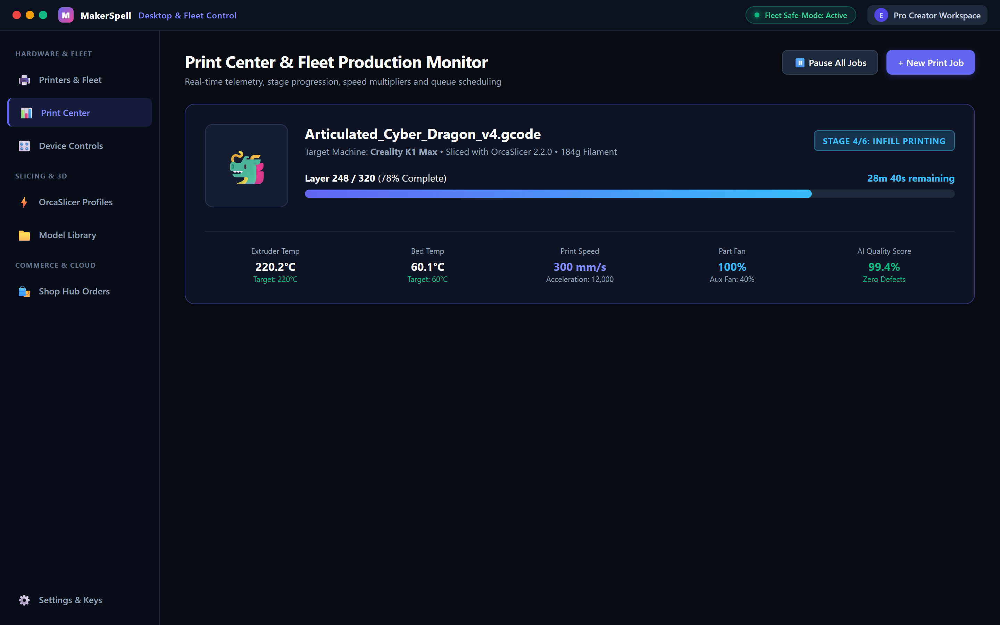

# 🗂️ Print Center & Multi-Printer Monitoring

The **Print Center** is designed for makers, print farm operators, and workshops managing multiple 3D printers simultaneously.

---

## 📌 1. Metric Badges

At the top of the Print Center, live badges summarize your fleet status:
- **Active Jobs:** The number of printers currently preheating, calibrating, or laying down plastic.
- **Ready Files:** Sliced G-code files queued up for printing.
- **Online Printers:** Connected, responding machines across your network.

---

## 📌 2. Real-Time Printer Cards

Each printer card provides instant telemetry:

- **State Indicators:**
  - 🟢 **Green (Idle):** Standby, bed clear, ready for the next job.
  - 🔵 **Blue (Printing):** Actively extruding; includes live percentage and progress bar.
  - 🟡 **Yellow (Paused):** Paused for filament swap or manual inspection.
  - 🔴 **Red (Offline):** Machine powered off or network dropped.
- **Job Progress:** Current file name, model thumbnail, completion percentage (`65%`), and time remaining (`14m 20s`).
- **Temperatures:** Real-time hotend and heatbed readings versus targets (`220°C / 60°C`).
- **Quick Controls:**
  - **Pause / Resume:** Temporarily halt printing in emergencies.
  - **Cancel Print:** Abort the current job with confirmation dialog.
  - **Open Dashboard:** Tap to enter the full two-column control cockpit.
