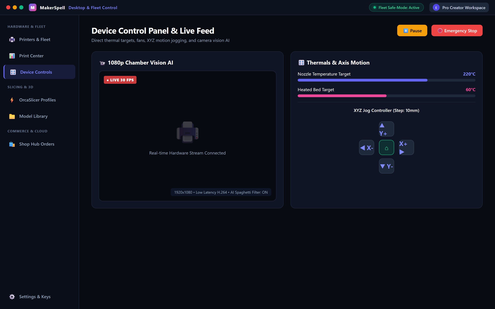

# Device Control Panel (Camera, Temperatures & Motion)

Opening a printer from the fleet list reveals the **Two-Column Desktop Dashboard**, optimized for 1100px+ displays (and responsive single-column on mobile).

---

## 1. Left Column: Telemetry & Visual Monitoring

- **Live Camera Stream:**
  Low-latency video preview from onboard cameras (CrealityOS MJPEG / WebRTC / Moonraker). Inspect the critical first layer without walking across your workshop.
- **Active Job Card:**
  Displays current layer (`120 / 450`), remaining print time, progress bar, and model thumbnail.
- **Filament Slot Matrix:**
  Visual palette indicating every filament bay in your CFS or AMS unit, including color swatches and material types.

---

## 2. Right Column: Manual Overrides & Hardware Commands

- **Thermal Controls:**
  - **Hotend:** Quick presets (PLA 200°C, PETG 240°C, ABS 260°C) or custom target input.
  - **Heated Bed:** Bed preheating and cool-down toggles.
  - **Chamber Light:** On/off toggle for onboard LED bars.
- **Cooling Fans:**
  - Fine-tune Model Fan, Auxiliary Fan, and Rear Exhaust Fan speeds (0–100%).
- **XYZ Jog & Homing:**
  - Circular jog wheel for X/Y movements and vertical Z buttons.
  - Step distance selectors: `0.1 mm`, `1 mm`, `10 mm`, and `100 mm`.
  - Center **Home All** or axis-specific homing commands.
  - *Safety Lock:* Motion controls are automatically disabled while printing to avoid toolhead collisions.
- **Local Storage Browser:**
  - View stored G-code files on the printer eMMC/SD card, delete old prints, or start reprints.
