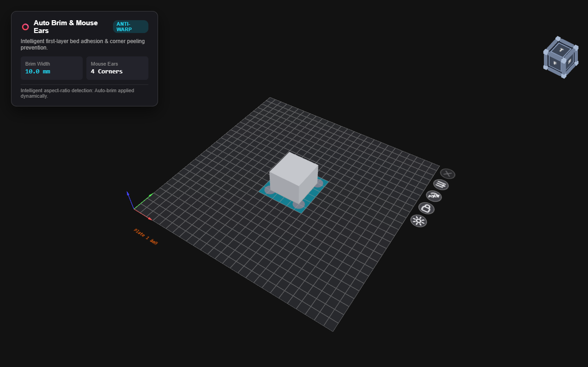

# Auto Brim & Mouse Ears: First-Layer Adhesion and Warping Prevention

First-layer adhesion is one of the most critical factors for 3D printing success. As upper layers cool, thermal contraction creates pulling forces that cause sharp corners to peel upward off the build plate (warping). Furthermore, tall or narrow parts can easily be knocked over by the moving print head.

The **Brim & Mouse Ears** tool provides intelligent adhesion strategies—ranging from automated tipping analysis to localized corner discs—keeping your prints securely anchored to the build plate.

---

## 1. Where to Find the Brim Configuration

You can configure brim settings from several editor locations:

- **Desktop context menu:** Right-click the model on the plate and select **Brim (Beta)**.
- **Touch & Mobile layout:** Select the model, open the actions sheet from the editor toolbar, and select **Brim (Beta)**.
- **Parameters panel:** Open the **Others** tab in the Parameters Panel to adjust brim parameters globally or per object.

---

## 2. The Six Brim Types

The editor supports six distinct brim types:

| Brim Type | How it works | When to use it |
| --- | --- | --- |
| **No brim** | No auxiliary brim loops are generated. | Large, flat models with generous base surface area and rounded corners. |
| **Auto brim** | Automatically evaluates contact area and tipping risk to generate a brim only when needed. | General printing; protects high-risk prints without wasting filament on stable models. |
| **Outer only** | Extrudes brim loops exclusively around the exterior silhouette of the model. | Standard prints requiring extra hold without filling internal holes or cavities. |
| **Inner only** | Extrudes brim loops exclusively inside holes, hollows, and interior cutouts. | Parts with small internal contact footprints that need extra support. |
| **Outer and inner** | Surrounds both the outer perimeter and interior cavities with brim loops. | Intricate or hollow models with minimal contact area throughout. |
| **Mouse ears** | Places circular adhesion discs specifically at sharp exterior corners. | Boxes, frames, and angular mechanical parts prone to corner lifting. |

---

## 3. How Auto Brim Evaluates Your Model

**Auto brim** uses intelligent footprint geometry analysis to protect vulnerable prints automatically:

- **Small contact area rule:** If your model's first-layer contact area is 150 mm² or smaller, auto-brim triggers automatically to prevent the part from detaching.
- **Aspect ratio (tipping risk) rule:** If your model is tall and slender—specifically when the height is four times greater than its narrowest base dimension—auto-brim activates to prevent the nozzle from knocking the part over.
- **Automatic width scaling:** For high-risk geometries, auto-brim dynamically scales brim width between 5.0 mm and 18.0 mm based on the measured risk. If the footprint is already broad and stable, the system indicates *"Footprint stable: brim not required"* and uses zero extra filament.

---

## 4. Mouse Ears: Localized Corner Adhesion

Standard full-brims wrap the entire perimeter of a model, which wastes filament and requires tedious trimming along long straight edges.

**Mouse ears** (brim ears) solve this problem by placing localized round adhesion discs exclusively at high-stress sharp corners:

### Disc diameter (6–24 mm)
Adjusts the size of the corner discs. A diameter of 10 mm to 14 mm is standard for typical FDM prints.

### Disc count (1–8)
Specifies how many corner discs to place around the object perimeter.

### Max corner angle (90°–150°)
Sets the angular threshold for corner detection. A default of 125° targets sharp 90-degree corners and acute angles while ignoring gentle curves.

Mouse ears peel off effortlessly by hand after printing, leaving clean straight edges with zero knife cleanup.

---

## 5. Adjusting Brim Width and Object Gap

When using **Outer only**, **Inner only**, or **Outer and inner** brims, two sliders control the brim behavior:

### Brim width (2.0–20.0 mm)
Sets how far the brim extends outward from the part. For standard PLA and PETG, 5.0 mm is usually sufficient; for high-shrinkage materials like ABS, ASA, or Nylon, increase the width to 8.0 mm or 12.0 mm.

### Brim-object gap (0.0–0.5 mm)
Controls the spacing between the brim line and the actual model wall:
- **0.0 mm (Zero gap):** Delivers the strongest mechanical bond against warping, but requires a deburring tool or craft knife to trim clean.
- **0.1 mm to 0.15 mm (Breakaway gap):** Creates an easy-peel connection that detaches cleanly by hand while still providing effective anti-warping hold.

---

## 6. Troubleshooting

**Corners are still lifting off the plate despite using a brim.**
Ensure your build plate is clean and degreased with isopropyl alcohol or warm soapy water. If lifting persists, increase your **Brim width** to 8–10 mm, set **Brim-object gap** to 0.0 mm, or switch from Mouse ears to **Outer only**.

**The brim is too hard to remove or leaves rough burrs on the part.**
Increase your **Brim-object gap** to 0.10 mm or 0.15 mm. This tiny separation allows the brim to snap off smoothly without fusing aggressively to the outer wall.

**Auto brim generated no brim on my model.**
This is expected behavior for broad, stable models. If the base contact area exceeds 150 mm² and the aspect ratio is low, auto-brim recognizes that the part is safe and avoids wasting material. If you still want a brim, select **Outer only** manually.

**Mouse ears appear on smooth curved surfaces.**
Lower the **Max corner angle** slider (e.g. from 135° down to 105°) so the detection filter targets only acute or right-angled corners.
