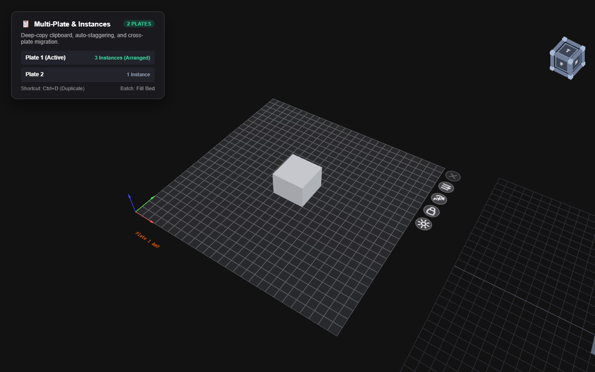

# Clipboard, Cloning & Multi-Plate Management

Managing complex 3D projects often requires duplicating parts, arranging production batches, or organizing multi-part assemblies across separate build plates. The 3D editor provides an integrated clipboard system with deep copying, one-click cloning, automatic bed filling, and multi-plate workspace management.

---

## 1. Clipboard Operations: Copy, Paste, and Clone

You can duplicate models across the workspace using standard shortcuts or on-screen menus:

### Copy (Ctrl + C / Cmd + C)
Select any model on the plate and press **Ctrl + C** (or **Cmd + C** on macOS), or choose **Copy** from the right-click context menu or mobile actions grid. The entire model hierarchy is copied to the internal clipboard.

### Paste (Ctrl + V / Cmd + V)
Press **Ctrl + V** (or **Cmd + V**), or choose **Paste**. The clipboard contents are placed onto the active plate. 
- **Automatic offset:** Each pasted model is automatically shifted 10 mm along the X and Y axes and snapped to the print bed, so duplicates never hide invisibly on top of the original.
- **Empty plate pasting:** You can paste onto an empty plate or blank canvas without needing a pre-existing selection.

### Clone (Ctrl + D / Cmd + D)
Press **Ctrl + D** (or **Cmd + D**), or choose **Clone**. This duplicates the selected object in place immediately in a single step.

---

## 2. Deep Copy Guarantees: What Travels with Your Model

When you copy or clone a model, the editor performs a **deep clone** rather than copying a simple surface mesh. Everything attached to the model is preserved with independent, fresh identity:

- **All sub-volumes:** Any negative parts (carved holes), modifiers (custom infill/perimeter zones), support blockers, and support enforcers attached to the model are fully duplicated.
- **3D Text and SVG Emboss:** Parametric text, chosen typography fonts, extrusion depth, and vector paths remain intact on the copy.
- **Height range modifiers:** Configured Z-bands and local layer settings transfer over completely.
- **Custom slicing overrides:** All per-object parameters (such as unique infill density or wall count) remain assigned to the newly created copy.
- **Independence:** Modifying, moving, or deleting the cloned copy will never affect the original model.

---

## 3. Rapid Duplication: Batch Cloning & Fill Bed

When setting up batch production runs, manual copy-pasting is unnecessary:

### Batch cloning (Number of copies)
When using **Clone model** on touch or mobile layouts, an options sheet asks for the **Number of copies** (from 1 to 20). Entering a quantity creates that exact number of identical parts instantly.

### Fill bed with copies
Right-click an object and select **Fill bed with copies**. The editor calculates your printer's build volume boundaries, factors in part dimensions and clearance spacing, and automatically tiles the maximum number of copies that safely fit on the build plate.

---

## 4. Managing Multiple Build Plates

For large projects with multiple parts, different colors, or oversized assemblies, you can organize your print run across separate build plates in a single project file.

### Adding a new plate
- **Desktop:** Click the **Add Plate** button in the toolbar, or right-click empty space and select **Add Plate**.
- **Mobile:** Open the scene tools and tap **Add plate**.

A new virtual build plate appears in your 3D viewport, numbered sequentially (Plate 1, Plate 2, etc.).

### Moving models between plates
To transfer a model from one plate to another:
1. Select the model on its current plate.
2. Choose **Move to plate** from the context menu or actions sheet.
3. Select your target plate from the list.
4. The model transfers over to the target plate, automatically resting flat against the new bed while retaining all its scales, rotations, and slicing settings.

### Deleting plates
If a plate is no longer needed, select the plate header and choose **Delete Plate**. Any models remaining on that plate should be moved or deleted beforehand.

---

## 5. Slicing Workflow for Multi-Plate Projects

A physical 3D printer builds one plate at a time. The editor's multi-plate slicing engine handles this cleanly:

- **Focus active plate:** Clicking on any plate sets it as the active focus. When you tap **Slice**, the slicer processes the currently focused plate and outputs its specific G-code toolpath.
- **Multi-plate overview:** The project dashboard displays all plates in your scene, reporting individual print times and filament consumption per plate (e.g. *"Plate 1: 42 g · 1h 15m"*, *"Plate 2: 110 g · 3h 40m"*).
- **Sequential printing:** Once Plate 1 finishes printing on your physical machine, select Plate 2 in the app to slice and send the next job wirelessly.

---

## 6. Troubleshooting

**Pasting did nothing.**
Check that you copied a model first. The **Paste** action is disabled when the internal clipboard is empty. Ensure you selected a model and saw the copy confirmation before attempting to paste.

**Copies are placed outside the build plate area.**
When pasting repeatedly or using **Fill bed with copies**, parts that exceed the printable volume will be highlighted with a boundary warning. Use **Arrange** to automatically pack all parts neatly within printable limits.

**Cannot delete a plate.**
Ensure you are selecting the plate you wish to remove. Empty plates can be deleted immediately; if a plate contains models, move them to another plate with **Move to plate** or delete them first.

**A copied model lost its height range bands after reopening.**
As noted in the height range guide, Z-band export to 3MF is session-bound in the current Beta. While active in your session, all cloned copies inherit all height ranges and slice faithfully; if you reopen a saved project file, re-verify your bands before slicing.
