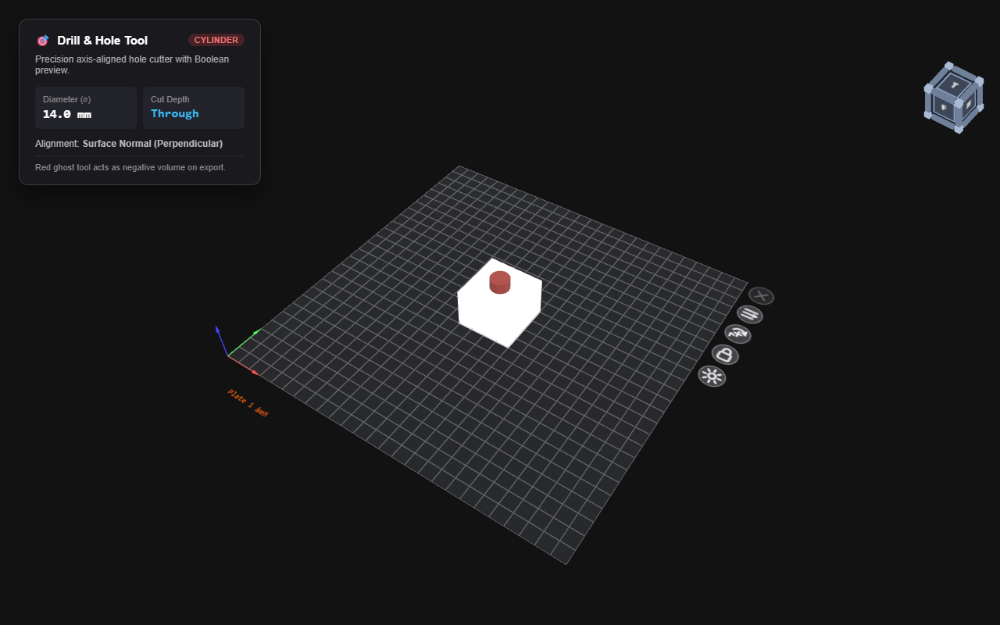

# Drill Tool: Axis-Aligned Hole Cutting and Placement

The **Drill Tool** provides a rapid, in-editor way to add screw holes, wiring channels, alignment pin sockets, and mounting slots directly to your 3D models. Rather than editing the source CAD file, you can place precision cutting shapes along specific axes and subtract them with a single click.

---

## 1. Where to Find the Drill Tool

You can access the drill tool from either interface:

- **Desktop context menu:** Right-click the model on the plate and select **Drill (Beta)**.
- **Touch & Mobile layout:** Select the model, open the actions sheet from the editor toolbar, and choose **Drill (Beta)**.

This opens the drill configuration panel displaying target selection, geometry options, and dimension sliders.

---

## 2. Choosing Target, Shape, and Orientation

### Target selection
If your project contains multiple parts or assemblies, choose which component to bore into using the **Target** radio list. The drill tool will attach specifically to that solid.

### Cutting shapes
Select the cross-sectional shape of your cut:

- **Cylinder** — Standard round holes for screws, bolts, heat-set inserts, dowels, and electrical cables.
- **Box** — Rectangular or square mortises for magnets, sliding tabs, connectors, and mounting brackets.
- **Triangle** — Prismatic alignment sockets and indexed registration pins that guarantee single-orientation assembly.

### Orientation modes
Choose the axis along which the hole is driven:

- **Surface Normal** — Bores directly perpendicular to the model's outer skin at the placement point. Ideal for curved shells and angled facets.
- **Plate Parallel** — Forces the hole horizontally, perfectly parallel to the build plate surface. Ideal for side mounting holes, horizontal axles, and wiring tunnels that must stay level regardless of model surface angles.
- **Camera View** — Drives the hole straight into the model along your current viewport viewing angle. Align your camera directly where you want to drill and place the cut.

---

## 3. Hole Sizing and Depth

Configure dimensions to match your hardware:

- **Diameter (1–60 mm):** Sets the outer diameter or width of the drill tool.
- **Through hole:** When enabled, the tool cuts completely through the entire thickness of the model from entry to exit.
- **Depth (1–60 mm):** When **Through hole** is turned off, this slider sets the exact stopping depth for blind holes (such as threaded insert pockets or recessed screw seats).

---

## 4. Placing the Tool and Executing the Cut

1. Configure your shape, orientation, diameter, and depth.
2. Tap **Place Drill Tool**.
3. A red tool solid is generated and placed at the target location. This red volume represents the cutting shape and will never be printed.
4. An on-screen notification appears: **"Drill tool is ready. Subtract it with Boolean?"**.
5. Tap **Subtract** to instantly execute the cut using Boolean Difference.

The tool cuts the cavity cleanly out of the target solid, leaving your model ready for slicing.

---

## 5. Undo and Precision Tips

- **Fully reversible:** If the hole is misplaced or the diameter needs adjustment, press **Undo** (or **U** / **Ctrl + Z**) to restore the solid part immediately.
- **3D printing hole shrinkage:** Holes printed vertically on FDM printers often measure 0.1 mm to 0.3 mm smaller than nominal CAD dimensions due to filament thermal contraction. If you are drilling for a tight-fitting M3 screw or 608 bearing, increase your diameter slider by 0.2 mm to ensure a smooth slip fit.

---

## 6. Troubleshooting

**The red drill shape is visible, but no hole was cut into the part.**
Placing the tool creates the cutting solid; the cut happens when you tap **Subtract** on the confirmation snackbar. If you dismissed the prompt, open **Mesh boolean** from the tools menu, select the main model as Part A, the red drill tool as Part B, and choose Difference.

**The hole bored at an unexpected angle.**
Check your **Orientation** setting. If you used **Camera View**, any slight camera tilt affects the cut angle. Switch to **Surface Normal** for perpendicular holes, or **Plate Parallel** for level horizontal holes.

**Boolean subtraction fails or produces missing faces.**
Boolean cutting requires closed, watertight (manifold) meshes. If your source model has open edges or inverted normals, run **Fix model** or mesh diagnostics before performing the drill operation.
