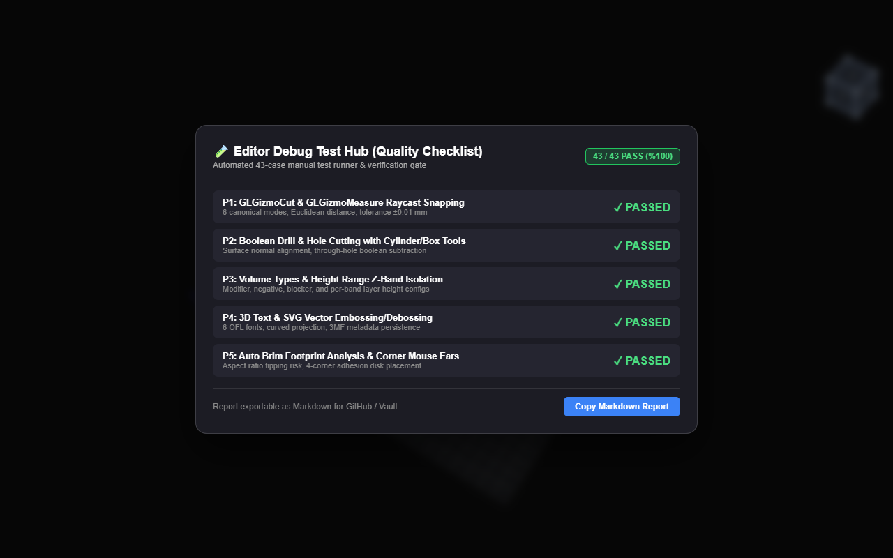

# The Editor Debug Test Hub (Debug Builds Only)

The editor ships with a built-in manual test hub: a full-screen checklist of everything a tester should verify before signing off an editor build. It is built for people who test the app by hand and want a fast, repeatable way to record what passed and what did not.

> [!IMPORTANT]
> The debug test hub is available **only in debug builds**. It does not appear in release builds published to end users, so do not look for it in a store-installed copy of the app.

---

## 1. Opening the Hub

1. Run a **debug build** of the app.
2. Open the 3D editor.
3. In the editor toolbar, click or tap the **bug icon** — its tooltip reads **"Editor debug test hub"**.
4. The hub opens full screen. Close it with the back action to return to the editor exactly where you left it.

There is no menu entry and no keyboard shortcut; the toolbar button is the only way in.

---

## 2. What Is Inside

The hub contains **43 manual test cases**, organised into seven groups:

| Group | Cases |
| --- | --- |
| **Transform** | 6 |
| **View** | 10 |
| **Scene** | 7 |
| **Paint** | 3 |
| **Mesh** | 8 |
| **File / Export** | 6 |
| **Printer** | 3 |

Every case carries the same information:

- **Expected result** — what correct behaviour looks like.
- **Steps** — the short sequence to perform, in order.
- **Related shortcuts** — the keyboard or toolbar equivalent, so you can test both paths.
- **Status chips** — **Untested**, **Pass**, **Fail**, **Blocked**.
- **Gut note** — a free-text field for anything the formal fields do not capture.

---

## 3. Header, Progress and Counters

At the top of the hub you will see a single summary line:

> `X / N tested · P pass · F fail · B blocked`

- **X / N tested** — how many cases have any status other than *Untested*.
- **P / F / B** — running totals of *Pass*, *Fail* and *Blocked*.

Beneath the line sits a progress bar and a percentage, both based on tested-versus-total. The counters update the moment you change a status; there is no save step.

---

## 4. Working Through the Cases

### Record a result
For each case: read the expected result, follow the steps, then tap the status chip that matches what you saw. Changing a chip overwrites the previous status.

Use **Blocked** when you cannot judge the case — for example the printer is offline, or a dependency is unavailable. Blocked cases count as tested but are not counted as passes.

### Add a note
Use the **Gut note** field under any case to record a hunch, a screenshot reference, or a reproduction detail. Notes save as you type.

### Jump to the next untested case
Press **Next untested**. The hub scrolls to the first case that is still *Untested*, skipping anything already marked. When nothing is left, the button reports that every case has a status.

### Move between groups
Each group is a collapsible section. Collapse groups you have finished to shorten the list, and expand the one you are working on.

---

## 5. The Three Action Buttons

**Next untested** — described above; moves the view to the next case without a status.

**Copy report** — copies a **markdown table** to the clipboard containing every case with its group, title, status and note. Paste it straight into a ticket, a pull request description, or a chat message. This is the fastest way to hand a tester's result to a developer.

**Reset session** — clears every status and every note in the session. A confirmation prompt appears first, because the reset cannot be undone. Use it when starting a fresh pass on a new build.

> [!TIP]
> Copy the report to the clipboard *before* resetting. The session is the only thing the hub keeps, so a reset discards the evidence of the previous pass.

---

## 6. Session Persistence

Your progress is saved **on your device only**, so you can close the hub, restart the app, or continue the next morning without losing statuses or notes.

- A single session is kept; there is no history of previous runs.
- Nothing is uploaded — the report exists only in your clipboard once you copy it.
- **Reset session** is the only way to clear progress early. Clearing the app's local data also removes it.

---

## 7. Troubleshooting

**The bug button is missing.**
You are almost certainly running a release build, or an app installed from a store. The hub is debug-only by design.

**The button is present but the progress numbers look wrong.**
A case counts as tested as soon as it has any status other than *Untested*. Check for chips you set by accident; **Reset session** gives you a clean start.

**Copy report did nothing.**
Some desktop environments silently refuse clipboard writes when the app is not focused. Click inside the hub first, then press the button again. If the report is long, confirm the paste succeeded before closing the hub.

**My statuses disappeared after an update.**
Local data can be cleared during a manual reinstall or a data reset. Re-enter the statuses for the cases you already verified, or copy the report from the previous pass beforehand.

**A case does not apply to my setup.**
Mark it **Blocked** and explain why in the *Gut note* — that is exactly what the chip and the note field are for.
