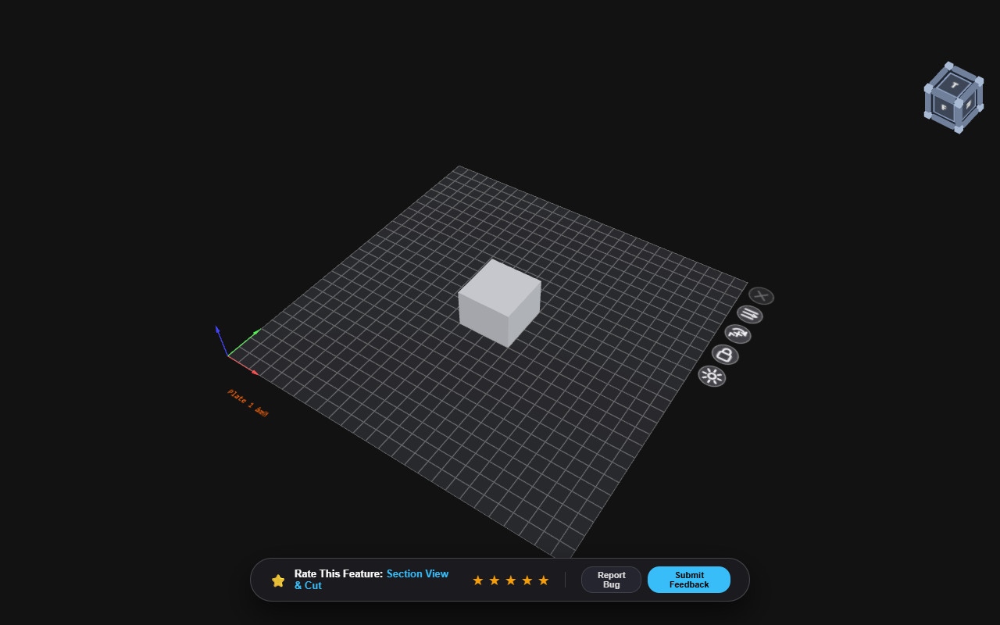

# Rating Editor Features: The "Rate this feature" Bar

The 3D editor can now collect quick, in-context feedback on individual tools instead of relying on long forum threads. A small rating bar appears inline inside a few editor panels, right where you are working, so you can rate a feature the moment you use it and move on.

Your feedback never leaves your device: there is no account, no upload, and no network request involved.

---

## 1. What It Is

A compact bar with two buttons:

- 👍 **Thumbs up** — "this worked for me."
- 👎 **Thumbs down** — "this did not work for me."

The bar is deliberately unobtrusive: it sits at the bottom of the panel it belongs to, uses a single line of height, and never opens a dialog unless you choose to explain a problem.

---

## 2. Where You Will Find It

The rating bar is mounted in exactly three places in the 3D editor:

| Panel | When the bar is visible |
| --- | --- |
| **Support / seam paint** | After the paint panel has been opened for the current model |
| **Cut / boolean** | Inside the cut and boolean tools panel |
| **Mesh diagnostics results** | At the end of the results list, once a diagnostics run has produced output |

There is intentionally **no entry in any global menu**. If a panel does not show the bar, that feature is not part of the rating program yet.

> [!NOTE]
> The bar is not shown for other editor tools (transform, arrange, view controls, and so on). This is expected, not a bug.

---

## 3. Rating a Feature

### 👍 Leave a positive rating
1. Open one of the three panels listed above.
2. Click or tap the **thumbs up** button.
3. A short confirmation message — *"Thanks for the feedback"* — appears at the bottom of the screen.

That is the entire flow. The rating is saved immediately and the bar becomes inactive for that feature for the rest of the day.

### 👎 Report a problem
1. Click or tap the **thumbs down** button.
2. The bar expands to show an optional text field labelled **"What went wrong?"**.
3. Type a short description of the problem — what you were doing, and what happened instead. This field is optional; you can send the rating without writing anything.
4. Choose **Send** to record the rating together with your note, or **Cancel** to close the field without recording anything.

The same *"Thanks for the feedback"* confirmation appears after **Send**.

---

## 4. One Rating per Feature per Day

Each of the three features can be rated **once per calendar day**. After you rate a feature:

- The bar stays visible but its buttons no longer record anything.
- The next opportunity to rate that same feature opens on the following day (local time).

This daily limit keeps the feedback signal meaningful and avoids repeated prompts while you are working on a single project.

---

## 5. What Is Stored, and Where

- Ratings and notes are saved **on your device only**, inside the app's local preferences area.
- Only the **newest 200 entries** are kept. When that limit is reached, the oldest entries are discarded first.
- Nothing is transmitted: there is no sign-in requirement, no telemetry endpoint, and no background sync.

Because the data is local, uninstalling the app or clearing its stored data permanently removes your collected feedback.

---

## 6. Troubleshooting

**The bar does not appear in the support paint panel.**
Open the panel for a loaded model first; the bar is created with the panel, not on the file browser screen.

**The bar does not appear after running mesh diagnostics.**
The bar is shown with a completed results list. Run diagnostics again; if the run is cancelled or produces no results, no bar is shown.

**I pressed a thumb and nothing happened.**
You have most likely already rated that feature today. Wait until the next day, or rate a different feature.

**I typed a note but it was not saved.**
Only **Send** records the note. Using **Cancel**, pressing back, or closing the panel before sending discards it.

**I want to remove my ratings.**
Clear the app's local data (or reinstall). The ratings are not visible in any settings screen and are not synced to any account.

---

## 7. Why It Matters

Feedback attached to the exact tool you were using is far more actionable than a general complaint. A thumbs-down on the cut tool with one line about what broke is enough for the team to reproduce and prioritize a fix — so please use it whenever a panel helps you or gets in your way.
