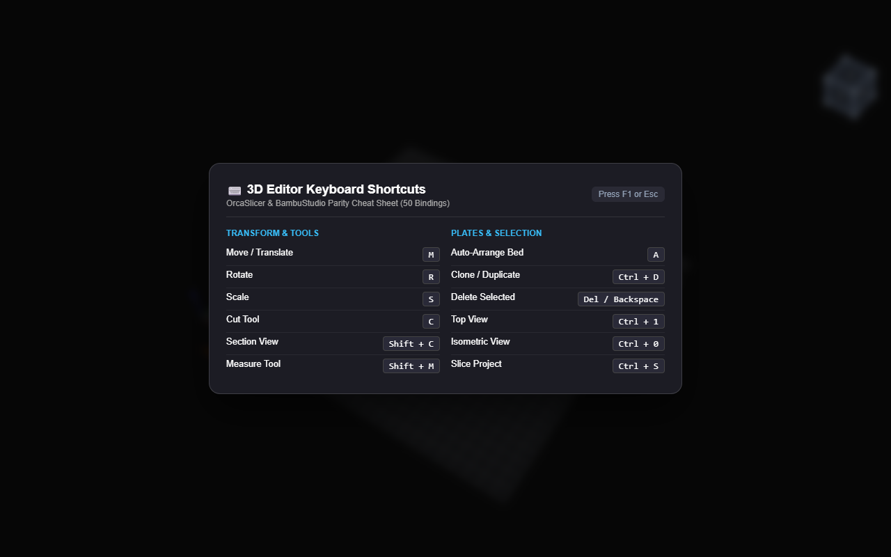

# 3D Editor Keyboard Shortcuts (OrcaSlicer-Style)

The MakerSpell 3D editor uses an OrcaSlicer-style keyboard layout, so anyone coming from a desktop slicer can work without relearning their muscle memory. Fifty bindings are grouped into five categories, and a built-in cheat sheet is one key press away.

---

## 1. Opening the Cheat Sheet

Press **F1** anywhere in the editor to open an in-app overlay listing every binding, grouped by category. Press **F1** again, or **Esc**, to close it.

The cheat sheet is rendered inside the editor itself, so it works on a touch device or a locked-down machine where printing a reference card is not an option.

---

## 2. The Binding Table

### Tools and modes

| Key | Action |
| --- | --- |
| **Q** | Select |
| **M** | Move |
| **R** | Rotate |
| **S** | Scale |
| **L** | Lay on face |
| **A** | Arrange |
| **O** | Auto-orient |
| **C** | Cut |
| **B** | Support paint |
| **P** | Seam paint |

### View

| Key | Action |
| --- | --- |
| **F** | Fit model to view |
| **G** | Toggle build-plate grid |
| **T** | Top view |
| **1** – **6** | Standard views (front, back, left, right, top, bottom) |

### History and editing

| Key | Action |
| --- | --- |
| **U** or **Ctrl + Z** | Undo |
| **Ctrl + Y** or **Ctrl + Shift + Z** | Redo |
| **Del** or **Backspace** | Delete selection |
| **Ctrl + A** | Select all |
| **Ctrl + C** | Copy |
| **Ctrl + V** | Paste |
| **Ctrl + D** | Duplicate in place |
| **Esc** | Cancel the current operation |

### File and output

| Key | Action |
| --- | --- |
| **Ctrl + S** | Save project |
| **Ctrl + E** | Export G-code |
| **Ctrl + Shift + E** | Export model |

### Nudging

| Key | Action |
| --- | --- |
| **Shift + Arrow key** | Nudge the selection by 1 mm |
| **Ctrl + Arrow key** | Nudge the selection by 10 mm |

Arrow keys are the four directions on the movement plane, so a single press moves the selection along the corresponding axis.

---

## 3. Shortcuts Never Fire While You Are Typing

If the cursor is inside a text field — naming a project, typing a value in a numeric box, writing a note — no shortcut is triggered. Typing the letter **Q** in a name field inserts a "Q"; it does not switch the editor to the select tool.

This also means you can stop worrying about **Del** or **Backspace** deleting your model while you are editing text: inside a field, those keys only edit text.

Click outside the field, or press **Esc** to leave it, before using a shortcut again.

---

## 4. Browser Keys Are Never Intercepted

The editor runs inside an embedded web view, but it deliberately stays out of the way of the browser and the operating system. The following are **never** captured by the editor:

- **Ctrl + W** — close tab or window
- **Ctrl + T** — new tab
- **Ctrl + N** — new window
- **Ctrl + R** — reload
- **F5** — reload
- **F12** — developer tools

The editor also leaves **Ctrl + Shift** combinations alone except for the two it owns (**Ctrl + Shift + Z** for redo, **Ctrl + Shift + E** for exporting a model). If a browser key does not do what the table above says, the editor is not the one swallowing it.

---

## 5. Save and Export: What Happens Today

**Ctrl + S** (save project) and **Ctrl + E** (export G-code) send a signal from the editor to the host app rather than performing the action themselves. Saving and G-code export are **not yet wired up inside the embedded editor view**.

What that means in practice:

- Pressing **Ctrl + S** or **Ctrl + E** is safe — nothing is lost and no partial file is written.
- If no action appears to happen, this is expected in the current build; use the host app's own **Save** and **Export** controls for now.
- **Ctrl + Shift + E** (export model) works from the editor as listed.

> [!NOTE]
> Once save and G-code export are connected, the same two shortcuts will drive them without any change to the layout.

---

## 6. Troubleshooting

**A shortcut does nothing.**
Check that no text field has focus, and that the panel using that key is open. For example, **B** for support paint needs a model on the plate, and view keys need the viewport focused.

**Esc closed a panel instead of cancelling my operation.**
Esc first dismisses the most recent thing on screen — an overlay, a field, or a panel — then cancels the operation. Press it again.

**F1 opened help for the browser, not the editor.**
Some browsers claim F1 at the window level. Click inside the 3D viewport first so the editor has focus, then press F1. If the browser still claims the key, the cheat sheet cannot be shown; use this page instead.

**My arrow-key nudge jumps too far (or too little).**
Plain arrow keys do not nudge. **Shift + Arrow** is 1 mm and **Ctrl + Arrow** is 10 mm; make sure the modifier is held for the whole press.

**Ctrl + D copied the model but placed it on top of the original.**
That is what "duplicate in place" does by design. Follow up with **M** (move) to offset the copy, or **Shift + Arrow** for a precise 1 mm shift.
