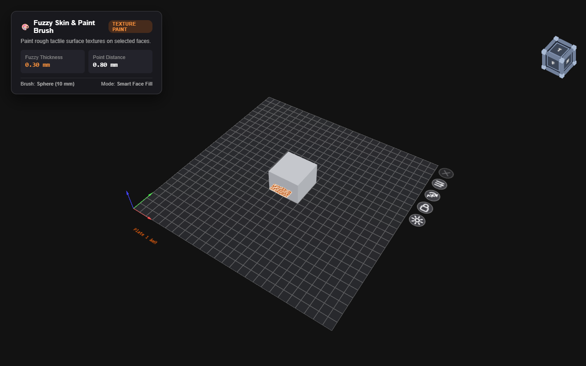

# Fuzzy Skin Painting: Adding a Rough Surface Texture

**Fuzzy skin** adds a rough, grainy texture to the outside walls of a print. While the printer follows the wall it adds a small random wobble, so the finished surface looks and feels like fine sandpaper instead of a smooth extrusion.

This is a **physical change, not a preview effect**. The nozzle actually moves differently: travel, print time and the surface of the part all change. Because the wobble is random, no two parts come out identical.

You do not have to make the whole model fuzzy. You paint the facets you want textured, and only those areas are affected — which makes fuzzy skin useful for grip surfaces, hiding layer lines on a visible side, or giving a print a matte, stone-like finish while keeping critical faces smooth.

---

## 1. Opening Fuzzy Skin Painting

1. Load a model and open the 3D editor.
2. Open the editor grid — the panel that lists the editing actions for the selected model.
3. Choose **Fuzzy skin**. It sits next to the other paint actions: colour, support and seam.
4. The **Fuzzy skin** painting panel opens over the viewport.

If no model is selected, the app tells you to select one first — painting always belongs to a specific model, so pick it on the plate before opening the tool.

> [!NOTE]
> The paint actions only appear once a model is on the plate. If **Fuzzy skin** is not in the list at all, the slider engine in use does not report fuzzy skin support, and the action stays hidden rather than opening a tool that cannot slice.

---

## 2. The Painting Controls

The panel is a toolbar in the same style as the colour, support and seam painters, so the controls behave the way you already expect.

### Pen size
The **Pen size** control sets how wide a single stroke is. Increase it to cover large areas quickly; reduce it for narrow strips and small details along an edge.

### Brush shape
**Brush shape** has three options:

- **Circle** — a flat disc that paints everything it touches in screen space. Best for painting a visible face straight on.
- **Sphere** — a ball that catches the surface behind the cursor, including around a curve. Best for wrapping around corners and cylindrical parts.
- **Triangle** — a small, precise brush that follows the individual facets under the cursor. Best for tidying up a boundary or hitting a single flat face without spilling onto its neighbours.

### Brush and Smart fill
- **Brush** paints exactly what you drag over. Straightforward and predictable.
- **Smart fill** floods outward from the point you click and stops at a natural boundary — an edge, a sharp shoulder, or the edge of the region you already painted. Use it to cover a whole panel in one click instead of scrubbing back and forth.

### Add, Remove and Erase all fuzzy skin painting
- **Add** paints fuzzy skin onto the model. This is the normal mode.
- **Remove** takes it away again, using the same brush. Use it to correct an over-painted edge rather than starting from scratch.
- **Erase all fuzzy skin painting** clears the entire model in one action. It affects only the fuzzy skin painting, not your colour, support or seam work.

Every stroke and every clear step can be undone with **Undo** (or **U** / **Ctrl + Z** in the editor), so an accidental swipe is cheap to reverse.

### Section view
**Section view** cuts the model open with a plane so you can see and paint the inside. Turn it on when the surface you need to reach faces inward — a cavity, a bore, or the far side of a hollow shell — then paint normally. Turn it off to return to the normal view.

Section view is a **viewing aid only**. It does not cut the model, and it has no effect on the print.

### Overhangs only and Overhang threshold
**Overhangs only** restricts painting to facets that are overhanging, so a stroke across a flat top or a vertical wall does nothing. This is deliberate: it is a filter, and it rejects everything that is not an overhang.

**Overhang threshold** sets how steep a facet must be before it counts as an overhang. Lower it to include more steeply angled faces; raise it to accept only near-horizontal overhangs.

> [!TIP]
> If a stroke appears to do nothing at all, **Overhangs only** is almost always the reason. Either move to a genuinely overhanging surface or switch it off. Rejecting a stroke is not an error — no painting is recorded and nothing else changes.

---

## 3. The Two Settings That Matter

Painting says *where* the texture goes; two slicer settings decide *how rough* it looks. Both live with the process settings, in the fuzzy skin group, and both accept millimetre values.

### Fuzzy skin thickness
How far the wall is allowed to wander away from its original path, in millimetres. It is the main "how rough" dial:

- **Small values** (around 0.1–0.2 mm) give a fine, sandblasted feel and barely change print time.
- **Larger values** produce a coarser, more pronounced grain, but the wobble also pushes outward, which means more travel and longer printing.

Keep it **below the outer wall line width**. If the wobble is wider than the wall itself, the wall cannot absorb it and the slice either fails or produces a wall that no longer holds together as intended.

### Fuzzy skin point distance
How often a new jitter point is placed along the wall, in millimetres. Smaller values insert points more densely:

- **Smaller** (for example 0.3–0.5 mm) gives a fine, busy texture.
- **Larger** spaces the points out, giving a coarser grain with fewer direction changes and less extra travel time.

### Values that are ignored
The engine rejects values that are too small to make sense. Anything below roughly **0.001 mm** for thickness, or below roughly **0.01 mm** for point distance, is discarded rather than applied.

This matters when you type a value by hand: entering **0** looks like "no texture", but the engine simply ignores it and keeps whatever setting was already in effect. If you set a value of zero and see no change, that is what happened — enter a small but real value instead.

> [!IMPORTANT]
> Changing these settings triggers a new slice. Painting alone does not change any existing G-code until you slice again.

---

## 4. Where Painting Is Saved

Painted fuzzy skin is stored **with the model, inside the saved 3MF project file**, as a per-facet annotation. It therefore survives the full round trip: paint, save the project, close the app, reopen the project — the painted areas are still there, attached to the same facets.

This is separate from whole-object fuzzy skin. Whole-object fuzzy is a normal slicing setting (in OrcaSlicer terms, the object or process level option set to *all*), which makes the entire model fuzzy without any painting. The two are not in conflict and can coexist: whole-object fuzzy textures everything, while your painted facets remain marked and keep their own behaviour.

---

## 5. Limits, Stated Honestly

- **Walls only.** Fuzzy skin is applied to walls. Infill and top surfaces are not affected, so a solid top will stay smooth even when the sides are textured.
- **Dimensions do not change.** The jitter is a surface treatment. It is not a way to grow a part, and you should not measure a finished print expecting the painted thickness to appear as a size increase.
- **Section view is a viewing aid.** Cutting the view open helps you paint hidden facets; it does not modify geometry and leaves no mark on the print.
- **Random by nature.** Two prints of the same project will not have identical grain, and a re-slice can produce a slightly different pattern. Judge the effect by the settings, not by an exact expected surface.
- **Longer prints.** Extra wobble means extra travel. A large fuzzy area with a coarse thickness noticeably increases print time, so confirm it on a small test print before committing to a big one.

---

## 6. Troubleshooting

**The Fuzzy skin action is missing from the editor grid.**
The slider engine in use does not report fuzzy skin support, so the action is hidden. Update the app, or check that you are on a slicer profile that supports fuzzy skin.

**A stroke does nothing.**
Most likely **Overhangs only** is on and the facet under the cursor is not an overhang. Turn it off, or paint a surface that genuinely overhangs. It can also be **Remove** being active with nothing painted yet.

**I painted a region but the print looks smooth.**
Check **Fuzzy skin thickness** and **Fuzzy skin point distance**: a value below the engine's minimum is ignored, and typing **0** silently keeps the previous value. Then re-slice — painting does not regenerate G-code by itself.

**The paint seems to spill onto faces I did not touch.**
Switch the brush to **Triangle** for a facet-precise stroke, or reduce **Pen size**. The **Circle** and **Sphere** brushes intentionally catch everything they overlap.

**I cannot reach the inside of the part.**
Turn on **Section view** to open the model with a plane, then paint the interior facets.

**Undo did not remove the whole area I painted.**
Each drag is a single undo step, and **Erase all fuzzy skin painting** is one step too. Undo again, or use **Erase all fuzzy skin painting** and repaint.

**My painted areas vanished after reopening.**
Save the project as a 3MF file. The annotation travels inside the project file; painting that was never saved is lost when you close the model.
