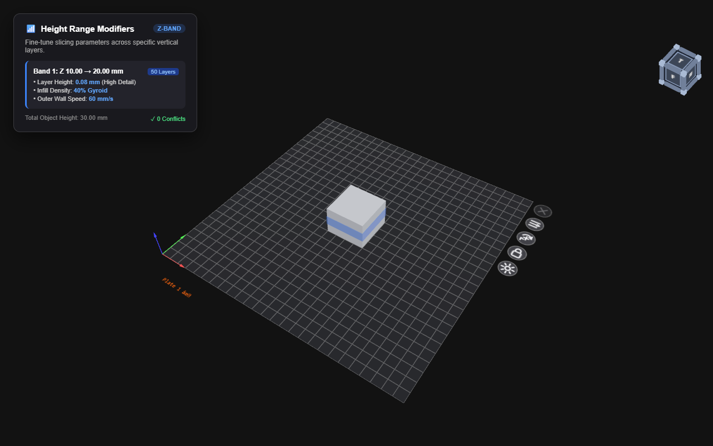

# Height Range: Applying Settings to a Z Band

A **height range** is a Z band that applies its own slicer settings to this object. Instead of re-slicing the whole model with different settings, you say "from this height to that height, behave differently" — and only that slice of the print changes.

Think of it as a horizontal layer range stacked on top of the object: the model below the band and above the band keeps the normal settings, while everything inside the band uses the ones you attach to it.

Some practical uses:

- Denser infill only in the upper half of a tall part, where strength matters and the lower half is decorative.
- More walls in a middle band that takes a screw.
- Different layer height for a detailed section, with the rest of the model printed quickly.

---

## 1. Where to Find Height Range

There are two ways in, depending on which editor surface you are using:

- **Editor grid (touch layout):** select the object, open **Volume (Beta)** in the editor grid; the **Height range** section sits below the volume type list in that panel.
- **Context menu (desktop):** right-click the object and choose **Height range Modifier**.

If no ranges exist yet, the section reads **"No height ranges added yet."** — that is the empty state, not an error.

> [!NOTE]
> Height ranges belong to the **object**, not to an individual volume inside it. A band covers the full cross-section of the object at that height, whatever volumes it is made of. If you need a zone limited to one volume, that is what a **Modifier** is for.

---

## 2. Adding a Range

1. Press **Add range**.
2. Two fields appear: **Min Z** and **Max Z**, both in **mm**, measured from the build plate.
3. Type the lower bound in **Min Z** and the upper bound in **Max Z**. Min Z is where the band starts; Max Z is where it ends.
4. Confirm. **"Height range added."** appears at the bottom of the screen, and the range is listed in the panel.

Every number is the height above the plate — not a thickness. A band from 10 to 20 is ten millimetres deep, but a band from 10 to 11 is one millimetre deep; both start ten millimetres up.

### Attaching settings to the band
The band itself only says *where*. The settings that apply inside it are the object's layer-range settings — the same per-range configuration the slicer stores for that band. Once a range exists, set the values you want for that band (infill, walls, layer height, and so on) through the object's settings for that range; the band is the address, the settings are the payload.

A band with no settings attached changes nothing, exactly like an empty modifier.

---

## 3. Rules a Range Must Follow

Four checks run when you confirm a range, and any one of them refuses the entry outright:

| What you see | What it means |
| --- | --- |
| **"Enter a number for both Z values."** | One of the two fields is empty, or contains something that is not a number. |
| **"Min Z must be smaller than Max Z."** | The bounds are reversed or identical. The lower value always goes in Min Z. |
| **"Min Z cannot be below the build plate."** | The band would start underneath the plate. Min Z must be zero or above. |
| **"Max Z is above the top of this object."** | The band would end above the model. Lower Max Z to the object's top height or below. |

> [!IMPORTANT]
> A refused band is **not silently adjusted**. The app does not quietly clamp your 0 → 999 entry down to the object's real height, and it does not swap reversed bounds for you. Nothing is added, and the message tells you which rule failed so you can correct it. This is deliberate: a clipped band that looks accepted would slice differently from what you asked for, and you would have no way to notice.

A fifth check applies when ranges overlap:

> **"This range overlaps one that is already added."**

Two bands cannot occupy the same Z interval, because the slicer would have two conflicting answers for the same layers. Adjust the bounds so they meet without overlapping, or remove the existing range first.

---

## 4. Managing Ranges

- **View** — every added range is listed in the panel with its bounds, so you can see at a glance how the object is divided.
- **Remove** — **Remove range** deletes one band. **"Height range removed."** confirms it, and those layers return to the object's normal settings.
- **Order** — ranges are independent; adding one does not shift the others, and they do not need to be listed in height order to work.

Removing a band does not remove the settings you configured for it — it removes the *place* those settings were applied.

---

## 5. An Honest Note About Saving

For now, height ranges live in the **current session only**. They are not yet written into the saved 3MF project file, because the export side is still being finished.

What that means in practice:

- Add your bands, slice, and print — everything behaves correctly during that session.
- Save the project and reopen it later, and the ranges will be gone. Re-add them before slicing again.
- Nothing is corrupted and no other project data is affected; only the bands need re-entering.

Because a band can change the print substantially, treat re-adding them as part of the routine when you return to an old project, exactly as you would re-check a modifier's placement.

---

## 6. Troubleshooting

**The Height range section is missing.**
Open **Volume (Beta)** from the editor grid with an object selected. The section lives inside that panel, below the volume type list, and the panel itself is a Beta capability that may need an app update.

**My Max Z is rejected even though it looks right.**
Max Z is measured from the plate, not from the object's own bottom. If the object is raised or has been moved up, the top of the object may be higher than you expect — or lower, if the model is shorter than assumed.

**I want the band to cover the whole object.**
Use 0 for Min Z and the object's full height for Max Z. If Max Z is refused, you have gone past the top of the object.

**Two ranges will not sit next to each other.**
They are overlapping, even by a fraction of a millimetre — typically because the first band's Max Z equals the second band's Min Z after rounding differently. Leave a tiny gap, or merge them into one band.

**I typed a value and nothing was added, but no message appeared.**
Scroll the panel; validation messages appear at the very bottom, below the button. If a message is visible, read it as listed in section 3 rather than retrying the same numbers.

**My ranges disappeared after reopening the project.**
Expected for now — see section 5. Re-add the bands in the new session.

**The print did not change after I added a band.**
Check that the band has settings attached and that you sliced again afterwards. A band with no settings is a no-op, and slicing is what turns the configuration into G-code.
