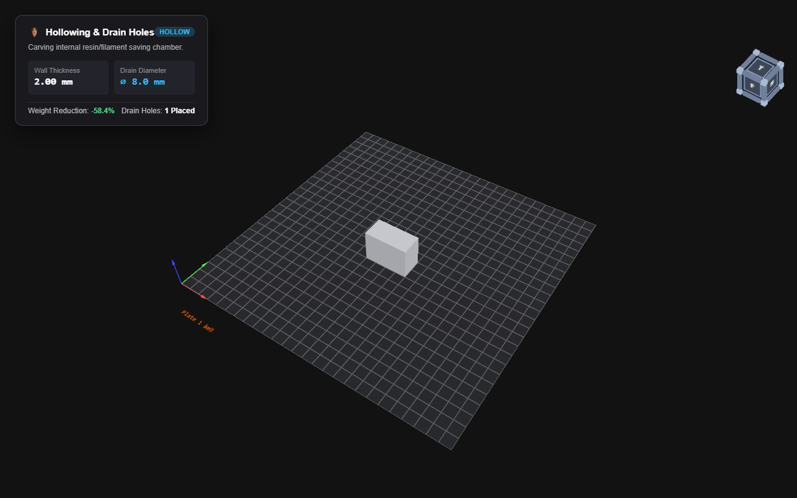

# Model Hollowing & Drain Holes: Saving Material and Weight

**Model Hollowing** carves an internal cavity inside solid 3D models, transforming solid volumes into hollow shells with uniform wall thickness. Whether you print on FDM or resin (SLA/DLP) printers, hollowing offers major benefits:

- **Saves material:** Can reduce filament or resin consumption by 30% to 70%.
- **Shortens print times:** Less material extruded or cured per layer translates directly into faster prints.
- **Reduces part weight:** Produces lightweight figurines, architectural maquettes, and decorative ornaments.
- **Relieves thermal stress:** In FDM, thinner walls cool with far less internal stress, minimizing bed warping on large prints.

---

## 1. Where to Find the Hollowing Tool

1. Select your target model on the build plate.
2. Open the tool from either interface:
   - **Desktop context menu:** Right-click the object and select **Simplify and hollow**.
   - **Touch & Mobile layout:** Open the object actions sheet and select **Hollow model (Beta)**.
3. The hollowing panel opens with interactive slider controls.

---

## 2. The Three Hollowing Parameters

Configure the wall geometry using three parameters:

### Minimum wall thickness (0.8–8.0 mm)
Sets the physical thickness of the printed shell.
- **For FDM:** Set this to a multiple of your nozzle line width (e.g., 1.6 mm or 2.0 mm for a 0.4 mm nozzle) so the slicer generates solid, continuous perimeters.
- **For Resin:** A wall thickness of 1.5 mm to 2.5 mm provides the ideal balance between structural rigidity and resin savings.

### Quality (0–100%)
Determines the polygon resolution of the interior cavity. Higher quality conforms closely to intricate exterior contours, while lower quality creates a smoother, computationally faster inner shell. A default of 50% is recommended for most prints.

### Closing distance (0.0–3.0 mm)
Bridges narrow internal gaps and seals microscopic interior cavities that would otherwise create unprintable micro-features or trap material. Increasing the closing distance smooths out narrow pinch points inside tight corners.

Tap **Apply hollowing** to generate the inner cavity.

---

## 3. Automatic Mesh Simplification Guard

Calculating an internal offset on high-poly models with hundreds of thousands of triangles requires significant processing power and memory.

If your model is excessively detailed, the app displays a safeguard dialog:

> **"Simplify and hollow model?"**  
> *"This model is too complex for reliable on-device hollowing. It will be simplified first, then hollowing will be applied automatically. You can undo the complete operation."*

Selecting **Simplify and hollow** optimizes the triangle count first while preserving visual exterior detail, then completes the hollowing operation cleanly without crashing or freezing.

---

## 4. Why Drain Holes Are Essential

When you hollow a model, you create an enclosed chamber. In 3D printing, a completely sealed chamber creates two serious problems:

1. **Suction cups (Resin / SLA):** As the build plate lifts during each layer, a closed cavity acts like a rubber plunger, creating massive negative pressure. This often tears the print off the supports or splits layer lines.
2. **Trapped material:** In resin printing, liquid resin remains trapped inside. Over days or weeks, uncured resin off-gasses, expands, and inevitably cracks the printed part open from the inside. In SLS printing, un-sintered powder stays permanently trapped.

### Placing drain holes
Always pair hollowing with drain holes:
1. After hollowing, open the **Drill (Beta)** tool.
2. Select **Cylinder** shape and choose a diameter of 2.0 mm to 4.0 mm.
3. Place at least two holes on hidden or non-cosmetic areas (such as the bottom of the base or under an arm). Two holes are recommended: one for resin or powder to escape, and one to admit air and prevent vacuum locks.
4. Tap **Subtract** to cut the drain holes through the outer wall into the inner cavity.

---

## 5. Mesh Integrity and Reversibility

- **Watertight requirement:** Hollowing requires a closed, manifold (watertight) mesh. If your model contains open holes, missing faces, or self-intersecting boundaries, the operation will warn you: *"The model is not closed enough for safe hollowing. Repair the mesh first."* Run the mesh repair tool or diagnostics to seal the exterior before hollowing.
- **Fully reversible:** The entire hollowing and simplification sequence is non-destructive. If you want to revert to the solid original or try a different wall thickness, use **Undo** (or **U** / **Ctrl + Z**) to restore the original mesh instantly.

---

## 6. Troubleshooting

**Hollowing fails with a "mesh too complex" message.**
Accept the **Simplify and hollow** prompt when offered. If you dismissed it, open the simplify tool manually, reduce the triangle count by 30% to 50%, and run hollowing again.

**The print cracked weeks after printing.**
This is classic trapped liquid resin. Ensure you place at least two drain holes on every hollowed resin print, and flush the interior cavity thoroughly with isopropyl alcohol (IPA) before final UV curing.

**Internal features have strange, floating bits of material.**
If a model has very narrow limbs or separate thin appendages, an internal offset can create tiny disconnected voids. Increase the **Closing distance** slider (e.g. to 1.5 mm or 2.0 mm) so the algorithm merges those tight areas into solid material instead of hollow cavities.

**The outer surface shows small imperfections after hollowing.**
Your **Minimum wall thickness** may be set too thin for the model's geometry. Increase the thickness slider to at least 1.5 mm to ensure the outer shell has sufficient backing.
