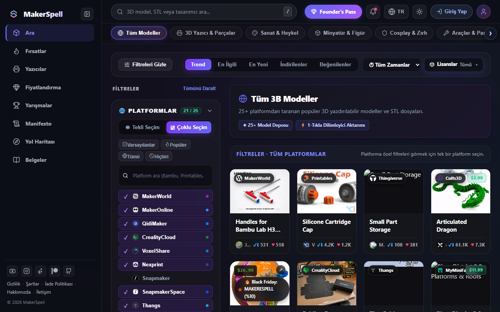

# 📸 AI Agent Automated Screenshot Capture Pipeline

> **STANDARD OPERATING PROCEDURE FOR ALL AGENTS:**  
> When developing or updating a screen, capture its screenshot and embed it into the corresponding guide.

---

## 📌 1. Flutter Desktop & Mobile Screenshots

Flutter screens are rendered in a headless virtual viewport using Flutter's test engine (`RepaintBoundary` -> `toImage`):

```powershell
cd makersync_app
flutter test test/doc_screenshot_test.dart
```

- Renders pixel-perfect 2.0x Retina PNGs in 1 second.
- Output path: `community-hub/docs/assets/screenshots/app/<screen-name>.png`.

---

## 📌 2. Web Platform Screenshots

Web pages are captured using the headless Edge/Chromium CLI pipeline:

```powershell
node tools/capture-web-screenshots.mjs <URL> <output-name.png>
```

### Examples:
```powershell
node tools/capture-web-screenshots.mjs https://www.makerspell.com/browse web-browse.png
node tools/capture-web-screenshots.mjs https://www.makerspell.com/deals web-deals.png
node tools/capture-web-screenshots.mjs https://www.makerspell.com/pricing web-pricing.png
```

- Output path: `community-hub/docs/assets/screenshots/web/<output-name.png>`.

---

## 📌 3. Embedding in Markdown

Embed the screenshot directly into your documentation guide:

```markdown

```
