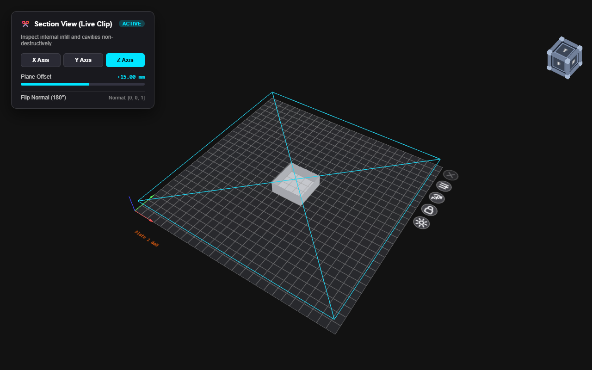
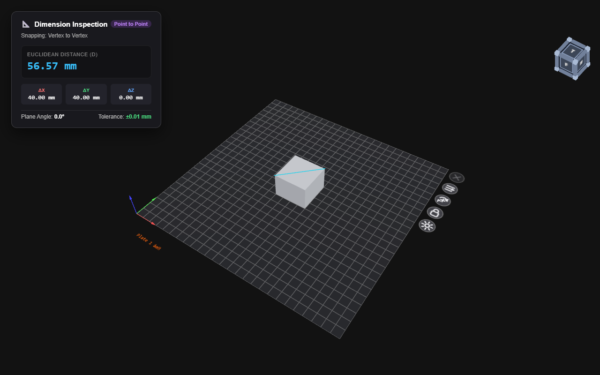

# Section View & Measurement Tools: Inspecting Internal Cavities and Precision Dimensions

Before sending a project to your 3D printer, inspecting internal structures and verifying critical mechanical tolerances is essential. The 3D editor provides non-destructive **Section View** cross-section clipping and advanced **Measurement Tools** that snap to points, edges, faces, and cylindrical holes to measure distances, clearances, angles, and wall thicknesses directly in the viewport.

---

## 1. Where to Find Section View and Measurement

You can activate inspection tools from either layout:

- **Desktop context menu:** Right-click anywhere in the scene to open **Section View** or activate **Measure**.
- **Touch & Mobile layout:** Tap the **Section view** or **Measure** icons in the editor viewport toolbar.

Both tools work alongside your loaded models without altering part geometry or changing your slicing settings.

---

## 2. Using Section View (Cross-Section Clipping)

**Section View** slices open your model along a virtual plane, allowing you to inspect internal infill, check hollow cavities, verify drain holes, or examine interior clearance fits.

### Clipping Axis
Choose the primary axis along which the model is clipped:
- **X axis:** Cuts side-to-side (sagittal cross-section).
- **Y axis:** Cuts front-to-back (coronal cross-section).
- **Z axis:** Cuts horizontally parallel to the print bed (layer-by-layer axial cross-section).

### Plane Offset slider
Drag the **Plane Offset** slider (-150 mm to +150 mm) to move the clipping plane backward or forward through the interior of your model.

### Flip Direction (Reverse Cut)
Toggle **Flip Direction** to reverse the viewing normal by 180 degrees, hiding the front half and displaying the opposite interior half of the model.

### Vertical Dual-Range Z Slider
Directly along the right edge of the 3D viewport (beneath the orientation ViewCube), a vertical dual-thumb slider allows interactive Z-axis section viewing across all models on the build plate:
- **Top thumb:** Slide downwards from maximum height to inspect horizontal cross-sections and inner hollows layer-by-layer.
- **Bottom thumb:** Slide upwards from the build plate to clip from the bottom up.
- **Boundary protection:** Boundary faces on the opposite side remain completely solid with zero z-fighting or moiré artifacts.
- **Full bounds:** When both handles are at full bounds (`0.0 mm` and maximum height), cross-section clipping automatically turns off.

### Orientation ViewCube & Home Button
The interactive 3D ViewCube at the top-right corner provides standard orthographic and isometric viewing angles:
- **Faces, Edges, and Corners:** Click any face (`T`, `F`, `R`, `B`, `L`, `D`), edge, or corner to orient the camera to that exact vantage point.
- **Home (House) button:** A dedicated Home button is located in the upper-left corner of the ViewCube. Clicking it smoothly resets the camera back to the default three-quarter isometric perspective framing.

### Non-destructive inspection
Section View is **strictly a visualization tool**. It does not cut, carve, or split your model, and turning it on has zero effect on your exported G-code toolpaths. Tap **Clear Section Plane** or slide the vertical handles to full bounds at any time to remove the cross-section and return to the complete model view.

---

## 3. The Six Measurement Modes

The **Measure** tool automatically calculates dimensions based on the types of features you select:

| Measurement Type | What it measures | How to use it |
| --- | --- | --- |
| **Point to Point** | Direct 3D distance and coordinate deltas. | Click two vertices or corners to view Euclidean distance $d$ and coordinate separation ($\Delta X, \Delta Y, \Delta Z$). |
| **Edge to Edge** | Distance and relative angle between two lines. | Click two edges to view the clearance distance and relative angle $\theta$ (0° to 180°). |
| **Plane to Plane** | Perpendicular wall thickness or face gap. | Click two parallel faces to measure thickness (such as slot widths or outer wall depth). |
| **Point to Plane** | Perpendicular height or clearance. | Click a corner or point followed by a flat surface to measure true perpendicular drop. |
| **Point to Edge** | Shortest distance from a point to a line. | Click a point and an edge to find the shortest clearance boundary. |
| **Circle & Diameter** | Cylindrical bore and pin dimensions. | Click any circular hole or cylinder to inspect diameter ($\varnothing$), radius ($r$), and center coordinates. |

---

## 4. Step-by-Step: Measuring Your Model

1. Activate **Measure** from the toolbar or context menu.
2. The viewport displays an interactive prompt: *"Tap the first point on the model."*
3. Click or tap your first target feature (a corner vertex, edge line, planar face, or circular hole). A highlighted snap marker indicates the selection.
4. The prompt updates: *"Now tap the second point on the model."*
5. Click or tap the second feature.
6. The **Measurement** card immediately pops up displaying:
   - Primary measured distance or dimension.
   - Relative **Angle** if non-parallel edges or faces are selected.
   - **Infinite distance** (perpendicular distance between the infinite line extensions).
   - **Center** and diameter readings if circular geometry is measured.
7. To measure a different feature, tap another point or click **Clear** to reset the tool.

---

## 5. Practical Engineering Tips

- **Verifying fastener clearances:** When designing screw mounts or snap joints, click the circular rim of a bore to verify nominal hole diameter.
- **Checking wall thickness:** Click an interior hollow wall and the corresponding exterior face. The Plane to Plane reading will confirm your minimum wall thickness before you slice.
- **Checking draft angles:** Click an angled side face and the bottom flat surface to confirm draft angles and ensure clean overhang release.

---

## 6. Troubleshooting

**Part appears cut in half or missing in the viewport.**
Section View is currently active. Open the Section View panel and tap **Clear Section Plane** to restore the full view.

**Measurement tool snaps to the wrong vertex.**
On dense, high-poly meshes with thousands of tiny triangles, vertices sit very close together. Zoom in closer to your target feature before clicking to ensure the cursor snaps to the exact corner or edge intended.

**Circular diameter is not recognized on a curved hole.**
Ensure the hole is a true cylindrical bore or circular arc. If a model was exported with very low polygon settings (turning circles into 6-sided or 8-sided polygons), the tool recognizes individual flat facets rather than a continuous arc. In that case, measure point-to-point across opposite vertices.

**Measurement disappears when moving the model.**
Measurements are live geometric queries between static coordinates. If you move, scale, or rotate a model, the previous measurement is cleared automatically to prevent stale dimension readouts.
