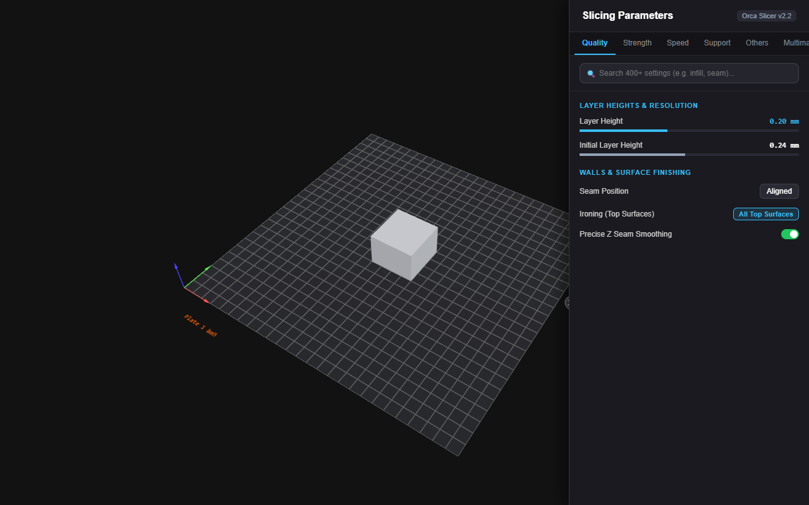

# Slicing Parameters & Settings Search: The 8-Tab Parameters Panel

The **Parameters Panel** gives you precise control over more than 400 slicing settings directly within the 3D editor. Organised into eight specialised tabs matching standard slicer architecture, it allows you to configure everything from layer heights and infill patterns to cooling fans and multi-material purge towers, with an instant search tool to find any parameter in milliseconds.

---

## 1. Where to Find the Parameters Panel

You can access slicing parameters from both desktop and mobile layouts:

- **Desktop layout:** The parameters panel lives docked along the right side of the screen. You can expand it to inspect tabs or collapse it to maximize your 3D viewport.
- **Mobile & Touch layout:** Tap the **Parameters** icon in the editor toolbar or bottom navigation to open the full-height parameter sheet.

When an object or part is selected on the build plate, the panel automatically indicates whether you are adjusting global print settings or targeting a specific component.

---

## 2. The Eight Parameter Tabs

Slicing parameters are grouped logically across eight tabs:

### 1. Quality
Governs surface precision, layer resolution, and fine exterior detail:
- **Layer heights:** Primary layer thickness and initial first-layer height for bed adhesion.
- **Line widths:** Extrusion widths for outer walls, inner walls, top surfaces, and infill.
- **Seam placement:** Alignment of layer start/stop points (Aligned, Nearest, Random, or Back).
- **Ironing:** Smooths topmost flat faces by running a heated nozzle across the plastic with minimal extrusion.

### 2. Strength
Determines the structural rigidity, density, and wall thickness of your print:
- **Perimeters & Walls:** Number of solid concentric wall loops surrounding the model.
- **Shell layers:** Count of solid top and bottom horizontal layers protecting the interior.
- **Infill density & patterns:** Infill percentage (e.g. 15%, 40%, 100%) and internal geometry (Grid, Gyroid, Honeycomb, Adaptive Cubic).

### 3. Speed
Controls print head movements, accelerations, and throughput:
- **Print speeds:** Specific travel velocities for outer walls, inner perimeters, sparse infill, solid infill, bridges, and overhangs.
- **Acceleration & Jerk:** Motion dynamics reducing ringing and ghosting artifacts on high-speed printers.

### 4. Support
Configures sacrificial structures required for overhanging geometry:
- **Support types:** Standard linear supports or organic Tree supports that branch around models without touching delicate details.
- **Threshold angles:** Overhang angles that trigger support generation (typically 45° to 55°).
- **Interface layers:** Dense contact layers between supports and the model surface for clean detachment.

### 5. Others
Handles print preparation, bed adhesion assists, and special print modes:
- **Brim:** Extra perimeter loops attached to the base to prevent warping on corners.
- **Fuzzy skin:** Adds random surface wobble for a textured, matte finish.
- **Spiral vase mode:** Produces a seamless, single-perimeter continuous extrusion with no retractions.
- **Print sequence:** Choose between printing all models layer-by-layer, or completing one object at a time.

### 6. Multimaterial
Configures multi-filament prints, automated color changes, and wipe towers:
- **Purge / Flush volumes:** Amount of filament extruded when transitioning between dark and light colors to prevent color bleeding.
- **Wipe tower:** Sacrificial pillar where the nozzle primes and stabilizes pressure after a filament swap.

### 7. Cooling
Manages part-cooling airflow and thermal dynamics:
- **Fan speeds:** Minimum and maximum part cooling fan percentages.
- **Layer time thresholds:** Automatically slows down print speed when a layer prints too quickly, allowing molten plastic adequate time to solidify.

### 8. Search Settings
An instant search palette that indexes all slicing parameters. Typing any term immediately returns matching settings across all categories with direct access.

---

## 3. Understanding Settings Scopes

The parameters panel adapts dynamically based on what you have selected on the plate:

| Scope | Active Selection | Available Tabs |
| --- | --- | --- |
| **Global Preset** | Nothing selected (or clicking empty plate) | All 8 tabs (Quality, Strength, Speed, Support, Others, Multimaterial, Cooling, Search) |
| **Object Settings** | An entire 3D model selected | 7 tabs (Quality, Strength, Speed, Support, Others, Multimaterial, Search) |
| **Part Settings** | A sub-volume or modifier selected | 5 tabs (Quality, Strength, Speed, Others, Search) |

### Why do available tabs change?
- **Cooling is absent from Object and Part scopes:** Cooling fan curves apply to the physical filament spool loaded in the extruder, so they can only be set globally.
- **Support and Multimaterial are absent from Part scope:** Support generation and purge tower planning require full-object context; an individual sub-part cannot independently trigger its own wipe tower.

---

## 4. Fast Setting Search

Instead of browsing through tabs to locate an obscure setting, switch to **Search Settings** or use the search bar at the top of the panel:

1. Type any keyword into the search bar (e.g., *"gyroid"*, *"seam"*, *"brim"*, *"ironing"*, or *"fan"*).
2. Results populate instantaneously as you type.
3. Each search result displays:
   - The user-friendly setting label.
   - A badge indicating which tab it belongs to (e.g., *Strength*, *Quality*, or *Others*).
   - An informative tooltip description explaining how the value alters slicing behavior.
4. Tapping a result takes you directly to that control.

---

## 5. Setting Overrides and Slicing Precedence

When you configure a setting under **Object Settings** or **Part Settings**, you create a **local override**:

- **Precedence:** Local settings override global settings. For example, if your Global Preset specifies 15% infill, but you set a mechanical gear object to 50% infill, only that gear prints with 50% density.
- **Selective customization:** You only need to touch the settings you wish to change. All untouched parameters continue inheriting their values automatically from your Global Preset.
- **Immediate slicing update:** Adjusting any parameter invalidates the active slice cache, ensuring your next sliced G-code accurately reflects the new values.

---

## 6. Troubleshooting

**The Cooling tab is missing from my panel.**
You have an object or part selected. As explained in section 3, cooling parameters apply to the active filament profile and are only accessible under **Global Preset**. Tap empty space on the build plate to switch back to global scope.

**My search returned "No settings found".**
Check your spelling or try alternative terminology (e.g., search for *"perimeters"* if searching for *"walls"* returns no hits, or search *"support"* instead of *"tree"*).

**I changed an object setting, but the sliced model didn't change.**
Ensure you re-slice the plate after editing parameters. While the editor registers your new value instantly, your printer executes the generated toolpath, which must be re-compiled via **Slice**.

**I want to discard my custom overrides and return to default.**
Open the object or part settings panel and tap the reset icon next to modified values. The parameter will revert to inheriting its default value from the Global Preset.
