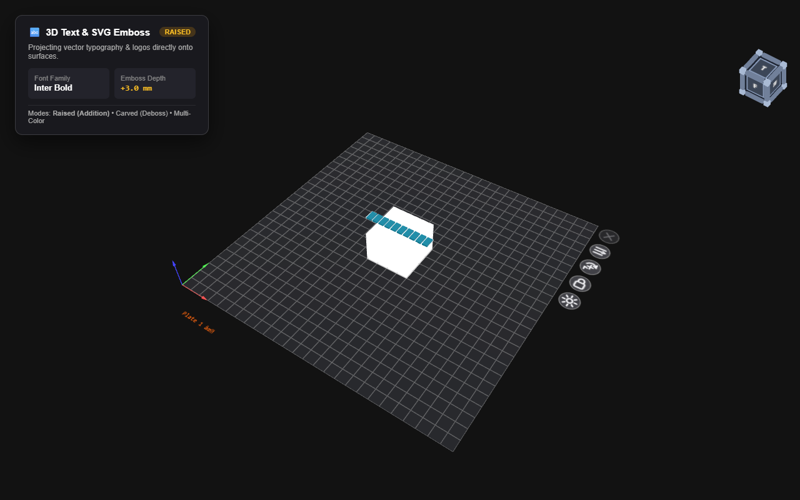

# 3D Text & SVG Emboss: Adding Raised and Carved Details

The 3D editor allows you to add custom lettering, serial numbers, maker marks, and vector logos directly onto your models. Instead of returning to external CAD software to modify your mesh, you can generate 3D typography and project vector graphics straight from the editor viewport.

---

## 1. Where to Find Text and SVG Emboss

You can open the embossing tools from two surfaces:

- **Desktop context menu:** Right-click the target object and choose **Add 3D Text** or **Add SVG Emboss**.
- **Touch & Mobile layout:** Select the object, open the object actions sheet from the editor toolbar, and choose **Add 3D Text** or **Add SVG Emboss**.

Both tools open dedicated configuration panels with real-time parameter controls.

---

## 2. The Three Emboss Modes

Whenever you add text or SVG shapes, you choose how the shape interacts with the model:

| Mode | What it does |
| --- | --- |
| **Raised (Emboss)** | Generates a solid 3D feature protruding outward from the model surface. It prints as an integral part of the model. |
| **Carved (Deboss)** | Cuts into the model surface, engraving the letters or artwork inward. It subtracts material instead of printing outward. |
| **Modifier** | Leaves geometry unchanged, but applies custom slicing settings (such as dense infill, extra perimeters, or alternative color) exclusively inside the shape's boundary. |

> [!IMPORTANT]
> Text and SVG volumes cannot be configured as **Support blocker** or **Support enforcer**. The app strictly prevents this assignment because decorative lettering and vector artwork are meant for surface detailing or settings overrides, not support zone boundaries.

---

## 3. Customizing 3D Text

The **Add 3D Text** panel offers full typographic control:

### Text input
Type your label, monogram, or part number into the **Text** field.

### Open-source typography (6 OFL typefaces)
Choose from six bundled open-source typefaces licensed under the SIL Open Font License (OFL 1.1), ensuring unrestricted personal and commercial printing:

1. **Inter** — Modern, clean sans-serif for functional markings and UI labels.
2. **Roboto Mono** — Monospaced technical font for serial codes, timestamps, and coordinates.
3. **Bebas Neue** — Bold, all-caps headline display font for prominent maker marks.
4. **Playfair Display** — High-contrast serif for elegant plaques, gifts, and presentation prints.
5. **Lobster** — Expressive cursive script for custom names, decorative gifts, and signage.
6. **Orbitron** — Geometric, sci-fi inspired typeface for mechanical, cosplay, and robotics enclosures.

### Size and depth
- **Size (2–50 mm):** Sets the baseline font height across the lettering.
- **Depth (0.2–20 mm):** Adjusts how far the text protrudes outward in Raised mode, or cuts inward in Carved mode. For legible FDM printing, a depth of 0.8 mm to 1.6 mm is typically optimal.

### Project on curved surface
When enabled, the text conforms and wraps over rounded, cylindrical, or organic contours instead of projecting as a flat planar extrusion. Use this for spheres, bottles, rounded handles, and contoured handles.

Tap **Place Emboss** to commit the text to your model.

---

## 4. Customizing SVG Vector Emboss

The **Add SVG Emboss** panel lets you turn 2D vector artwork into physical 3D geometry:

1. Paste valid vector XML into the **SVG Markup** box (e.g., copied from Inkscape, Adobe Illustrator, or Figma).
2. Choose your mode: **Raised (Emboss)**, **Carved (Deboss)**, or **Modifier**.
3. Adjust **Depth (0.2–20 mm)** to control extrusion height.
4. Toggle **Project on curved surface** if your target mesh is contoured or non-planar.
5. Tap **Place Emboss** to generate the 3D volume.

Vector paths are preserved as vector curves rather than rasterized images, ensuring crisp lines even on high-resolution prints.

---

## 5. Project Saving and Persistence

Embossed text and SVG volumes are fully integrated with the 3MF project format:

- Typographic settings, font selections, depth parameters, and raw SVG vector paths are saved directly into the 3MF archive.
- When you save, close, and reopen your project, your text and SVG volumes reload with their full parametric properties intact.
- You can re-edit text or change dimensions at any time before slicing.

---

## 6. Troubleshooting

**Text looks jagged or distorted around sharp corners.**
Turn off **Project on curved surface** if your model has sharp, 90-degree edges. Planar extrusion is cleaner on flat faces, while curved projection is designed for smooth, continuous contours.

**Carved text is not visible in the preview.**
Carved lettering cuts into the model. If your model's wall thickness is thinner than the depth you specified, the cut will pierce through the interior. Verify your model is solid and inspect the viewport from an angle.

**The app refuses to change text to a support zone.**
As noted in section 2, text and SVG volumes cannot be assigned as support blockers or support enforcers. If you need a support zone, place a standard box or cylinder primitive instead.

**SVG markup is rejected or fails to extrude.**
Ensure your SVG contains standard closed paths (`<path d="...">`, `<circle>`, or `<polygon>`). Text elements inside SVGs should be converted to path outlines before exporting from your vector editor. Embedded raster images (`<image>`) and JavaScript scripts inside SVGs are ignored and rejected for safety.
