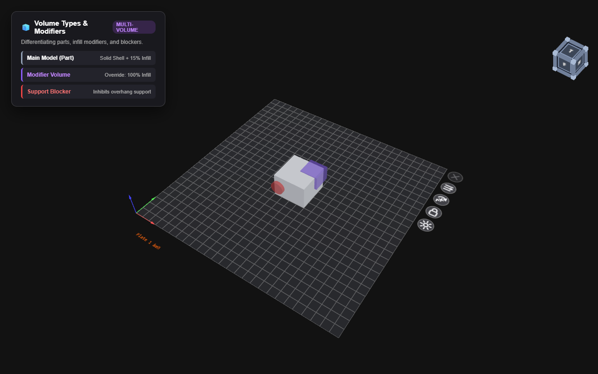

# Volume Types: Parts, Negative Parts, Modifiers and Support Zones

Every object in the 3D editor is built from one or more **volumes**, and each volume has a **type** that tells the slicer what its job is. Five types exist:

| Type | What it does |
| --- | --- |
| **Part** | A normal printed part. Included in slicing. |
| **Negative part** | A subtractor volume. It cuts material out of the part instead of printing. |
| **Modifier** | A settings zone. It overrides slicer settings for the space it covers. |
| **Support blocker** | A no-support zone. Supports are not generated inside this volume. |
| **Support enforcer** | A support zone. Supports are generated inside this volume. |

Only the first one prints. The other four are *instructions* that shape how the printed material is produced: subtract from it, treat it differently, or decide where supports may and may not grow.

---

## 1. Where to Find Volume Types

There are two ways in, depending on which editor surface you are using:

- **Editor grid (touch layout):** select the object, then in the editor grid — the panel that lists the editing actions for the selection — choose **Volume (Beta)**.
- **Context menu (desktop):** right-click the object and choose **Change type**.

Either way, a sheet opens listing the volumes of the selected object, each with its current type. Selecting a volume shows the five types as a radio list, each with its one-line description, so you never have to memorise the table above.

New volumes of a specific type can also be added directly: the object menu contains **Add part**, **Add negative part**, **Add modifier**, **Add support blocker** and **Add support enforcer**, alongside the text and SVG volumes. Adding a volume of the right type up front is usually faster than adding a part and converting it later.

> [!NOTE]
> Volume types are a Beta capability: the action appears in the editor grid only when it is enabled for your build. If **Volume (Beta)** is missing, update the app.

---

## 2. What Each Type Does to the Print

### Part
The default. A solid, printed volume. An object must always keep at least one Part — the last remaining solid part cannot be converted to another type, and the app refuses the change instead of leaving you with an unprintable object.

### Negative part
A shape that is *subtracted* from the parts it overlaps. Instead of printing, it carves material away: place a cylinder as a negative part through a block and you get a hole; place a box and you get a cavity or an open channel.

Two things are worth knowing before you rely on it:

- A carved **cavity adds wall**: the slicer must print the inner surface of the hole, so a hollowed region can use *more* material than the solid original. A channel that cuts fully through the part is where material is actually removed.
- The cut applies only where the negative part **overlaps** other volumes. A negative part floating in empty space does nothing.

### Modifier
A zone that changes **settings**, not geometry. The model inside it is untouched; whatever slicer settings the modifier carries are applied only to the space it covers. A typical use is a sparse-infill block inside an otherwise solid part, or a zone with different wall counts around a mounting boss.

A modifier that carries no settings changes nothing. The shape and position of the zone are the whole story: move it and the overridden region moves with it.

### Support blocker
A keep-out zone for supports. Where automatic supports would otherwise be generated — under an overhang, inside a cavity — a blocker says "not here". Useful for keeping support tips off a visible face or out of a hole that must stay clean.

### Support enforcer
The opposite: supports are generated *inside* this volume even where the geometry would not normally need them. Useful for reinforcing a thin bridge, a long horizontal pin, or any region you know from experience prints better with help underneath.

> [!TIP]
> Blocker and enforcer only matter when automatic supports are enabled for the print. With supports off, neither has anything to suppress or force.

---

## 3. Changing a Volume's Type

1. Select the object, open **Volume (Beta)** in the editor grid.
2. Pick the volume you want to convert.
3. Select the new type from the radio list. Each option shows its description next to it.
4. Confirm. A short **"Volume type was updated."** message appears at the bottom of the screen.

Two refusals are built in, and both are protective rather than errors:

- **"The last solid part of an object cannot be changed to another type."** An object with no printed volume left cannot be sliced, so the last Part stays a Part. If you really want it gone, delete the volume instead.
- **"Text and SVG volumes cannot be support blockers or enforcers."** Text and SVG shapes cannot act as support zones; convert the intent into a box or primitive of the same footprint instead.

Each change is a single undo step, so an accidental conversion is cheap to reverse.

---

## 4. Saving, Reopening — and an Honest Limit

Volume type changes are applied to the **in-memory scene immediately**: the object list, the slicing input and any new slice all reflect the new type while the project stays open.

However, in the current Beta the volume type is **not yet written into the saved 3MF project file**. The sheet warns about this directly:

> **"This volume type is not exported to 3MF yet, so it will not change G-code."**

What this means in practice:

- Set your types, slice, send to print — everything works during that session.
- Save the project, close it, reopen it later, and the volume types will have reverted to their saved values. Re-apply them before slicing again.
- Treat type changes as a per-session step until export support lands. The warning banner in the sheet is the source of truth: as long as it is shown, the type does not travel with the file.

---

## 5. Troubleshooting

**The Volume (Beta) action is missing from the editor grid.**
The capability is not enabled in your build. Update the app and check again.

**A negative part did not remove any material.**
It must overlap a printed volume to cut anything — a negative part on its own in empty space is a no-op. Also confirm it is inside the object, not merely near it, and that the banner from section 4 is not in play for a saved-and-reopened project.

**I expected less material after carving, but the print got heavier.**
That is the cavity effect: the inner walls of the carved space are real printed surface. Cut fully through the part if the goal is removing material.

**A support blocker did not stop supports.**
Check that automatic supports are enabled for the print at all, and that the blocker volume actually overlaps the region where supports appear. The same check applies to an enforcer that adds nothing.

**The type changed back after reopening my project.**
Expected for now — see section 4. Re-apply the types in the new session; nothing is corrupted.

**The app refused my change with a message about the last solid part.**
Keep at least one Part per object. Split off a new volume first if you want to convert the one you are looking at.

**Undo did not restore the previous type.**
Set the type back manually from the radio list. The change itself is one undo step; older builds may not replay the type value, and the sheet is the quickest place to fix it either way.
