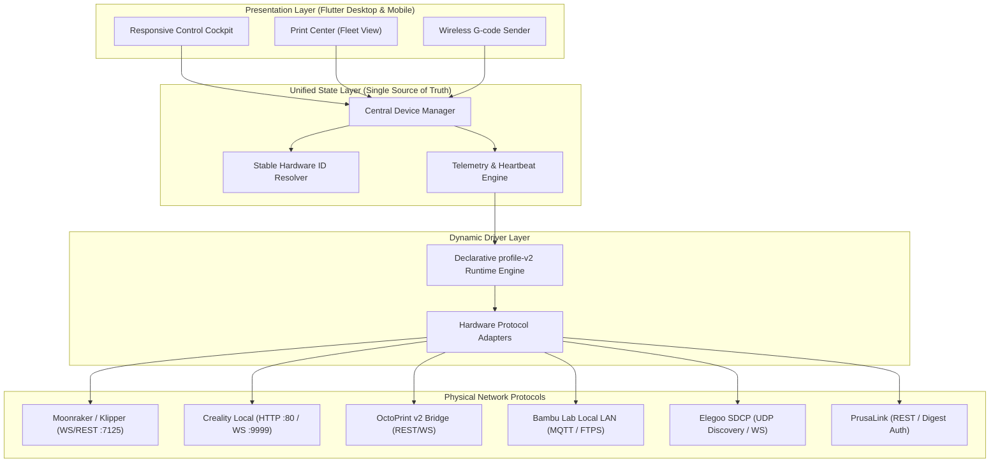

# 3D Printer Connectivity & Integration Architecture

The MakerSpell ecosystem features a modular, hybrid connection architecture designed to discover, monitor, and stream G-code to hundreds of 3D printer models across all major manufacturers.

---

## 1. Architectural Layers

1. **Declarative JSON Drivers (`profile-v2`):** Adding a new printer model or customizing its UI controls requires zero source code compilation. JSON driver profiles declare communication channels (`channels`), endpoints (`operations`), telemetry mapping (`state`), and user actions (`actions`).
2. **Audited Hardware Transports:** Network sockets, HTTP requests, and binary protocols are managed by battle-tested transport adapters.
3. **Safe-Mode (Physical Safety First):** Only lab-verified machines (Creality K1, Snapmaker U1, Creality Hi) receive remote start privileges. All community hardware defaults to strictly sandboxed `UPLOAD_ONLY` mode.

---

## 2. Documentation Directory

- [Safe-Mode Hardware Safety Protocol](safe-mode-protocol.md)
- [Network Discovery & Stable Hardware Identity](network-discovery.md)
- [Transport Adapters & Network Protocols](transport-adapters.md)
- [Multi-Color Systems (Creality CFS, Snapmaker AMS)](filament-ams-cfs.md)
