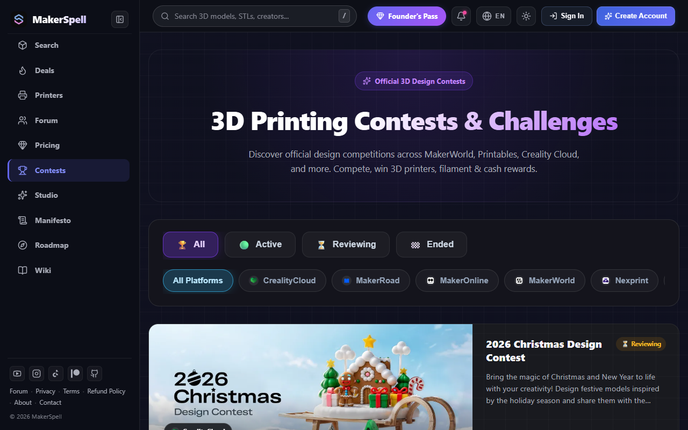

# Community 3D Design Contests & Prizes

MakerSpell Contests ([makerspell.com/contests](https://www.makerspell.com/contests)) is a global calendar tracking active 3D design competitions across Printables, CrealityCloud, MakerWorld, and other repositories.

---

## 1. Contest Information Cards

Every competition card displays:
- **Theme & Title:** (e.g., *Desk Organization*, *Halloween Props*, *Functional Gears*).
- **Hosting Platform:** The repository running the competition.
- **Time Remaining / Deadline:** Real-time countdown to entry cut-off.
- **Prize Tiers:** Details on 1st, 2nd, and runner-up prizes (printers, filament bundles, cash vouchers).

---

## 2. Participation & Submission Rules

Clicking a competition card reveals:
- Full participation criteria, licensing rules, and jury guidelines.
- The **"Enter Contest"** button directs you straight to the platform’s official submission portal.
