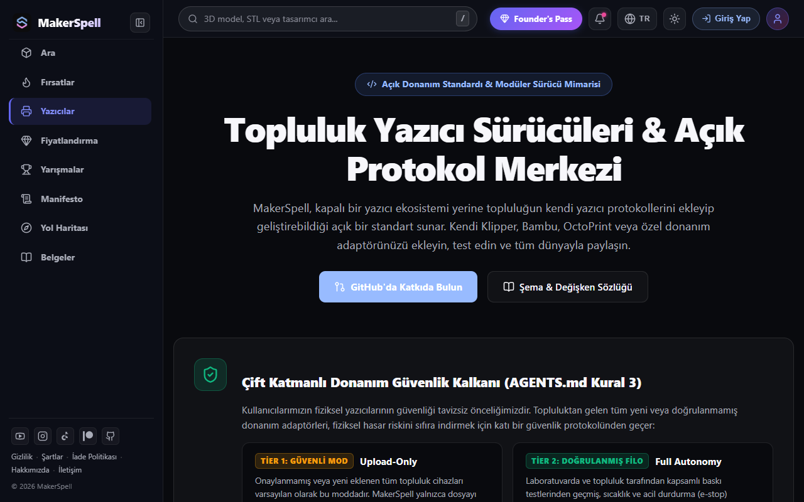

# 🖨️ Community Printer Drivers & Hardware Portal

[makerspell.com/community-printers](https://www.makerspell.com/community-printers) is the web-accessible showcase for community-contributed 3D printer drivers.

---

## 📌 1. Web Portal Features

- **Live Driver Matrix:** View verified driver profiles for Creality, Snapmaker, Bambu Lab, Klipper/Moonraker, Prusa, and Elegoo hardware.
- **Community Vetting:** Track community vote tallies, verified badges, and test feedback.
- **One-Click Export:** Copy JSON profile payloads directly to your clipboard or download them into your local app.
- **Safety Tiers:** Transparent indicators showing whether a profile is Tier 1 Verified or operating in Safe-Mode (`UPLOAD_ONLY`).
