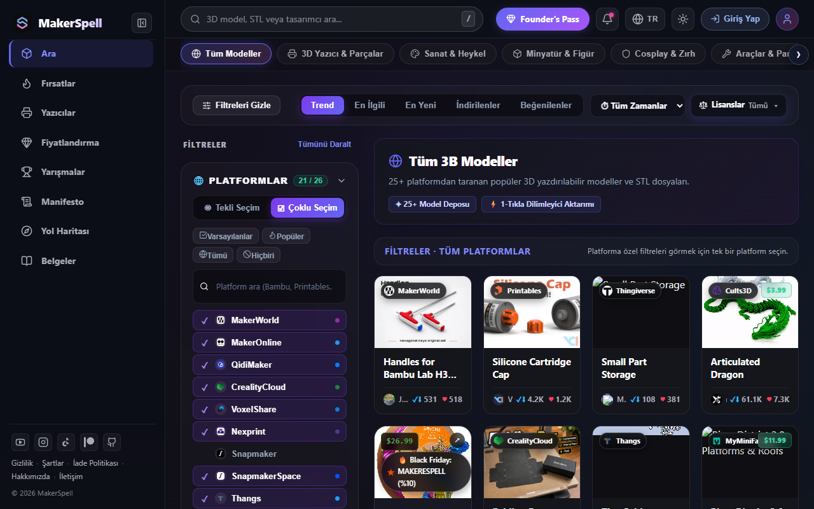

# 🔎 26-Platform 3D Model Search & Filtering Guide

The MakerSpell search engine eliminates the frustration of checking dozens of separate model platforms one by one.

---

## 📌 1. Searching for Models

1. Navigate to [makerspell.com/browse](https://www.makerspell.com/browse) or use the search bar on the homepage.
2. Enter your search query (e.g., *phone stand*, *articulated dragon*, *cable organizer*).
3. Press Enter or click the search icon.

---

## 📌 2. Intelligent Filters & Sorting

- **Free vs. Commercial:** Filter models instantly between free open-source downloads and premium commercial designs.
- **Platform Selection:** Narrow down results to specific repositories (e.g. *Printables*, *MakerWorld*) or search everything at once.
- **Sorting Modes:** Sort by Popularity, Most Recent, or Highest Downloads.
- **3D Preview:** Click any card to view detailed renders, licensing details, author information, and launch directly into your slicing workflow.
