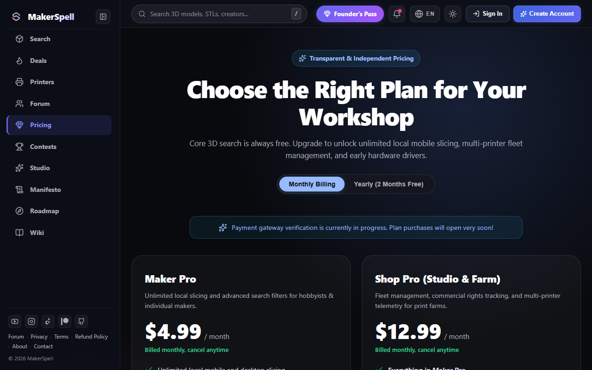

# Pricing, Memberships & Lifetime Founder's Pass

MakerSpell offers flexible membership tiers tailored to hobbyists, makers, and production print farms.

---

## 1. Membership Tiers

- **Free Tier:**
  - Unlimited multi-platform search across 26 repositories.
  - Connect and control 1 local 3D printer with basic telemetry.
  - Access to community hardware deals and coupon codes.
- **Maker Pro ($4.99 / mo):**
  - Unlimited printer connections and full fleet monitoring.
  - High-framerate live camera streaming and cloudless local relay.
  - Advanced search filters and STL mesh repair tools.
- **Shop Pro ($12.99 / mo):**
  - Direct e-commerce order synchronization (Shop Hub).
  - Multi-printer print queue automation.
  - Priority engineering support and early access to beta firmware.

---

## 2. Limited "Lifetime Founder's Pass"

Exclusively available to our first 200 early backers:
- One-time payment with **lifetime Maker Pro access** (no recurring subscriptions).
- Exclusive Founder badge on your profile and access to private Discord engineering channels.
- Guaranteed day-one access to future AI vision diagnostics and slicing innovations.

---

## 3. Redeeming Promo & Discount Codes

If you have a promotional discount code or partner voucher:

1. **On the Web:**
   - Navigate to the **Pricing** page (`/pricing`).
   - Locate the **Promo or Discount Code** box right under the billing cycle selector.
   - Enter your code and click **Apply**.
   - Your discount will be validated and automatically attached when proceeding to the secure checkout.

2. **In the MakerSync App (Desktop & Mobile):**
   - Open **Settings** → **Subscriptions & Plans**.
   - Enter your coupon code in the promo code field above the plan cards.
   - Tap **Apply** to verify your savings.
   - Proceed with checkout; your discount will be automatically reflected on the order summary.

---

## 4. Referral Program: Invite Friends & Earn Pro Rewards

MakerSpell features a dual-sided referral reward system:

1. **Get Your Invite Link:**
   - Open **Settings** → **Subscriptions & Plans** in the MakerSync app.
   - Copy your personal invite link (`https://www.makerspell.com/r/YOURCODE`).
2. **Share with Fellow Makers:**
   - When a friend visits your link, their account is attributed to you for 30 days.
3. **Dual-Sided Reward:**
   - Once your referred friend subscribes to any paid plan:
     - **You (the inviter):** Receive an exclusive coupon code for **1 Month of Pro for free (100% off)**.
     - **Your friend (the invitee):** Receives a **20% welcome discount** on their subscription renewals.
