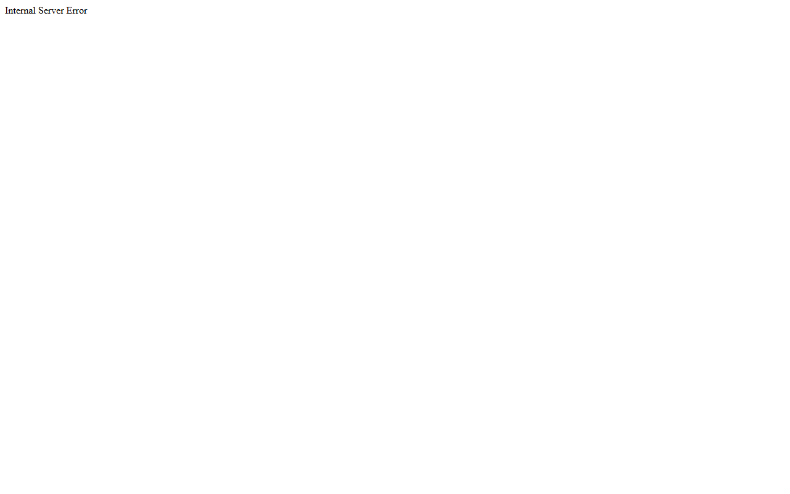

# MakerSpell Wiki Knowledge Portal

The **MakerSpell Wiki** ([wiki.makerspell.com](https://wiki.makerspell.com)) is a dedicated, open-hardware knowledge portal designed specifically for 3D printing enthusiasts, makers, and print farm operators.

---

## Key Highlights

1. **Focused 3-Column Navigation:**
   - **Primary Rail (Left Column):** Direct access to core knowledge categories including CFS/AMS filament systems, FFF 3D printer hardware (Creality K1, Bambu Lab, Snapmaker, Voron), OrcaSlicer and software guides, and safety standards.
   - **Page Contents Tree (Middle Column):** Live categorized navigation covering all available guides, driver manuals, and community documentation, complete with sharing tools and print-to-PDF support.
   - **Knowledge Canvas (Main Body):** High-readability documentation canvas featuring interactive mermaid architecture diagrams, clean syntax-highlighted configuration blocks, and device setup walkthroughs.

2. **Multilingual Global Availability:**
   - Available natively across 22 supported languages with seamless instant language switching.

3. **Subdomain Independence:**
   - Completely independent from the main storefront and search UI, offering a clutter-free, fast-loading reading experience for workshops and maker benches.
