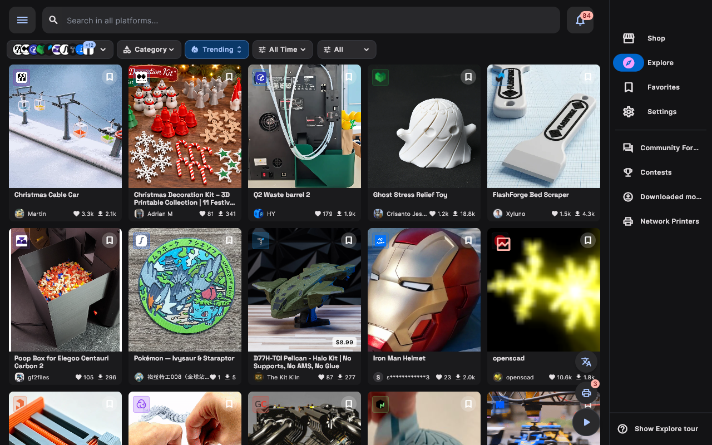
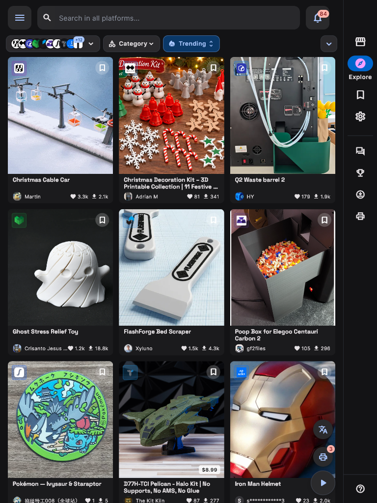
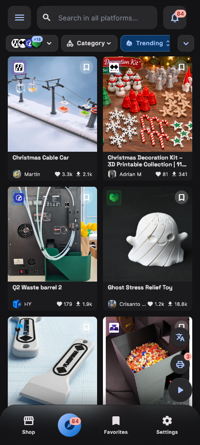

# MakerSpell Masaüstü & Mobil Uygulama Kullanım Kılavuzu

MakerSpell masaüstü (Windows, macOS, Linux) ve mobil (Android, iOS) uygulaması; tüm 3D yazıcılarınızı tek bir ekrandan kontrol etmenizi, baskılarınızı gerçek zamanlı izlemenizi ve dilimlenen modellerinizi doğrudan yazıcınıza göndermenizi sağlayan modern bir kontrol merkezidir.

---

## Duyarlı (Responsive) Çoklu Platform Deneyimi

MakerSpell arayüzü ekran boyutunuza göre uyarlanır. Karşılaştırmak için bir cihaz seçin:

<input class="dv-input" type="radio" name="dv-overview" id="dv-overview-desktop" checked>
<input class="dv-input" type="radio" name="dv-overview" id="dv-overview-tablet">
<input class="dv-input" type="radio" name="dv-overview" id="dv-overview-mobile">

<label for="dv-overview-desktop"><svg width="16" height="16" aria-hidden="true" focusable="false" viewBox="0 0 24 24" fill="none" stroke="currentColor" stroke-width="1.8" stroke-linecap="round" stroke-linejoin="round" aria-hidden="true"><rect x="2" y="3" width="20" height="14" rx="2"/><path d="M8 21h8"/><path d="M12 17v4"/></svg>Masaüstü1280 px</label>
<label for="dv-overview-tablet"><svg width="16" height="16" aria-hidden="true" focusable="false" viewBox="0 0 24 24" fill="none" stroke="currentColor" stroke-width="1.8" stroke-linecap="round" stroke-linejoin="round" aria-hidden="true"><rect x="4" y="2" width="16" height="20" rx="2"/><path d="M12 18h.01"/></svg>Tablet768 px</label>
<label for="dv-overview-mobile"><svg width="16" height="16" aria-hidden="true" focusable="false" viewBox="0 0 24 24" fill="none" stroke="currentColor" stroke-width="1.8" stroke-linecap="round" stroke-linejoin="round" aria-hidden="true"><rect x="7" y="2" width="10" height="20" rx="2.5"/><path d="M11 18h2"/></svg>Mobil412 px</label>

<figure class="dv-panel">

<figcaption><strong>Masaüstü</strong> — Çok sütunlu model keşfi, tam gezinme paneli ve canlı filo takibi.</figcaption>
</figure>
<figure class="dv-panel">

<figcaption><strong>Tablet</strong> — Dokunma öncelikli gezinme paneli ve duyarlı üç sütunlu keşif ızgarası.</figcaption>
</figure>
<figure class="dv-panel">

<figcaption><strong>Mobil</strong> — Tek elle kullanım: alt gezinme çubuğu ve atölyede hareket için kompakt kartlar.</figcaption>
</figure>

Yerleşimler 1280 px, 768 px ve 412 px genişlikte alınmıştır.

---

## Öne Çıkan Özellikler

- **🔍 Otomatik Ağ Keşfi:** Yerel ağınızdaki (Wi-Fi / Ethernet) Creality K1, Snapmaker U1, Voron, Ender (Klipper/Moonraker) ve OctoPrint cihazlarını otomatik olarak bulur.
- **🗂️ Baskı Merkezi (Print Center):** Atölyenizdeki veya evinizdeki tüm yazıcıların anlık durumunu, aktif baskılarını ve kalan sürelerini tek bakışta gösterir.
- **🚀 Tek Tıkla G-code Gönderme:** Dilimlediğiniz 3D modelleri kablosuz olarak yazıcı hafızasına aktarır veya doğrudan baskıyı başlatır.
- **📹 Canlı Kamera İzleme:** Yazıcınızın dahili kamerasından düşük gecikmeli canlı görüntü sağlar.
- **🎨 Çok Renkli Baskı (CFS / AMS) Desteği:** Creality CFS ve Snapmaker AMS gibi çoklu malzeme sistemlerinin yuva ve filament renklerini otomatik tanır.
- **🕹️ Tam Eksen ve Sıcaklık Kontrolü:** Nozul ve tabla sıcaklıklarını ayarlayabilir, fan hızlarını yönetebilir ve eksenleri hareket ettirebilirsiniz.

---

## Kılavuz Başlıkları

1. [Yazıcıları Ağa Bağlama ve Eşleştirme](connecting-printers.md)
2. [Baskı Merkezi (Print Center) Kullanımı](print-center-guide.md)
3. [G-code Gönderme ve Dilimleme Entegrasyonu](gcode-sending.md)
4. [Cihaz Denetim Panosu (Kamera, Sıcaklık ve Eksenler)](printer-controls.md)
5. [Çok Renkli Baskı ve Filament (CFS / AMS) Yönetimi](multicolor-printing.md)
