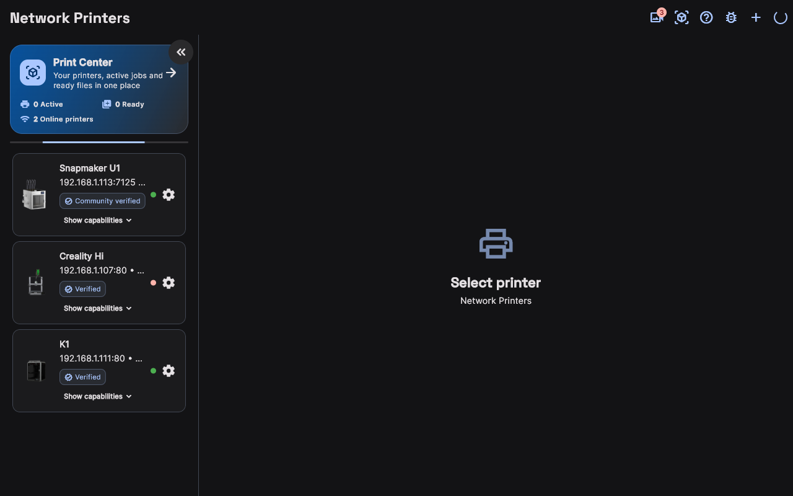
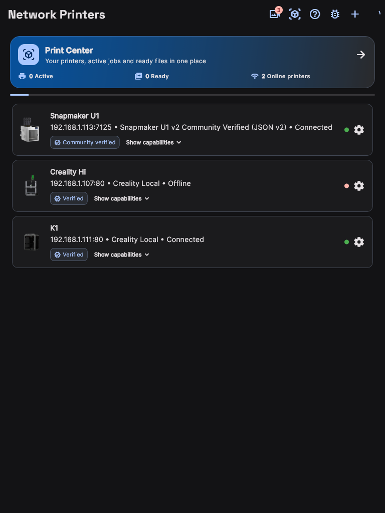
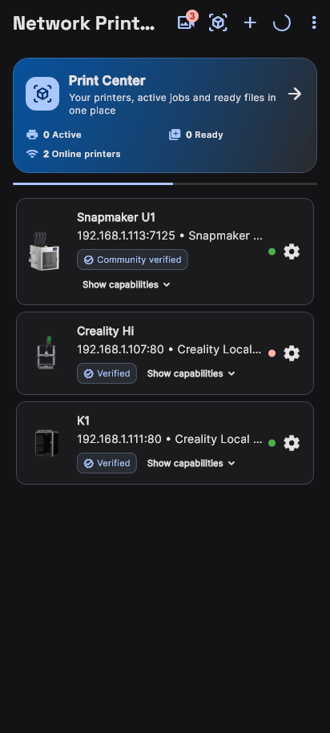

# 🌐 Yazıcıları Ağa Bağlama ve Eşleştirme Kılavuzu

MakerSpell uygulaması, yerel ağınızda açık olan yazıcıları bulmak için otomatik tarama teknolojisi kullanır.

---

## 1. Otomatik Ağ Taraması ile Yazıcı Ekleme

### Ağ Yazıcıları Her Ekranda

Masaüstünde bulunan yazıcılar pencerenin tüm genişliğini kullanır:

Tablette her yazıcı satırı durum düğmesini başparmak menzilinde tutar:

Telefonda liste, makinenin başına yürürken bakabileceğiniz tam genişlikte kartlara dönüşür:

1. 3D yazıcınızın açık ve bilgisayarınız/telefonunuz ile **aynı Wi-Fi veya Ethernet ağına** bağlı olduğundan emin olun.
2. Uygulamanın üst menüsünden veya yan panelinden **"Ağ Yazıcıları"** sekmesini açın.
3. Sağ üst köşedeki **"Yenile / Tara"** butonuna tıklayın.
4. MakerSpell yerel ağınızdaki mDNS (Zeroconf) ve Klipper/Creality servislerini tarayacaktır.
5. Birkaç saniye içinde cihazınız (Örn: *Creality K1*, *Snapmaker U1*, *Moonraker*) listede belirecektir.
6. Cihaz kartının sağ tarafındaki durum indikatörü yeşil yandığında yazıcınız kontrol edilmeye hazırdır.

---

## 2. Manuel IP ile Yazıcı Ekleme

Eğer modeminiz ağ içi cihaz keşif paketlerini (mDNS) kısıtlıyorsa, cihazınızı doğrudan IP adresiyle ekleyebilirsiniz:

1. **"Ağ Yazıcıları"** ekranında sağ üstteki **"Yazıcı Ekle" (+)** butonuna tıklayın.
2. Açılan formda:
   - **Yazıcı Adı:** İstediğiniz bir isim verin (Örn: *Atölye K1*).
   - **IP Adresi:** Yazıcınızın ekranından öğrendiğiniz yerel IP adresini girin (Örn: `192.168.1.105`).
   - **Port:** Kullandığınız yazılımın portunu girin:
     - Klipper / Moonraker için varsayılan: `7125`
     - CrealityOS (K1, Ender-3 V3, Hi) için: `80`
     - OctoPrint için: `80` veya `5000`
   - **Protokol / Sürücü:** Cihaz tipinize uygun sürücüyü seçin (Örn: *Creality Local v2*, *Moonraker*, *OctoPrint*).
3. **"Bağlantıyı Test Et ve Kaydet"** butonuna basın. Başarılı onay mesajından sonra cihaz listenize eklenecektir.

---

## 3. Dinamik IP Değişimi Durumunda Ne Olur?

Modeminiz veya yazıcınız yeniden başlatıldığında IP adresi değişse bile, MakerSpell cihazınızı donanım kimliği (MAC / UUID) üzerinden hatırlar. Cihazınız yeni bir IP aldığında uygulama bunu arka planda otomatik algılar ve kontrolü kesintisiz sürdürür.

