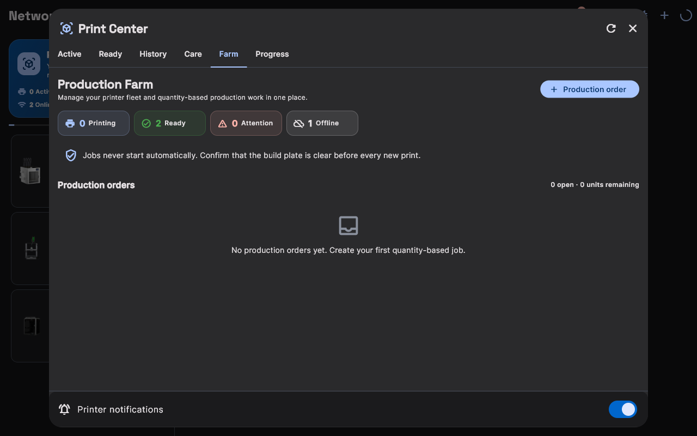
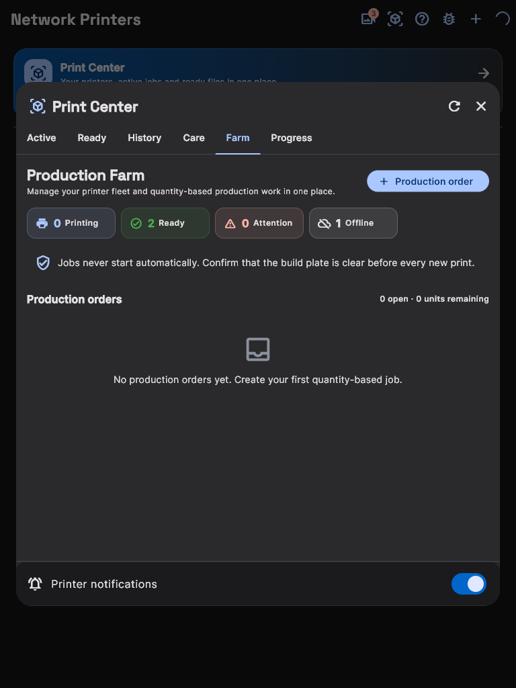
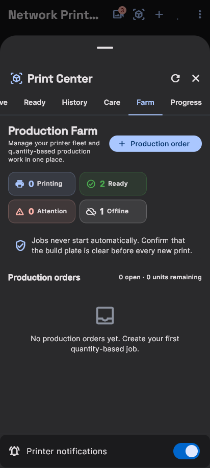

# Baskı Merkezi (Print Center) Kullanım Kılavuzu

Baskı Merkezi, birden fazla 3D yazıcı kullanan makerlar ve atölyeler için tasarlanmış merkezi operasyon ekranıdır.

### Baskı Merkezi Her Ekranda

Aynı canlı filo panosu cihazınıza göre kendini yeniden düzenler. Ekran görüntüleri, adet bazlı üretim emirlerinin kuyruğa alındığı **Üretim Çiftliği** sekmesini gösterir; diğer sekmeler (Aktif, Hazır, Geçmiş, Bakım Çiftliği, İlerleme) aynı yerleşimi kullanır.

<input class="dv-input" type="radio" name="dv-printcenter" id="dv-printcenter-desktop" checked>
<input class="dv-input" type="radio" name="dv-printcenter" id="dv-printcenter-tablet">
<input class="dv-input" type="radio" name="dv-printcenter" id="dv-printcenter-mobile">

<label for="dv-printcenter-desktop"><svg width="16" height="16" aria-hidden="true" focusable="false" viewBox="0 0 24 24" fill="none" stroke="currentColor" stroke-width="1.8" stroke-linecap="round" stroke-linejoin="round" aria-hidden="true"><rect x="2" y="3" width="20" height="14" rx="2"/><path d="M8 21h8"/><path d="M12 17v4"/></svg>Masaüstü1280 px</label>
<label for="dv-printcenter-tablet"><svg width="16" height="16" aria-hidden="true" focusable="false" viewBox="0 0 24 24" fill="none" stroke="currentColor" stroke-width="1.8" stroke-linecap="round" stroke-linejoin="round" aria-hidden="true"><rect x="4" y="2" width="16" height="20" rx="2"/><path d="M12 18h.01"/></svg>Tablet768 px</label>
<label for="dv-printcenter-mobile"><svg width="16" height="16" aria-hidden="true" focusable="false" viewBox="0 0 24 24" fill="none" stroke="currentColor" stroke-width="1.8" stroke-linecap="round" stroke-linejoin="round" aria-hidden="true"><rect x="7" y="2" width="10" height="20" rx="2.5"/><path d="M11 18h2"/></svg>Mobil412 px</label>

<figure class="dv-panel">

<figcaption><strong>Masaüstü</strong> — Paneller geniş ızgarada yan yana durur; çalışma istasyonu için idealdir.</figcaption>
</figure>
<figure class="dv-panel">

<figcaption><strong>Tablet</strong> — Paneller dokunmaya elverişli bir ızgaraya akar.</figcaption>
</figure>
<figure class="dv-panel">

<figcaption><strong>Mobil</strong> — Pano, tek elle kaydırılabilen tek kolona dönüşür.</figcaption>
</figure>

Yerleşimler 1280 px, 768 px ve 412 px genişlikte alınmıştır.

---

## 1. Baskı Merkezi Başlığı ve Özet Sayaçları

Ekranın üst kısmında yer alan mavi bilgi panosunda atölyenizin anlık özeti gösterilir:
- **Aktif İşler:** Şu anda tablaya baskı yapan veya ısınan cihaz sayısı.
- **Hazır Dosyalar:** Dilimlenmiş ve yazıcılara gönderilmeye hazır G-code dosyaları.
- **Çevrimiçi Yazıcılar:** Ağa bağlı ve iletişim kurulabilen toplam cihaz sayısı.

---

## 2. Yazıcı Durum Kartları

Listedeki her bir cihaz kartı üzerinde şu bilgiler canlı olarak güncellenir:

- **Baskı Durumu İndikatörü:**
  - 🟢 **Yeşil:** Cihaz hazır ve boşta (`Idle`).
  - 🔵 **Mavi / Animasyonlu:** Aktif baskı devam ediyor (`Printing`).
  - 🟡 **Sarı:** Baskı duraklatıldı (`Paused`).
  - 🔴 **Kırmızı / Soluk:** Cihaz kapalı veya ağdan düştü (`Offline`).
- **Canlı İlerleme:** Modelin yüzde kaçının tamamlandığı (`%65`) ve tahmini kalan süre (`14m 20s`).
- **Sıcaklık Değerleri:** Anlık ve hedef nozul / tabla sıcaklıkları (`220°C / 60°C`).
- **Hızlı Butonlar:**
  - **Duraklat / Devam Et:** Baskıyı acil durumlarda geçici olarak bekletir.
  - **İptal Et:** Onay kutusunun ardından baskıyı güvenle sonlandırır.
  - **Detay Paneli:** Yazıcının tam kontrol panosunu açar.
