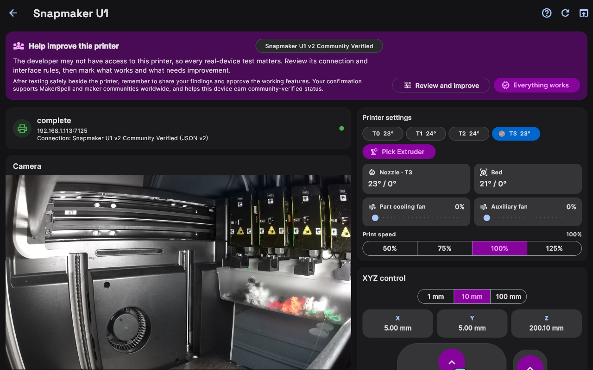
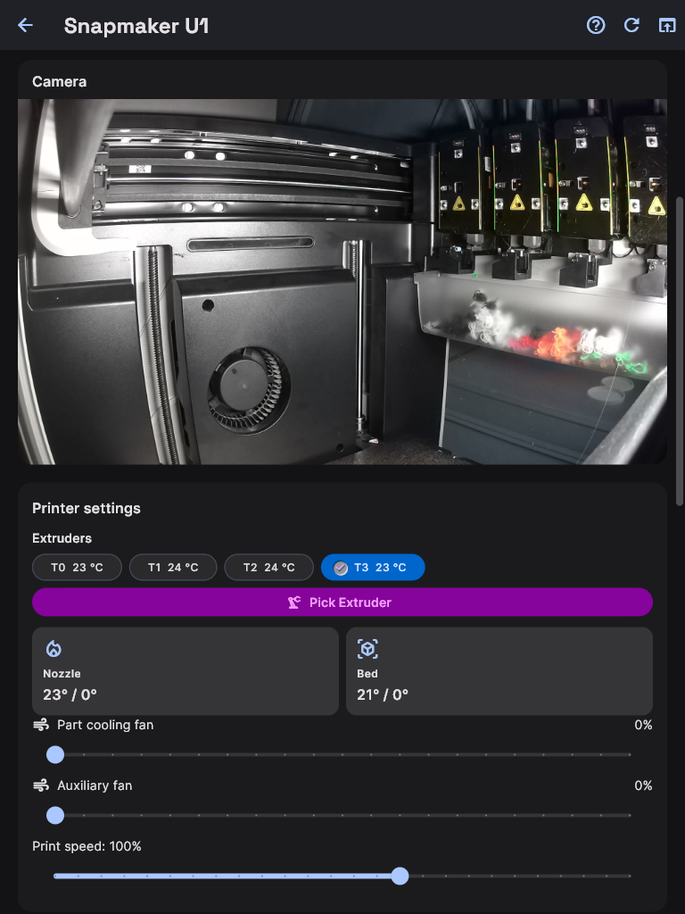
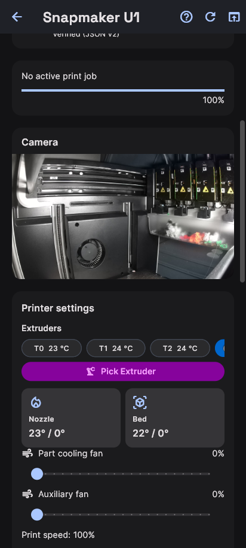

# Cihaz Denetim Panosu (Kamera, Sıcaklık ve Eksenler)

Bir yazıcının detayına girdiğinizde karşınıza çıkan **Cihaz Denetim Panosu**, masaüstünde 2 kolonlu optimize edilmiş bir kumanda masası sunar.

### Cihaz Denetim Panosu Her Ekranda

Masaüstü monitörde kamera ve hareket pedi yan yana kalır:

Tablette iki bölüm de görünür kalır, ancak daha uzun ve dokunma öncelikli bir düzene geçer:

Telefonda paneller tek parmakla kaydırılan tek kolona dönüşür:

---

## 1. Sol Kolon: Canlı İzleme ve Görüntü

- **Canlı Kamera Yayını:**
  Yazıcınızın dahili kamerası varsa akış otomatik başlar. Gecikmesiz video üzerinden ilk katman yapışmasını ve baskı sürecini izleyebilirsiniz.
- **Aktif İş Durumu:**
  Hangi dosyanın basıldığı, katman sayısı (Örn: *120 / 450*), kalan süre ve ilerleme yüzdesi canlı olarak takip edilir.
- **Çok Renkli Filament Yuvaları:**
  Yazıcınıza bağlı CFS veya AMS ünitesindeki bobinlerin rengi ve malzeme türü (PLA, PETG, ABS) görsel olarak listelenir.

---

## 2. Sağ Kolon: Manuel Kontroller ve Donanım Ayarları

- **Sıcaklık Ayarları:**
  - **Nozul Sıcaklığı:** Hızlı ön ısıtma hazır ayarları (PLA 200°C, PETG 240°C, ABS 260°C) veya manuel derece girişi.
  - **Tabla Sıcaklığı:** Tablayı ısıtma ve soğutma düğmeleri.
  - **Hazne / Kabin Işığı:** Cihaz içi aydınlatmayı açıp kapatma düğmesi.
- **Fan Hızları:**
  - Model Soğutma Fanı, Arka Egzoz Fanı ve Yan Fan hızlarını yüzde cinsinden ayarlayabilirsiniz.
- **XYZ Eksen Hareketi & Sıfırlama (Homing):**
  - Dairesel kontrol pedi üzerinden X ve Y eksenlerini kaydırabilir, Z eksenini yukarı/aşağı hareket ettirebilirsiniz.
  - Hareket adım büyüklüğünü (`0.1 mm`, `1 mm`, `10 mm`, `100 mm`) seçebilirsiniz.
  - Ortadaki Home butonuyla veya alttaki **"Tüm Eksenleri Başlangıca Al"** düğmesiyle kafayı sıfırlayabilirsiniz.
  - *Güvenlik Notu:* Yazıcı baskı yaparken eksen hareket butonları kazaları önlemek için otomatik kilitlenir.
- **Yerel Dosya Listesi & Baskı Geçmişi:**
  - Yazıcının hafızasındaki eski dosyaları görebilir, silebilir veya geçmiş baskıların süre raporlarını inceleyebilirsiniz.
