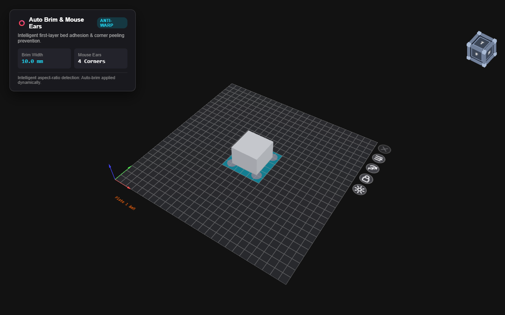

# Otomatik Kenarlık ve Fare Kulağı: İlk Katman Yapışması ve Kalkmayı Önleme

İlk katman yapışması, 3D baskı başarısının en kritik faktörlerinden biridir. Üst katmanlar soğudukça oluşan termal büzülme, keskin köşelerin baskı tablasından yukarı doğru kıvrılmasına (warping/kalkma) neden olan çekme kuvvetleri yaratır. Ayrıca uzun veya dar parçalar, hareket eden baskı kafası tarafından kolayca devrilebilir.

**Kenarlık ve Fare Kulağı** aracı; devrilme riskini otomatik analiz eden akıllı kenarlıktan yerel köşe disklerine kadar gelişmiş yapışma stratejileri sunarak baskılarınızın tablaya sağlam şekilde tutunmasını sağlar.

---

## 1. Kenarlık Yapılandırmasını Nerede Bulacaksınız

Kenarlık ayarlarına editör içinde birkaç farklı noktadan erişebilirsiniz:

- **Masaüstü bağlam menüsü:** Tabladaki modele sağ tıklayın ve **Kenar (Beta)** veya **Brim (Beta)** seçeneğini seçin.
- **Dokunmatik & Mobil yerleşim:** Modeli seçin, editör araç çubuğundaki işlemler sayfasını açın ve **Kenar (Beta)** seçeneğini seçin.
- **Parametreler paneli:** Kenarlık ayarlarını genel veya nesne bazında yapılandırmak için Parametreler Panelindeki **Diğerleri** sekmesini açın.

---

## 2. Altı Kenarlık Tipi

Editör altı farklı kenarlık tipini destekler:

| Kenarlık Tipi | Nasıl çalışır | Ne zaman kullanılır |
| --- | --- | --- |
| **Kenarlık yok** | Hiçbir yardımcı kenarlık hattı üretilmez. | Geniş taban alanına ve yuvarlak köşelere sahip büyük, düz modeller için. |
| **Otomatik kenarlık** | Temas alanını ve devrilme riskini otomatik değerlendirerek kenarlığı yalnızca gerektiğinde üretir. | Genel baskılar; stabil modellerde filament israfı yapmadan riskli parçaları korur. |
| **Yalnızca dış** | Kenarlık hatlarını yalnızca modelin dış siluetinin etrafına örer. | İç delikleri veya boşlukları doldurmadan ekstra tutunma gereken standart baskılar. |
| **Yalnızca iç** | Kenarlık hatlarını yalnızca deliklerin ve iç kesimlerin içine örer. | Ekstra desteğe ihtiyaç duyan küçük iç temas yüzeylerine sahip parçalar. |
| **Dış ve iç** | Hem dış çevreyi hem de iç boşlukları kenarlık hatlarıyla sarar. | Taban temas alanı çok kısıtlı olan karmaşık veya içi boş modeller. |
| **Fare kulağı** | Yalnızca keskin dış köşelere dairesel yapışma diskleri yerleştirir. | Köşe kalkmasına meyilli kutular, çerçeveler ve köşeli mekanik parçalar. |

---

## 3. Otomatik Kenarlık Modelinizi Nasıl Değerlendirir

**Otomatik kenarlık**, hassas modelleri otomatik olarak korumak için akıllı taban geometrisi analizini kullanır:

- **Dar temas alanı kuralı:** Modelinizin ilk katman temas alanı 150 mm² veya daha küçükse, parçanın tabladan ayrılmasını önlemek için otomatik kenarlık devreye girer.
- **En-boy oranı (devrilme riski) kuralı:** Modeliniz uzun ve ince bir yapıdaysa — özellikle yüksekliği en dar taban genişliğinin dört katından fazlaysa — nozulun parçayı devirmesini önlemek için otomatik kenarlık etkinleşir.
- **Dinamik genişlik ölçekleme:** Riskli geometrilerde otomatik kenarlık, ölçülen riske bağlı olarak genişliği 5,0 mm ile 18,0 mm arasında otomatik ölçeklendirir. Taban zaten geniş ve dengeliyse sistem *"Taban dengeli: kenarlık gerekmez"* bilgisini verir ve sıfır ekstra filament harcar.

---

## 4. Fare Kulağı: Keskin Köşelere Yerel Yapışma

Standart tam kenarlıklar modelin tüm çevresini sarar; bu da filament israfına yol açar ve uzun düz kenarlar boyunca zahmetli temizlik gerektirir.

**Fare kulağı** (brim ears), gerilimin en yüksek olduğu keskin köşelere yerel yuvarlak yapışma diskleri yerleştirerek bu sorunu çözer:

### Disk çapı (6–24 mm)
Köşe disklerinin boyutunu ayarlar. Standart FDM baskılar için 10 mm ila 14 mm arası çap idealdir.

### Disk adedi (1–8)
Nesne çevresine kaç adet köşe diski yerleştirileceğini belirler.

### Maks köşe açısı (90°–150°)
Köşe algılama açı eşiğini belirler. Varsayılan 125° değeri yumuşak kavisleri yok sayarken dik 90 derecelik köşeleri ve dar açıları hedefler.

Fare kulakları baskıdan sonra elle kolayca koparılır; bıçakla temizlik gerektirmeden geriye tertemiz düz kenarlar bırakır.

---

## 5. Kenarlık Genişliği ve Boşluğunu Ayarlama

**Yalnızca dış**, **Yalnızca iç** veya **Dış ve iç** kenarlık tipleri kullanılırken iki kaydırıcı kenarlık davranışını belirler:

### Kenarlık genişliği (2,0–20,0 mm)
Kenarlığın parçadan dışa doğru ne kadar uzanacağını belirler. Standart PLA ve PETG için 5,0 mm genellikle yeterlidir; ABS, ASA veya Naylon gibi yüksek çekme yapan malzemeler için genişliği 8,0 mm veya 12,0 mm'ye çıkarın.

### Kenarlık-nesne boşluğu (0,0–0,5 mm)
Kenarlık çizgisi ile modelin gerçek duvarı arasındaki mesafeyi ayarlar:
- **0,0 mm (Sıfır boşluk):** Kalkmaya karşı en güçlü mekanik bağı sağlar, ancak temizlemek için çapak alma bıçağı gerektirir.
- **0,1 mm ila 0,15 mm (Ayrılabilir boşluk):** Elle kolayca soyulan temiz bir ayrılma sağlarken kalkmaya karşı etkili tutuş sunar.

---

## 6. Sorun Giderme

**Kenarlık kullanılmasına rağmen köşeler tabladan kalkıyor.**
Baskı tablanızın izopropil alkol veya ılık sabunlu suyla temizlendiğinden ve yağdan arındırıldığından emin olun. Kalkma devam ederse **Kenarlık genişliği**ni 8–10 mm'ye çıkarın, **Kenarlık-nesne boşluğu**nu 0,0 mm yapın veya Fare Kulağı yerine **Yalnızca dış** kenarlığa geçin.

**Kenarlık çok zor ayrılıyor veya parçada pürüzlü çapaklar bırakıyor.**
**Kenarlık-nesne boşluğu**nu 0,10 mm veya 0,15 mm'ye yükseltin. Bu küçük aralık, kenarlığın dış duvara aşırı kaynamadan pürüzsüzce kopmasını sağlar.

**Otomatik kenarlık modelimde hiçbir kenarlık üretmedi.**
Bu, geniş ve stabil modeller için beklenen bir davranıştır. Taban temas alanı 150 mm²'nin üzerindeyse ve en-boy oranı düşükse, otomatik kenarlık parçanın güvende olduğunu anlar ve malzeme israfını önler. Yine de kenarlık istiyorsanız manuel olarak **Yalnızca dış** seçeneğini belirleyin.

**Fare kulakları düz kavisli yüzeylerde de beliriyor.**
Algılama filtresinin yalnızca dik veya dar köşeleri hedeflemesi için **Maks köşe açısı** kaydırıcısını düşürün (örneğin 135°'den 105°'ye).
