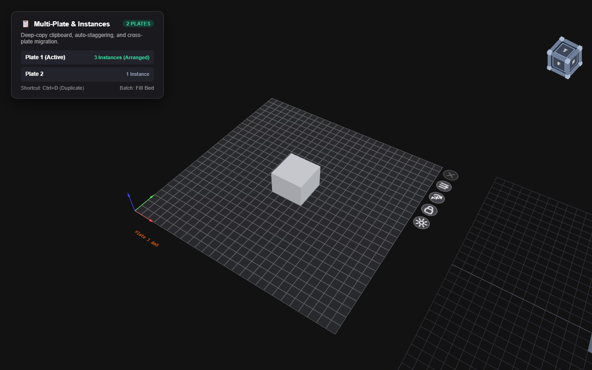

# Pano, Klonlama ve Çoklu Plaka Yönetimi

Karmaşık 3D projeleri yönetmek; parçaları çoğaltmayı, seri üretim dizilimleri yapmayı veya çok parçalı montajları ayrı baskı tablalarına bölmeyi gerektirir. 3D editör; derin kopyalama özellikli entegre pano sistemi, tek tıkla klonlama, tablayı otomatik kopyalarla doldurma ve çoklu plaka çalışma alanı yönetimi sunar.

---

## 1. Pano İşlemleri: Kopyala, Yapıştır ve Klonla

Modelleri çalışma alanında standart klavye kısayollarını veya ekran menülerini kullanarak çoğaltabilirsiniz:

### Kopyala (Ctrl + C / Cmd + C)
Tabladaki herhangi bir modeli seçin ve **Ctrl + C** (macOS'ta **Cmd + C**) tuşlarına basın veya sağ tık bağlam menüsünden ya da mobil işlemler ızgarasından **Kopyala** seçeneğini seçin. Modelin tüm hiyerarşisi dahili panoya kopyalanır.

### Yapıştır (Ctrl + V / Cmd + V)
**Ctrl + V** (veya **Cmd + V**) tuşlarına basın ya da **Yapıştır** seçeneğini seçin. Pano içeriği aktif plakaya yerleştirilir:
- **Otomatik ofset:** Yapıştırılan her model, X ve Y eksenlerinde otomatik olarak 10 mm kaydırılır ve baskı tablasına oturtulur; böylece kopyalar asla orijinalin üzerine görünmez şekilde binmez.
- **Boş plakaya yapıştırma:** Önceden bir model seçilmemiş olsa bile, panoda içerik olduğu sürece boş bir plakaya veya boş çalışma alanına doğrudan yapıştırabilirsiniz.

### Klonla (Ctrl + D / Cmd + D)
**Ctrl + D** (veya **Cmd + D**) tuşlarına basın ya da **Kopyasını oluştur** seçeneğini seçin. Bu işlem seçili nesneyi tek bir adımda hemen yerinde çoğaltır.

---

## 2. Derin Kopyalama Güvencesi: Modelinizle Birlikte Neler Taşınır?

Bir modeli kopyaladığınızda veya klonladığınızda editör basit bir yüzey ağı kopyalamak yerine **derin klonlama** gerçekleştirir. Modele bağlı olan her şey bağımsız ve yeni kimliklerle korunur:

- **Tüm alt hacimler:** Modele bağlı negatif parçalar (delikler), değiştiriciler (özel dolgu/duvar bölgeleri), destek engelleyiciler ve destek zorlayıcılar eksiksiz olarak çoğaltılır.
- **3D Metin ve SVG Kabartma:** Parametrik metinler, seçilen yazı tipleri, kabartma derinliği ve vektör çizim yolları kopyada aynen korunur.
- **Yükseklik aralığı değiştiricileri:** Tanımlanmış Z bantları ve yerel katman ayarları yeni kopyaya eksiksiz aktarılır.
- **Özel dilimleme geçersiz kılmaları:** Nesneye özel tüm parametreler (benzersiz dolgu yoğunluğu veya duvar sayısı gibi) yeni oluşturulan kopyaya atanmış kalır.
- **Bağımsızlık:** Klonlanan kopyayı değiştirmek, taşımak veya silmek orijinal modeli kesinlikle etkilemez.

---

## 3. Hızlı Çoğaltma: Toplu Klonlama ve Tablayı Doldurma

Seri üretim hazırlığı yaparken tek tek kopyalayıp yapıştırmak gerekmez:

### Toplu klonlama (Kopya sayısı)
Dokunmatik veya mobil yerleşimlerde **Kopyasını oluştur** seçeneği kullanıldığında bir seçenek penceresi **Kopya sayısı** (1 ila 20 arası) sorar. Bir miktar girmek o sayıda özdeş parçayı anında oluşturur.

### Yatağı kopyalarla doldur
Bir nesneye sağ tıklayın ve **Yatağı kopyalarla doldur** seçeneğini seçin. Editör; yazıcınızın baskı hacmi sınırlarını hesaplar, parça boyutlarını ve aralık paylarını hesaba katarak tablaya güvenle sığabilecek maksimum kopya sayısını otomatik olarak dizer.

---

## 4. Çoklu Baskı Plakalarını Yönetme

Çok parçalı büyük projeler, farklı renkler veya devasa montajlar için baskı sürecinizi tek bir proje dosyasında ayrı baskı tablalarına bölebilirsiniz.

### Yeni plaka ekleme
- **Masaüstü:** Araç çubuğundaki **Plaka Ekle** düğmesine tıklayın veya boş alana sağ tıklayıp **Plaka Ekle** seçeneğini seçin.
- **Mobil:** Sahne araçlarını açın ve **Plaka Ekle** seçeneğine dokunun.

3D görünüm alanınızda sırayla numaralandırılmış yeni bir sanal baskı tablası (Plaka 1, Plaka 2 vb.) belirir.

### Modelleri plakalar arasında taşıma
Bir modeli bir plakadan diğerine aktarmak için:
1. Modeli mevcut plakasında seçin.
2. Bağlam menüsünden veya işlemler sayfasından **Plakaya taşı** seçeneğini seçin.
3. Listeden hedef plakanızı seçin.
4. Model, tüm ölçeklerini, döndürmelerini ve dilimleme ayarlarını koruyarak yeni tablanın üzerine otomatik olarak oturur ve hedef plakaya aktarılır.

### Plakaları silme
Bir plakaya artık ihtiyaç duyulmuyorsa, plaka başlığını seçin ve **Tablayı sil** seçeneğini seçin. O plakada kalan modeller önceden taşınmalı veya silinmelidir.

---

## 5. Çoklu Plaka Projelerinde Dilimleme Akışı

Fiziksel bir 3D yazıcı her seferinde tek bir tablayı basar. Editörün çoklu plaka dilimleme motoru bu süreci temiz bir şekilde yönetir:

- **Aktif plakaya odaklanma:** Herhangi bir plakaya tıklamak onu aktif odak noktası yapar. **Dilimle** düğmesine dokunduğunuzda dilimleyici odaklanılan plakayı işler ve ona özel G-code takım yolunu üretir.
- **Çoklu plaka genel bakışı:** Proje panosu sahnenizdeki tüm plakaları görüntüler ve plaka başına ayrı baskı süreleri ile filament tüketimlerini bildirir (*"Plaka 1: 42 g · 1 sa 15 dk"*, *"Plaka 2: 110 g · 3 sa 40 dk"* gibi).
- **Sıralı baskı:** Fiziksel makinenizde Plaka 1'in baskısı bittiğinde, uygulamada Plaka 2'yi seçip dilimleyebilir ve sonraki işi kablosuz olarak gönderebilirsiniz.

---

## 6. Sorun Giderme

**Yapıştırma işlemi hiçbir şey yapmadı.**
Önce bir modeli kopyaladığınızdan emin olun. Dahili pano boşken **Yapıştır** işlemi pasiftir. Yapıştırmayı denemeden önce bir model seçtiğinizi ve kopyalama onayını gördüğünüzü doğrulayın.

**Kopyalar baskı tablası alanının dışına taştı.**
Art arda yapıştırırken veya **Yatağı kopyalarla doldur** seçeneğini kullanırken, basılabilir hacmi aşan parçalar sınır uyarısıyla vurgulanır. Tüm parçaları basılabilir sınırlar içine otomatik olarak düzgünce yerleştirmek için **Yerleştir (Arrange)** aracını kullanın.

**Bir plaka silinemiyor.**
Kaldırmak istediğiniz plakayı seçtiğinizden emin olun. Boş plakalar anında silinebilir; bir plaka içinde model barındırıyorsa modelleri önce **Plakaya taşı** ile başka bir plakaya aktarın veya silin.

**Kopyalanan bir model projeyi yeniden açtıktan sonra Z bantlarını kaybetti.**
Yükseklik aralığı kılavuzunda belirtildiği gibi, Z bantlarının 3MF formatına aktarımı mevcut Beta sürümünde oturuma bağlıdır. Oturumunuz açıkken klonlanan tüm kopyalar yükseklik aralıklarını devralır ve sadık bir şekilde dilimlenir; kaydedilmiş bir projeyi yeniden açarsanız dilimlemeden önce bantlarınızı tekrar doğrulayın.
