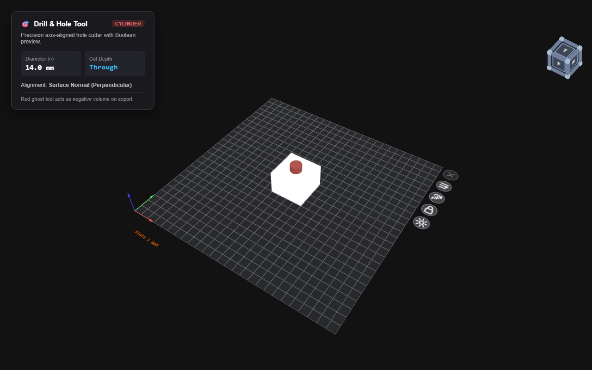

# Matkap Aracı: Eksene Duyarlı Delik Delme ve Yerleştirme

**Matkap Aracı**, 3D modellerinize vida delikleri, kablo kanalları, hizalama pimi yuvaları ve montaj yuvalarını doğrudan editör içinde hızlıca eklemenizi sağlar. Orijinal CAD dosyasını düzenlemek yerine, belirli eksenler boyunca hassas kesici gövdeler yerleştirebilir ve tek tıkla delik açabilirsiniz.

---

## 1. Matkap Aracını Nerede Bulacaksınız

Matkap aracına iki farklı arayüzden erişebilirsiniz:

- **Masaüstü bağlam menüsü:** Tabladaki modele sağ tıklayın ve **Del (Beta)** veya **Drill (Beta)** seçeneğini seçin.
- **Dokunmatik & Mobil yerleşim:** Modeli seçin, editör araç çubuğundaki işlemler sayfasını açın ve **Del (Beta)** seçeneğini seçin.

Bu işlem; hedef seçimi, geometri seçenekleri ve boyut kaydırıcılarını içeren matkap yapılandırma panelini açar.

---

## 2. Hedef, Şekil ve Doğrultu Seçimi

### Hedef seçimi
Projeniz birden fazla parça veya montaj bileşeni içeriyorsa, **Hedef** radyo listesini kullanarak hangi parçaya delik delineceğini seçin. Matkap aracı doğrudan o katı gövdeye bağlanır.

### Kesici şekiller
Deliğin enine kesit şeklini seçin:

- **Silindir** — Vidalar, cıvatalar, pirinç dişli ek parçaları (heat-set insert), pimler ve elektrik kabloları için standart yuvarlak delikler.
- **Kutu** — Mıknatıslar, kayar tırnaklar, konektörler ve montaj braketleri için kare veya dikdörtgen yuvalar.
- **Üçgen** — Yalnızca tek yönde montajı garanti eden prizmatik hizalama yuvaları ve kılavuz pimler.

### Doğrultu modları
Deliğin delineceği ekseni seçin:

- **Yüzey Normali** — Modelin dış kabuğuna yerleştirildiği noktada tam olarak dik deler. Kavisli kabuklar ve açılı yüzeyler için idealdir.
- **Plaka Paralel** — Deliği yatay olarak, baskı tablası yüzeyine tamamen paralel şekilde açar. Model yüzeyinin açısına bakılmaksızın düz kalması gereken yan montaj delikleri ve kablo tünelleri için idealdir.
- **Kameraya Dik** — Deliği mevcut kamera bakış açınız boyunca doğrudan modelin içine deler. Kameranızı delmek istediğiniz yöne çevirin ve deliği yerleştirin.

---

## 3. Delik Boyutu ve Derinlik

Boyutları donanımınıza uyacak şekilde yapılandırın:

- **Çap (1–60 mm):** Matkap ucunun dış çapını veya genişliğini ayarlar.
- **Boydan boya:** Etkinleştirildiğinde, delici takım derinliği gözetmeksizin modelin girişinden çıkışına kadar boydan boya keser.
- **Derinlik (1–60 mm):** **Boydan boya** seçeneği kapatıldığında, kör delikler (vida yuvaları veya gömme başlı vida yuvaları gibi) için durma derinliğini belirler.

---

## 4. Deliciyi Yerleştirme ve Kesimi Uygulama

1. Şeklinizi, doğrultunuzu, çapınızı ve derinliğinizi ayarlayın.
2. **Delici Yerleştir** düğmesine dokunun.
3. Hedef konumda kırmızı renkli bir kesici gövde oluşturulur. Bu kırmızı hacim kesici takımı temsil eder ve asla basılmaz.
4. Ekranda bir onay bildirimi belirir: **"Delici hazır. Boolean ile kesmek ister misiniz?"**.
5. Boolean Fark (Difference) işlemini kullanarak kesimi anında uygulamak için **Boolean ile Kes** düğmesine dokunun.

Araç, hedef katı parçadan boşluğu temiz bir şekilde çıkarır ve modelinizi dilimlemeye hazır hale getirir.

---

## 5. Geri Alma ve Hassasiyet İpuçları

- **Tamamen geri alınabilir:** Delik yanlış yere yerleştiyse veya çapın ayarlanması gerekiyorsa, katı parçayı anında eski haline getirmek için **Geri al** düğmesine (veya **U** / **Ctrl + Z**) basın.
- **3D baskıda delik çekmesi:** FDM yazıcılarda dikey olarak basılan delikler, filamentin termal büzülmesi nedeniyle genellikle nominal CAD boyutlarından 0,1 mm ila 0,3 mm daha dar çıkar. M3 vida veya rulman için delik açıyorsanız, rahat geçme sağlamak için çap kaydırıcısını 0,2 mm artırın.

---

## 6. Sorun Giderme

**Kırmızı delici gövde görünüyor ama parçada delik açılmadı.**
Takımı yerleştirmek kesici hacmi oluşturur; asıl delme işlemi onay bildiriminde **Boolean ile Kes** seçeneğine dokunduğunuzda gerçekleşir. Bildirimi kapattıysanız, araçlar menüsünden **Mesh boolean** penceresini açın, ana modeli Parça A, kırmızı deliciyi Parça B olarak seçin ve Fark (Difference) işlemini uygulayın.

**Delik beklenmeyen bir açıyla delindi.**
**Doğrultu** ayarınızı kontrol edin. **Kameraya Dik** modunu kullandıysanız, kameradaki en ufak eğim delme açısını etkiler. Yüzeye dik delikler için **Yüzey Normali**, düz yatay delikler için **Plaka Paralel** moduna geçin.

**Boolean kesme işlemi başarısız oluyor veya eksik yüzeyler üretiyor.**
Boolean kesme işlemleri kapalı ve su geçirmez (manifold) ağlar gerektirir. Kaynak modelinizde açık kenarlar veya ters dönmüş yüzey normalleri varsa, delme işleminden önce **Modeli onar** veya mesh teşhisini çalıştırın.
