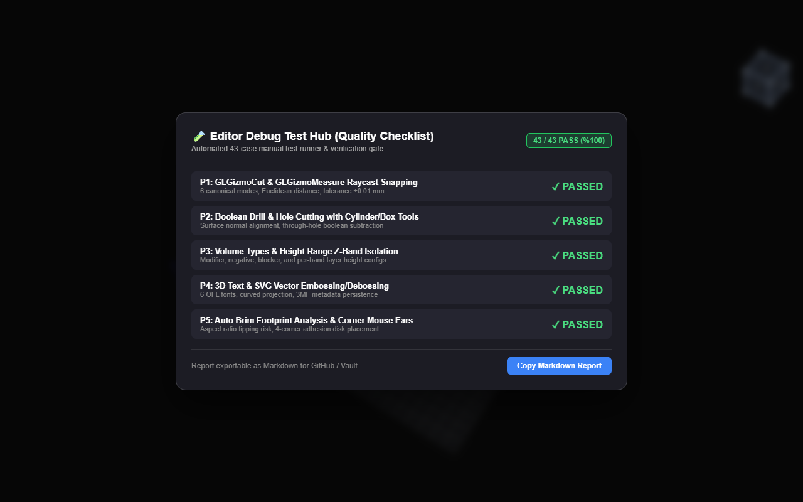

# Editör Hata Ayıklama Test Merkezi (Yalnızca Debug Sürümlerinde)

Editör, içinde yerleşik bir manuel test merkezi ile gelir: bir editör sürümünü onaylamadan önce test edilmesi gereken her şeyin tam ekran kontrol listesi. Elle test yapan ve neyin geçtiğini neyin geçmediğini hızlı ve tekrarlanabilir biçimde kaydetmek isteyenler için tasarlandı.

> [!IMPORTANT]
> Hata ayıklama test merkezi **yalnızca debug (hata ayıklama) sürümlerinde** kullanılabilir. Son kullanıcıya dağıtılan release sürümlerinde görünmez; bu yüzden mağazadan kurulmuş bir kopyada aramayın.

---

## 1. Merkezi Açma

1. Uygulamanın bir **debug sürümünü** çalıştırın.
2. 3D editörü açın.
3. Editör araç çubuğunda **böcek simgesine** tıklayın veya dokunun — ipucu metni **"Editör hata ayıklama test merkezi"** şeklindedir.
4. Merkez tam ekran açılır. Editöre, bıraktığınız yere dönmek için geri eylemiyle kapatın.

Menü girişi ve klavye kısayolu yoktur; tek giriş yolu araç çubuğundaki düğmedir.

---

## 2. İçinde Neler Var?

Merkezde yedi grupta düzenlenmiş **43 manuel test vakası** bulunur:

| Grup | Vaka |
| --- | --- |
| **Dönüştürme (Transform)** | 6 |
| **Görünüm (View)** | 10 |
| **Sahne (Scene)** | 7 |
| **Boyama (Paint)** | 3 |
| **Mesh** | 8 |
| **Dosya / Dışa aktarma** | 6 |
| **Yazıcı** | 3 |

Her vakada aynı bilgiler yer alır:

- **Beklenen sonuç** — doğru davranışın nasıl göründüğü.
- **Adımlar** — sırayla yapılacak kısa işlem dizisi.
- **İlgili kısayollar** — klavye veya araç çubuğu karşılığı; böylece iki yolu da test edebilirsiniz.
- **Durum etiketleri** — **Test edilmedi**, **Geçti**, **Kaldı**, **Engellendi**.
- **İçgüdü notu** — resmî alanların yakalayamadığı her şey için serbest metin alanı.

---

## 3. Başlık, İlerleme ve Sayaçlar

Merkezin üst kısmında tek satırlık bir özet görürsünüz:

> `X / N test edildi · P geçti · F kaldı · B engellendi`

- **X / N test edildi** — durumu *Test edilmedi* dışında olan vaka sayısı.
- **P / F / B** — *Geçti*, *Kaldı* ve *Engellendi* toplamları.

Bu satırın altında, test edilen/toplam oranına dayanan bir ilerleme çubuğu ve yüzde bulunur. Sayaclar bir durumu değiştirdiğiniz anda güncellenir; kaydetme adımı yoktur.

---

## 4. Vakaları İşleme

### Sonuç kaydetme
Her vaka için: beklenen sonucu okuyun, adımları uygulayın, ardından gördüğünüzle eşleşen durum etiketine dokunun. Etiketi değiştirmek önceki durumun üzerine yazar.

Vakayı değerlendiremiyorsanız **Engellendi** kullanın — örneğin yazıcı çevrimdışıysa veya bir bağımlılık yoksa. Engellenen vakalar test edilmiş sayılır ancak geçti olarak sayılmaz.

### Not ekleme
Herhangi bir vakanın altındaki **İçgüdü notu** alanını kullanarak bir sezgiyi, ekran görüntüsü referansını veya yeniden üretme ayrıntısını kaydedin. Notlar siz yazdıkça kaydedilir.

### Bir sonraki test edilmemiş vakaya gitme
**Sonraki test edilmemiş** düğmesine basın. Merkez, hâlâ *Test edilmedi* olan ilk vakaya kaydırır ve işaretlenmiş olanları atlar. Hiçbir şey kalmadığında düğme tüm vakaların bir durumu olduğunu bildirir.

### Gruplar arasında geçiş
Her grup katlanabilir bir bölümdür. Bitirdiğiniz grupları katlayarak listeyi kısaltın, üzerinde çalıştığınız grubu açın.

---

## 5. Üç Eylem Düğmesi

**Sonraki test edilmemiş** — yukarıda açıklandı; görünümü durumu olmayan bir sonraki vakaya taşır.

**Raporu kopyala** — her vakayı grubu, başlığı, durumu ve notuyla içeren bir **markdown tablosunu** panoya kopyalar. Doğrudan bir kayda, bir değişiklik açıklamasına veya bir sohbet mesajına yapıştırın. Bir testçinin sonucunu geliştiriciye aktarmanın en hızlı yolu budur.

**Oturumu sıfırla** — oturumdaki tüm durumları ve tüm notları temizler. Sıfırlama geri alınamadığı için önce bir onay istem gösterilir. Yeni bir sürümde temiz bir tur başlatırken kullanın.

> [!TIP]
> Sıfırlamadan *önce* raporu panoya kopyalayın. Merkezin tuttuğu tek şey oturumdur; bu yüzden sıfırlama önceki turun kanıtlarını siler.

---

## 6. Oturumun Kalıcılığı

İlerlemeniz **yalnızca cihazınızda** saklanır; merkezi kapatabilir, uygulamayı yeniden başlatabilir veya ertesi sabah durumlar ve notlar kaybolmadan devam edebilirsiniz.

- Tek bir oturum tutulur; önceki çalıştırmaların geçmişi yoktur.
- Hiçbir şey yüklenmez — rapor, siz kopyaladığınızda yalnızca panonuzda var olur.
- İlerlemeyi erken temizlemenin tek yolu **Oturumu sıfırla**dır. Uygulamanın yerel verilerini temizlemek de onu kaldırır.

---

## 7. Sorun Giderme

**Böcek düğmesi yok.**
Neredeyse kesinlikle bir release sürümü veya mağazadan kurulmuş bir uygulama çalıştırıyorsunuz. Merkez tasarımı gereği yalnızca debug sürümlerindedir.

**Düğme var ama ilerleme sayıları yanlış görünüyor.**
Bir vaka, *Test edilmedi* dışında herhangi bir durum aldığı anda test edilmiş sayılır. Yanlışlıkla ayarladığınız etiketleri kontrol edin; **Oturumu sıfırla** temiz bir başlangıç verir.

**Raporu kopyala hiçbir şey yapmadı.**
Bazı masaüstü ortamları, uygulama odakta değilken panoya yazmayı sessizce reddeder. Önce merkezin içine tıklayın, sonra düğmeye tekrar basın. Rapor uzunsa merkezi kapatmadan önce yapıştırmanın başarılı olduğunu doğrulayın.

**Bir güncellemeden sonra durumlarım kayboldu.**
Elle yeniden yükleme veya veri sıfırlama sırasında yerel veriler temizlenebilir. Zaten doğruladığınız vakaların durumlarını yeniden girin veya öncesinde önceki turun raporunu kopyalayın.

**Bir vaka benim kurulumuma uymuyor.**
Onu **Engellendi** olarak işaretleyin ve nedenini *İçgüdü notu* alanında açıklayın — etiket ve not alanı tam olarak bunun için var.
