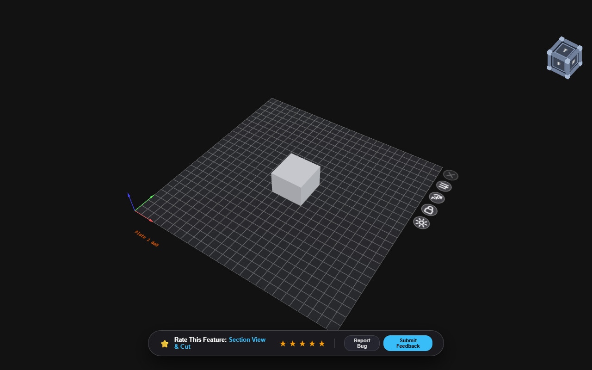

# Editör Özelliklerini Puanlama: "Bu özelliği puanla" çubuğu

3D editör artık tek tek araçlar için uzun forum başlıklarına gerek kalmadan, tam kullandığınız yerde hızlı geri bildirim toplayabiliyor. Birkaç editör panelinin içine, çalıştığınız noktaya küçük bir puanlama çubuğu yerleştirildi; böylece bir özelliği kullandığınız anda puanlayıp işinize devam edebilirsiniz.

Geri bildiriminiz cihazınızdan hiç çıkmaz: hesap yok, yükleme yok, ağ isteği yok.

---

## 1. Nedir?

İki düğmeli kompakt bir çubuk:

- 👍 **Beğendim** — "benim için çalıştı."
- 👎 **Beğenmedim** — "benim için çalışmadı."

Çubuk bilinçli olarak göze batmaz: ait olduğu panelin altında durur, tek satır yüksekliğindedir ve siz bir sorunu açıklamayı seçmedikçe hiçbir pencere açmaz.

---

## 2. Nerede Bulacaksınız?

Puanlama çubuğu 3D editörde tam olarak üç yere yerleştirilmiştir:

| Panel | Çubuğun göründüğü an |
| --- | --- |
| **Destek / dikiş boyama** | Boyama paneli o model için açıldıktan sonra |
| **Kesme / boolean** | Kesme ve boolean araçları panelinin içinde |
| **Mesh teşhis sonuçları** | Bir teşhis çalışması sonuç ürettikten sonra, sonuç listesinin sonunda |

Kasten **hiçbir genel menüde giriş yoktur**. Bir panel çubuğu göstermiyorsa, o özellik henüz puanlama programına dahil değildir.

> [!NOTE]
> Çubuk diğer editör araçlarında (dönüştürme, yerleştirme, görünüm kontrolleri vb.) gösterilmez. Bu beklenen bir durumdur, hata değildir.

---

## 3. Bir Özelliği Puanlama

### 👍 Olumlu puan bırakma
1. Yukarıda listelenen üç panelden birini açın.
2. **Beğendim** düğmesine tıklayın veya dokunun.
3. Ekranın altında kısa bir onay mesajı — *"Geri bildiriminiz için teşekkürler"* — görünür.

Akışın tamamı budur. Puan anında kaydedilir ve çubuk, günün geri kalanında o özellik için etkisiz hale gelir.

### 👎 Bir sorun bildirme
1. **Beğenmedim** düğmesine tıklayın veya dokunun.
2. Çubuk genişleyerek isteğe bağlı bir metin alanı gösterir: **"Ne yanlış gitti?"**.
3. Sorunu kısa bir cümleyle yazın — ne yapıyordunuz ve bunun yerine ne oldu. Bu alan isteğe bağlıdır; hiçbir şey yazmadan da puanı gönderebilirsiniz.
4. Puanı notunuzla birlikte kaydetmek için **Gönder**'i, hiçbir şey kaydetmeden alanı kapatmak için **Vazgeç**'i seçin.

**Gönder** sonrasında da aynı *"Geri bildiriminiz için teşekkürler"* onayı görünür.

---

## 4. Özellik Başına Günde Tek Puan

Üç özelliğin her biri **takvim günü başına bir kez** puanlanabilir. Bir özelliği puanladıktan sonra:

- Çubuk görünür kalır ancak düğmeleri artık bir şey kaydetmez.
- Aynı özelliği tekrar puanlama imkânı, ertesi gün (yerel saatle) açılır.

Bu günlük sınır, geri bildirim sinyalini anlamlı tutar ve tek bir proje üzerinde çalışırken tekrar tekrar istem gösterilmesini önler.

---

## 5. Neyin Nerede Saklandığı

- Puanlar ve notlar **yalnızca cihazınızda**, uygulamanın yerel tercihler alanında saklanır.
- Yalnızca **en yeni 200 kayıt** tutulur. Bu sınıra ulaşıldığında en eski kayıtlar önce silinir.
- Hiçbir şey iletilmez: oturum açma zorunluluğu, telemetri adresi ve arka planda eşitleme yoktur.

Veriler yerel olduğu için uygulamayı kaldırmak veya depoladığı verileri temizlemek, topladığınız geri bildirimleri kalıcı olarak siler.

---

## 6. Sorun Giderme

**Destek boyama panelinde çubuk görünmüyor.**
Önce yüklü bir model için paneli açın; çubuk dosya tarayıcı ekranında değil, panelle birlikte oluşturulur.

**Mesh teşhisini çalıştırdıktan sonra çubuk görünmüyor.**
Çubuk tamamlanmış bir sonuç listesiyle birlikte gösterilir. Teşhisi yeniden çalıştırın; çalışma iptal edilirse veya sonuç üretmezse çubuk gösterilmez.

**Bir başparmağa bastım ama hiçbir şey olmadı.**
Büyük olasılıkla o özelliği bugün zaten puanladınız. Ertesi günü bekleyin veya farklı bir özelliği puanlayın.

**Not yazdım ama kaydedilmedi.**
Notu yalnızca **Gönder** kaydeder. **Vazgeç**'i kullanmak, geri tuşuna basmak veya göndermeden paneli kapatmak notu siler.

**Puanlarımı silmek istiyorum.**
Uygulamanın yerel verilerini temizleyin (veya yeniden yükleyin). Puanlar hiçbir ayar ekranında görünmez ve hiçbir hesapla eşitlenmez.

---

## 7. Neden Önemli?

Tam kullandığınız araca bağlı geri bildirim, genel bir şikâyetten çok daha işe yarardır. Kesme aracına verilen bir "beğenmedim" ve tek satırlık bir açıklama, ekibin hatayı yeniden üretip önceliklendirmesi için yeterlidir — bu yüzden bir panel size yardımcı olduğunda ya da işinizi zorlaştırdığında lütfen kullanın.
