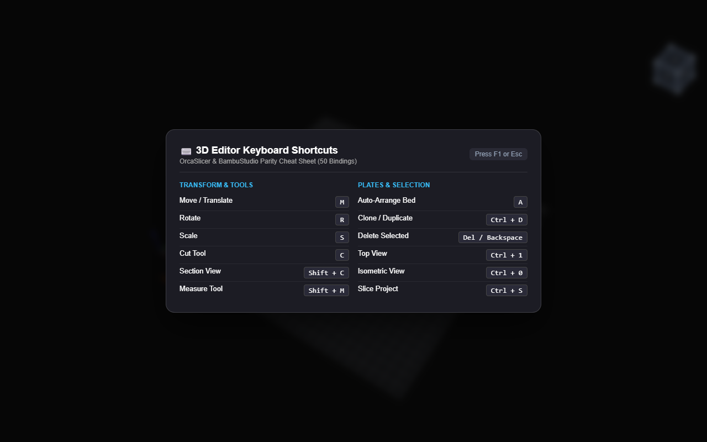

# 3D Editör Klavye Kısayolları (OrcaSlicer Tarzı)

MakerSpell 3D editörü, OrcaSlicer tarzı bir klavye düzeni kullanır; böylece masaüstü bir dilimleyiciden gelen herkes kas hafızasını yeniden öğrenmek zorunda kalmaz. Elli atama beş kategoride gruplanmıştır ve yerleşik kısayol kartı tek tuş uzağınızdadır.

---

## 1. Kısayol Kartını Açma

Editörün herhangi bir yerinde **F1** tuşuna basarak tüm atamaları kategoriye göre gruplanmış şekilde gösteren uygulama içi katmanı açın. Kapatmak için tekrar **F1** veya **Esc** tuşuna basın.

Kısayol kartı editörün kendisi içinde çizilir; bu sayede dokunmatik bir cihazda ya da referans kartı yazdırmanın mümkün olmadığı kilitli bir makinede de çalışır.

---

## 2. Atama Tablosu

### Araçlar ve modlar

| Tuş | Eylem |
| --- | --- |
| **Q** | Seç |
| **M** | Taşı |
| **R** | Döndür |
| **S** | Ölçekle |
| **L** | Yüze yatır |
| **A** | Yerleştir |
| **O** | Otomatik yönlendir |
| **C** | Kes |
| **B** | Destek boyama |
| **P** | Dikiş boyama |

### Görünüm

| Tuş | Eylem |
| --- | --- |
| **F** | Modeli görünüme sığdır |
| **G** | Tabla ızgarasını aç/kapat |
| **T** | Üstten görünüm |
| **1** – **6** | Standart görünümler (ön, arka, sol, sağ, üst, alt) |

### Geçmiş ve düzenleme

| Tuş | Eylem |
| --- | --- |
| **U** veya **Ctrl + Z** | Geri al |
| **Ctrl + Y** veya **Ctrl + Shift + Z** | Yinele |
| **Del** veya **Backspace** | Seçimi sil |
| **Ctrl + A** | Tümünü seç |
| **Ctrl + C** | Kopyala |
| **Ctrl + V** | Yapıştır |
| **Ctrl + D** | Yerinde çoğalt |
| **Esc** | Geçerli işlemi iptal et |

### Dosya ve çıktı

| Tuş | Eylem |
| --- | --- |
| **Ctrl + S** | Projeyi kaydet |
| **Ctrl + E** | G-code dışa aktar |
| **Ctrl + Shift + E** | Modeli dışa aktar |

### İnce kaydırma

| Tuş | Eylem |
| --- | --- |
| **Shift + Yön tuşu** | Seçimi 1 mm kaydır |
| **Ctrl + Yön tuşu** | Seçimi 10 mm kaydır |

Yön tuşları hareket düzlemindeki dört yöndür; tek bir basış seçimi ilgili eksen boyunca hareket ettirir.

---

## 3. Siz Yazarken Kısayollar Asla Çalışmaz

İmleç bir metin alanının içindeyse — proje adı verirken, sayısal bir kutuya değer yazarken, not yazarken — hiçbir kısayol tetiklenmez. Bir ad alanına **Q** harfini yazmak bir "Q" ekler; editörü seçim aracına geçirmez.

Bu aynı zamanda metin düzenlerken **Del** veya **Backspace** tuşlarının modelinizi sileceği endişesini ortadan kaldırır: bir alanın içinde bu tuşlar yalnızca metni düzenler.

Kısayolu tekrar kullanmadan önce alanın dışına tıklayın veya **Esc** ile alandan çıkın.

---

## 4. Tarayıcı Tuşları Asla Yakalanmaz

Editör gömülü bir web görünümü içinde çalışır, ancak tarayıcının ve işletim sisteminin yolundan bilinçli olarak çekilir. Aşağıdakiler editör tarafından **asla** yakalanmaz:

- **Ctrl + W** — sekmeyi veya pencereyi kapat
- **Ctrl + T** — yeni sekme
- **Ctrl + N** — yeni pencere
- **Ctrl + R** — yenile
- **F5** — yenile
- **F12** — geliştirici araçları

Editör, sahip olduğu iki kombinasyon (**Ctrl + Shift + Z** ile yineleme, **Ctrl + Shift + E** ile model dışa aktarma) dışında **Ctrl + Shift** kombinasyonlarına da dokunmaz. Bir tarayıcı tuşu yukarıdaki tablonun söylediğini yapmıyorsa, onu yutan editör değildir.

---

## 5. Kaydet ve Dışa Aktar: Bugün Ne Oluyor?

**Ctrl + S** (projeyi kaydet) ve **Ctrl + E** (G-code dışa aktar), işlemi kendileri yapmak yerine editörden ana uygulamaya bir sinyal gönderir. Kaydetme ve G-code dışa aktarma **gömülü editör görünümünün içinde henüz bağlanmamıştır**.

Bunun pratikte anlamı:

- **Ctrl + S** veya **Ctrl + E** tuşlarına basmak güvenlidir — hiçbir şey kaybolmaz ve yarım bir dosya yazılmaz.
- Hiçbir şey olmuyor gibi görünüyorsa bu mevcut sürümde beklenen bir durumdur; şimdilik ana uygulamanın kendi **Kaydet** ve **Dışa aktar** kontrollerini kullanın.
- **Ctrl + Shift + E** (modeli dışa aktar) tabloda yazdığı gibi editörden çalışır.

> [!NOTE]
> Kaydetme ve G-code dışa aktarma bağlandığında, aynı iki kısayol düzende hiçbir değişiklik olmadan bunları çalıştıracaktır.

---

## 6. Sorun Giderme

**Bir kısayol hiçbir şey yapmıyor.**
Hiçbir metin alanının odakta olmadığını ve o tuşu kullanan panelin açık olduğunu kontrol edin. Örneğin destek boyama için **B**, tablada bir model gerektirir; görünüm tuşları için görünüm alanının odakta olması gerekir.

**Esc, işlemi iptal etmek yerine bir paneli kapattı.**
Esc önce ekrandaki en son şeyi — bir katman, bir alan veya bir panel — kapatır, sonra işlemi iptal eder. Tekrar basın.

**F1, editörün değil tarayıcının yardımını açtı.**
Bazı tarayıcılar F1 tuşunu pencere düzeyinde sahiplenir. Önce 3D görünüm alanının içine tıklayarak editörün odaklanmasını sağlayın, sonra F1'e basın. Tarayıcı tuşu yine de sahiplenirse kısayol kartı gösterilemez; bunun yerine bu sayfayı kullanın.

**Yön tuşuyla kaydırma çok fazla (veya çok az) gidiyor.**
Yalın yön tuşları kaydırma yapmaz. **Shift + Yön** 1 mm, **Ctrl + Yön** 10 mm'dir; değiştirici tuşun basış boyunca basılı olduğundan emin olun.

**Ctrl + D modeli kopyaladı ama orijinalin üstüne yerleştirdi.**
"Yerinde çoğalt" tasarım gereği bunu yapar. Ardından kopyayı kaydırmak için **M** (taşı) veya hassas 1 mm kaydırma için **Shift + Yön** kullanın.
