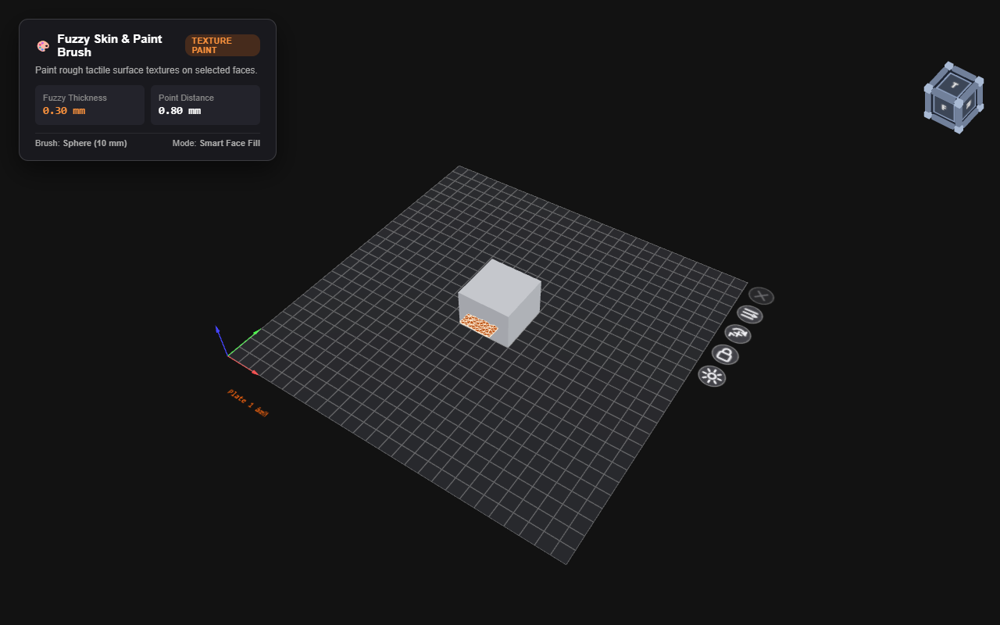

# Fuzzy Skin Boyama: Yüzeye Pürüzlü Doku Ekleme

**Fuzzy skin**, bir baskının dış duvarlarına pürüzlü, tanecikli bir doku ekler. Yazıcı duvarı izlerken küçük ve rastgele bir salınım yapar; böylece biten yüzey pürüzsüz bir ekstrüzyon yerine ince zımpara kâğıdı gibi görünür ve hissedilir.

Bu **fiziksel bir değişikliktir, önizleme efekti değildir**. Nozul gerçekten farklı hareket eder: yol, baskı süresi ve parçanın yüzeyi değişir. Salınım rastgele olduğu için iki parça asla birbirinin aynısı olmaz.

Modelin tamamını pürüzlü yapmak zorunda değilsiniz. İstediğiniz yüzeyleri boyarsınız ve yalnızca o bölgeler etkilenir — bu sayede fuzzy skin tutuş yüzeyleri için, görünen bir yüzde katman izlerini gizlemek için veya kritik yüzleri pürüzsüz bırakarak baskıya mat, taş görünümlü bir yüzey vermek için kullanışlıdır.

---

## 1. Fuzzy Skin Boyamayı Açma

1. Bir model yükleyin ve 3D editörü açın.
2. Editör ızgarasını — seçili model için düzenleme eylemlerini listeleyen paneli — açın.
3. **Fuzzy skin** seçeneğini seçin. Diğer boyama eylemlerinin yanında durur: renk, destek ve dikiş.
4. **Fuzzy skin** boyama paneli görünüm alanının üzerinde açılır.

Hiçbir model seçili değilse uygulama önce bir model seçmenizi söyler — boyama her zaman belirli bir modele aittir, bu yüzden aracı açmadan önce modeli tablada seçin.

> [!NOTE]
> Boyama eylemleri yalnızca tablada bir model olduğunda görünür. **Fuzzy skin** listede hiç yoksa, kullanılan dilimleme motoru fuzzy skin desteği bildirmiyordur; eylem, dilimleyemeyeceği bir aracı açmak yerine gizli kalır.

---

## 2. Boyama Kontrolleri

Panel, renk, destek ve dikiş boyayıcılarıyla aynı tarzda bir araç çubuğudur; yani kontroller zaten alıştığınız gibi davranır.

### Kalem boyutu
**Kalem boyutu** denetimi tek bir vuruşun ne kadar geniş olacağını belirler. Geniş alanları hızla kaplamak için artırın; dar şeritler ve bir kenar boyunca küçük ayrıntılar için azaltın.

### Fırça şekli
**Fırça şekli** üç seçenek sunar:

- **Daire** — ekran düzleminde dokunduğu her şeyi boyayan yassı bir disk. Doğrudan karşıdan görünen bir yüzü boyamak için en iyisi.
- **Küre** — imlecin arkasındaki yüzeyi, bir kavisin çevresini de yakalayan bir küre. Köşeleri ve silindirik parçaları sarmak için en iyisi.
- **Üçgen** — imlecin altındaki tek tek yüzeyleri izleyen küçük ve hassas bir fırça. Bir sınırı düzeltmek veya komşularına taşmadan tek bir düz yüzeye dokunmak için en iyisi.

### Fırça ve Akıllı doldurma
- **Fırça** yalnızca üzerinden sürüklediğinizi boyar. Basit ve öngörülebilir.
- **Akıllı doldurma** tıkladığınız noktadan dışarıya doğru yayılır ve doğal bir sınırda durur — bir kenar, keskin bir omuz veya zaten boyadığınız bölgenin sınırı. Bir panelin tamamını ileri geri ovalamak yerine tek tıklamayla kaplamak için kullanın.

### Ekle, Kaldır ve Tüm fuzzy skin boyamayı sil
- **Ekle** modele fuzzy skin boyar. Normal mod budur.
- **Kaldır** aynı fırçayı kullanarak boyamayı geri alır. Sıfırdan başlamak yerine taşan bir kenarı düzeltmek için kullanın.
- **Tüm fuzzy skin boyamayı sil** tüm modeli tek işlemde temizler. Yalnızca fuzzy skin boyamayı etkiler; renk, destek veya dikiş çalışmanıza dokunmaz.

Her vuruş ve her temizleme adımı **Geri al** ile (veya editörde **U** / **Ctrl + Z**) geri alınabilir, bu yüzden yanlışlıkla yapılan bir sürükleme kolayca düzeltilir.

### Kesit görünümü
**Kesit görünümü** modeli bir düzlemle kesip içini görmenizi ve boyamanızı sağlar. Ulaşmanız gereken yüzey içe bakıyorsa — bir boşluk, bir delik veya içi boş bir kabuğun arka yüzü — bunu açıp normal şekilde boyayın. Normal görünüme dönmek için kapatın.

Kesit görünümü **yalnızca bir görüntüleme yardımcısıdır**. Modeli kesmez ve baskı üzerinde hiçbir etkisi yoktur.

### Yalnızca çıkıntılar ve Çıkıntı eşiği
**Yalnızca çıkıntılar** boyamayı yalnızca çıkıntılı yüzeylerle sınırlar; böylece düz bir üst yüzey veya dikey bir duvar üzerinden geçen bir vuruş hiçbir şey yapmaz. Bu bilinçlidir: bir filtredir ve çıkıntı olmayan her şeyi reddeder.

**Çıkıntı eşiği** bir yüzeyin çıkıntı sayılmadan önce ne kadar dik olması gerektiğini belirler. Daha fazla eğimli yüzey dahil etmek için düşürün; yalnızca neredeyse yatay çıkıntıları kabul etmek için yükseltin.

> [!TIP]
> Bir vuruş hiçbir şey yapmıyor gibi görünüyorsa neden neredeyse her zaman **Yalnızca çıkıntılar**dır. Ya gerçekten çıkıntılı bir yüzeye geçin ya da onu kapatın. Bir vuruşun reddedilmesi hata değildir — hiçbir boyama kaydedilmez ve başka hiçbir şey değişmez.

---

## 3. Önemli Olan İki Ayar

Boyama, dokunun *nereye* gideceğini söyler; iki dilimleyici ayarı ise *ne kadar pürüzlü* görüneceğine karar verir. İkisi de süreç ayarlarında, fuzzy skin grubunda yer alır ve milimetre değerleri kabul eder.

### Fuzzy skin thickness
Duvarın orijinal yolundan ne kadar uzaklaşabileceğini milimetre cinsinden belirler. Ana "ne kadar pürüzlü" ayarıdır:

- **Küçük değerler** (yaklaşık 0,1–0,2 mm) ince, kumlanmış bir his verir ve baskı süresini neredeyse hiç değiştirmez.
- **Daha büyük değerler** daha kaba ve belirgin bir tanecik üretir, ancak salınım dışarıya da taşar; bu da daha fazla yol ve daha uzun baskı demektir.

Bunu **dış duvar çizgi genişliğinin altında** tutun. Salınım duvarın kendisinden genişse duvar bunu ememez ve dilimleme ya başarısız olur ya da amaçlandığı gibi bir arada durmayan bir duvar ortaya çıkar.

### Fuzzy skin point distance
Duvar boyunca ne sıklıkla yeni bir salınım noktası yerleştirileceğini milimetre cinsinden belirler. Küçük değerler noktaları daha sık ekler:

- **Daha küçük** (örneğin 0,3–0,5 mm) ince ve yoğun bir doku verir.
- **Daha büyük** noktaları seyreltir; daha az yön değişimi ve daha az ek yol ile daha kaba bir tanecik oluşur.

### Yoksayılan değerler
Motor, anlam ifade etmeyecek kadar küçük değerleri reddeder. Kalınlık için yaklaşık **0,001 mm** altındaki, nokta mesafesi için yaklaşık **0,01 mm** altındaki değerler uygulanmak yerine atılır.

Bu, bir değeri elle yazarken önemlidir: **0** girmek "doku yok" gibi görünür, ancak motor bunu yalnızca yoksayar ve zaten yürürlükte olan ayarı korur. Sıfır girip hiçbir değişiklik görmezseniz olan budur — bunun yerine küçük ama gerçek bir değer girin.

> [!IMPORTANT]
> Bu ayarları değiştirmek yeni bir dilimleme başlatır. Tek başına boyama, yeniden dilimleyene kadar mevcut G-code'u değiştirmez.

---

## 4. Boyamanın Nerede Saklandığı

Boyalı fuzzy skin, **modelle birlikte, kaydedilen 3MF proje dosyasının içinde**, yüzey başına bir not olarak saklanır. Bu yüzden tüm turu atlatır: boyayın, projeyi kaydedin, uygulamayı kapatın, projeyi yeniden açın — boyalı alanlar hâlâ orada, aynı yüzeylere bağlı durur.

Bu, nesnenin tamamına uygulanan fuzzy skin'den ayrıdır. Nesnenin tamamına fuzzy skin, normal bir dilimleme ayarıdır (OrcaSlicer terimleriyle nesne veya süreç düzeyindeki seçenek *all* değerine getirilir) ve hiç boyama yapmadan tüm modeli pürüzlü yapar. İkisi çatışmaz ve bir arada bulunabilir: nesnenin tamamına fuzzy skin her yeri dokulandırırken boyalı yüzeyleriniz işaretli kalır ve kendi davranışlarını korur.

---

## 5. Sınırlar, Dürüstçe

- **Yalnızca duvarlar.** Fuzzy skin duvarlara uygulanır. Dolgu ve üst yüzeyler etkilenmez; yani yanlar dokulandırılmış olsa bile dolu bir üst yüzey pürüzsüz kalır.
- **Ölçüler değişmez.** Salınım bir yüzey işlemidir. Bir parçayı büyütmenin yolu değildir ve bitmiş bir baskıyı ölçerken boyalı kalınlığın ölçü artışı olarak görünmesini beklememelisiniz.
- **Kesit görünümü bir görüntüleme yardımcısıdır.** Görünümü kesip açmak gizli yüzeyleri boyamanıza yardım eder; geometriyi değiştirmez ve baskıda iz bırakmaz.
- **Doğası gereği rastgele.** Aynı projenin iki baskısı birebir aynı taneciğe sahip olmaz ve yeniden dilimleme biraz farklı bir desen üretebilir. Etkiyi tam beklenen bir yüzeyle değil, ayarlarla değerlendirin.
- **Daha uzun baskılar.** Ek salınım ek yol demektir. Kaba kalınlıkla büyük bir fuzzy alan baskı süresini belirgin biçimde artırır; büyük bir baskıya girişmeden önce küçük bir test baskısında doğrulayın.

---

## 6. Sorun Giderme

**Editör ızgarasında Fuzzy skin eylemi yok.**
Kullanılan dilimleme motoru fuzzy skin desteği bildirmiyordur, bu yüzden eylem gizlidir. Uygulamayı güncelleyin veya fuzzy skin destekleyen bir dilimleyici profiline geçin.

**Bir vuruş hiçbir şey yapmıyor.**
Büyük olasılıkla **Yalnızca çıkıntılar** açık ve imlecin altındaki yüzey çıkıntı değil. Kapatın ya da gerçekten çıkıntı yapan bir yüzeyi boyayın. Ayrıca henüz hiçbir şey boyanmamışken **Kaldır** etkin olabilir.

**Bir bölgeyi boyadım ama baskı pürüzsüz çıktı.**
**Fuzzy skin thickness** ve **Fuzzy skin point distance** değerlerini kontrol edin: motorun alt sınırının altındaki bir değer yoksayılır ve **0** yazmak sessizce önceki değeri korur. Ardından yeniden dilimleyin — boyama tek başına G-code'u yeniden üretmez.

**Boyama dokunmadığım yüzeylere bulaşıyor gibi.**
Yüzeye hassas bir vuruş için fırçayı **Üçgen**e geçirin veya **Kalem boyutu**nu azaltın. **Daire** ve **Küre** fırçaları bilinçli olarak üzerinden geçtikleri her şeyi yakalar.

**Parçanın içine ulaşamıyorum.**
**Kesit görünümü**nü açarak modeli bir düzlemle açın, ardından iç yüzeyleri boyayın.

**Geri al, boyadığım alanın tamamını kaldırmadı.**
Her sürükleme tek bir geri alma adımıdır ve **Tüm fuzzy skin boyamayı sil** de tek adımdır. Tekrar geri alın veya **Tüm fuzzy skin boyamayı sil**i kullanıp yeniden boyayın.

**Boyalı alanlarım projeyi yeniden açtığımda kayboldu.**
Projeyi 3MF dosyası olarak kaydedin. Not proje dosyasının içinde taşınır; hiç kaydedilmemiş boyama modeli kapattığınızda kaybolur.
