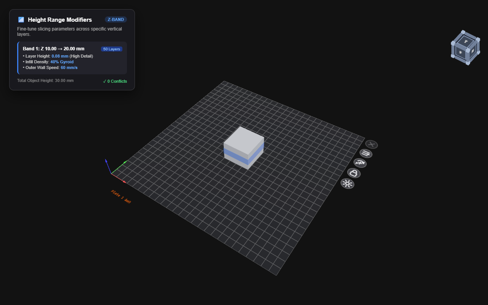

# Yükseklik Aralığı: Bir Z Bandına Ayar Uygulama

**Yükseklik aralığı**, bu nesneye kendi dilimleyici ayarlarını uygulayan bir Z bandıdır. Tüm modeli farklı ayarlarla yeniden dilimlemek yerine "şu yükseklikten şu yüksekliğe kadar farklı davran" dersiniz ve baskının yalnızca o dilimi değişir.

Bunu nesnenin üzerine yerleştirilmiş yatay bir katman aralığı gibi düşünün: bandın altındaki ve üstündeki model normal ayarları korur, bandın içindeki her şey ise ona bağladığınız ayarları kullanır.

Birkaç pratik kullanım:

- Uzun bir parçanın yalnızca üst yarısında daha yoğun dolgu; alt yarısı dekoratifken dayanımın önemli olduğu yerde.
- Vida alan orta bir bantta daha fazla duvar.
- Detaylı bir bölüm için farklı katman yüksekliği, modelin geri kalanı hızlı basılırken.

---

## 1. Yükseklik Aralığını Nerede Bulacaksınız

Kullandığınız editör yüzeyine göre iki giriş yolu vardır:

- **Editör ızgarası (dokunmatik yerleşim):** nesneyi seçin ve editör ızgarasında **Volume (Beta)**'yı açın; **Yükseklik aralığı** bölümü o panelde hacim türü listesinin altında yer alır.
- **Bağlam menüsü (masaüstü):** nesneye sağ tıklayın ve **Yükseklik aralığı değiştiricisi** seçeneğini seçin.

Henüz aralık yoksa bölüm **"Henüz yükseklik aralığı eklenmedi."** yazar — bu boş durumdur, hata değildir.

> [!NOTE]
> Yükseklik aralıkları **nesneye** aittir, içindeki tek bir hacme değil. Bir bant, o yükseklikte nesnenin tüm kesitini kaplar; nesne hangi hacimlerden oluşursa oluşsun. Tek bir hacimle sınırlı bir bölge gerekiyorsa bunun için **Değiştirici** vardır.

---

## 2. Aralık Ekleme

1. **Aralık ekle** düğmesine basın.
2. İki alan görünür: **Min Z** ve **Maks Z**; ikisi de tabla yüzeyinden ölçülen **mm** cinsindendir.
3. Alt sınırı **Min Z** alanına, üst sınırı **Maks Z** alanına yazın. Min Z bandın başladığı, Maks Z bittiği yerdir.
4. Onaylayın. Ekranın altında **"Yükseklik aralığı eklendi."** görünür ve aralık panelde listelenir.

Her sayı tablanın üzerindeki yüksekliktir — kalınlık değil. 10'dan 20'ye bir bant on milimetre derindir; ama 10'dan 11'e bir bant bir milimetre derindir; ikisi de on milimetre yukarıda başlar.

### Banda ayar bağlama
Bandın kendisi yalnızca *nerede* olduğunu söyler. İçinde geçerli olan ayarlar, nesnenin katman-aralığı ayarlarıdır — dilimleyicinin o bant için sakladığı aralık başına yapılandırmanın aynısı. Aralık oluştuktan sonra o bant için istediğiniz değerleri (dolgu, duvarlar, katman yüksekliği vb.) nesnenin o aralığa ait ayarlarından belirleyin; bant adres, ayarlar içeriktir.

Ayar bağlanmamış bir bant hiçbir şeyi değiştirmez, tıpkı boş bir değiştirici gibi.

---

## 3. Bir Aralığın Uyması Gereken Kurallar

Onayladığınızda dört kontrol çalışır ve herhangi biri girdiyi doğrudan reddeder:

| Gördüğünüz | Anlamı |
| --- | --- |
| **"Her iki Z değeri için bir sayı girin."** | İki alandan biri boş ya da sayı olmayan bir şey içeriyor. |
| **"Min Z, Maks Z değerinden küçük olmalı."** | Sınırlar ters veya eşit. Küçük değer her zaman Min Z'ye yazılır. |
| **"Min Z tabla yüzeyinin altında olamaz."** | Bant tablanın altında başlayacak. Min Z sıfır veya üzeri olmalı. |
| **"Maks Z bu nesnenin üst sınırını aşıyor."** | Bant modelin üstünde bitecek. Maks Z'yi nesnenin üst yüksekliğine ya da altına indirin. |

> [!IMPORTANT]
> Reddedilen bir bant **sessizce düzeltilmez**. Uygulama 0 → 999 girişinizi nesnenin gerçek yüksekliğine kırpmaz ve ters sınırları sizin yerinize değiştirmez. Hiçbir şey eklenmez ve mesaj hangi kuralın başarısız olduğunu söyler, böylece düzeltebilirsiniz. Bu bilinçlidir: kabul edilmiş gibi görünen kırpılmış bir bant, istediğinizden farklı dilimlenir ve bunu fark etmenin bir yolu olmazdı.

Aralıklar çakıştığında beşinci bir kontrol devreye girer:

> **"Bu aralık zaten eklenmiş bir aralıkla çakışıyor."**

İki bant aynı Z aralığını paylaşamaz, çünkü dilimleyicinin aynı katmanlar için iki çelişkili cevabı olurdu. Sınırları çakışmadan birleşecek şekilde ayarlayın veya önce mevcut aralığı kaldırın.

---

## 4. Aralıkları Yönetme

- **Görüntüleme** — eklenen her aralık, sınırlarıyla birlikte panelde listelenir; nesnenin nasıl bölündüğünü bir bakışta görürsünüz.
- **Kaldırma** — **Aralığı kaldır** bir bandı siler. **"Yükseklik aralığı kaldırıldı."** bunu doğrular ve o katmanlar nesnenin normal ayarlarına döner.
- **Sıra** — aralıklar birbirinden bağımsızdır; birini eklemek diğerlerini kaydırmaz ve çalışmaları için yükseklik sırasına dizilmeleri gerekmez.

Bir bandı kaldırmak, onun için yapılandırdığınız ayarları silmez — ayarların uygulandığı *yeri* kaldırır.

---

## 5. Kaydetme Hakkında Dürüst Bir Not

Şimdilik yükseklik aralıkları **yalnızca geçerli oturumda** yaşar. Dışa aktarma tarafı hâlâ tamamlanmadığı için henüz kaydedilen 3MF proje dosyasına yazılmazlar.

Bunun pratikteki anlamı:

- Bantlarınızı ekleyin, dilimleyin ve basın — o oturum boyunca her şey doğru davranır.
- Projeyi kaydedip sonra yeniden açın; aralıklar gitmiş olur. Yeniden dilimlemeden önce tekrar ekleyin.
- Hiçbir şey bozulmaz ve başka bir proje verisi etkilenmez; yalnızca bantların yeniden girilmesi gerekir.

Bir bant baskıyı ciddi biçimde değiştirebildiği için, eski bir projeye döndüğünüzde bunları yeniden eklemeyi rutinin parçası sayın — tıpkı bir değiştiricinin konumunu yeniden kontrol edeceğiniz gibi.

---

## 6. Sorun Giderme

**Yükseklik aralığı bölümü yok.**
Bir nesne seçiliyken editör ızgarasından **Volume (Beta)**'yı açın. Bölüm o panelin içinde, hacim türü listesinin altında yaşar ve panelin kendisi bir Beta yeteneğidir; uygulama güncellemesi gerekebilir.

**Maks Z doğru göründüğü hâlde reddediliyor.**
Maks Z tabladan ölçülür, nesnenin kendi tabanından değil. Nesne yükseltilmiş veya yukarı taşınmışsa nesnenin üstü beklediğinizden yüksek olabilir — ya da model sanıldığından kısaysa daha alçak.

**Bandın tüm nesneyi kaplamasını istiyorum.**
Min Z için 0, Maks Z için nesnenin tam yüksekliğini kullanın. Maks Z reddedilirse nesnenin üstünü geçmişsinizdir.

**İki aralık yan yana oturmuyor.**
Çakışıyorlar, bir milimetrenin çok küçük bir kısmı kadar bile olsa — genellikle ilk bandın Maks Z'si ile ikincinin Min Z'si farklı yuvarlanıp eşitlendiği için. Küçük bir boşluk bırakın veya tek banda birleştirin.

**Bir değer yazdım, hiçbir şey eklenmedi ama mesaj da görünmedi.**
Paneli kaydırın; doğrulama mesajları en altta, düğmenin altında görünür. Mesaj görünüyorsa aynı sayıları tekrar denemek yerine 3. bölümdeki listeye göre okuyun.

**Projeyi yeniden açtıktan sonra aralıklarım kayboldu.**
Şimdilik beklenen durum — 5. bölüme bakın. Yeni oturumda bantları tekrar ekleyin.

**Bant ekledikten sonra baskı değişmedi.**
Bandın ayar taşıdığını ve ardından yeniden dilimlediğinizi kontrol edin. Ayarı olmayan bant hiçbir şey yapmaz ve yapılandırmayı G-code'a çeviren şey dilimlemedir.
