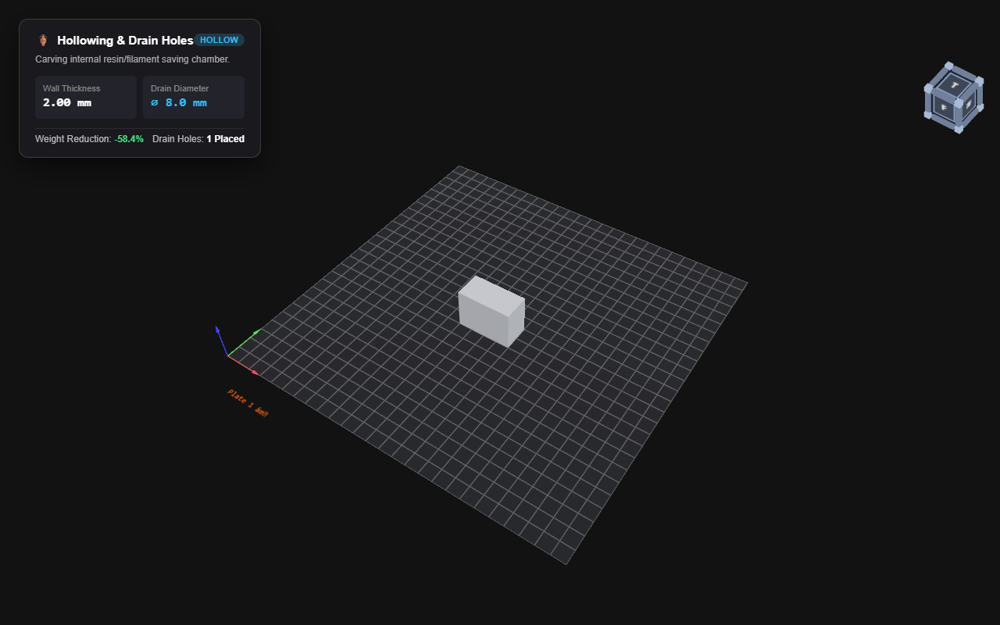

# Model İçi Boşaltma ve Tahliye Delikleri: Malzeme ve Ağırlık Tasarrufu

**Model İçi Boşaltma (Hollowing)**, dolu 3D modellerin içine bir iç boşluk açarak katı gövdeleri homojen duvar kalınlığına sahip içi boş kabuklara dönüştürür. İster FDM ister reçineli (SLA/DLP) yazıcı kullanın, modelin içini boşaltmak önemli avantajlar sağlar:

- **Malzeme tasarrufu:** Filament veya reçine tüketimini %30 ila %70 oranında azaltabilir.
- **Daha kısa baskı süreleri:** Katman başına daha az malzeme basılması veya kürlenmesi baskı süresini doğrudan kısaltır.
- **Daha hafif parçalar:** Figürler, mimari maketler ve dekoratif süs eşyaları için hafif parçalar üretir.
- **Termal gerilim azalması:** FDM baskılarda ince duvarlar çok daha düşük iç gerilimle soğur; bu da büyük baskılarda tabladan kalkma (warping) sorununu en aza indirir.

---

## 1. Boşaltma Aracını Nerede Bulacaksınız

1. Tabladaki hedef modelinizi seçin.
2. Aracı iki arayüzden biriyle açın:
   - **Masaüstü bağlam menüsü:** Nesneye sağ tıklayın ve **Basitleştir ve boşalt** seçeneğini seçin.
   - **Dokunmatik & Mobil yerleşim:** Nesne işlemleri sayfasını açın ve **Hollow model (Beta)** seçeneğini seçin.
3. Etkileşimli kaydırıcı denetimlerine sahip boşaltma paneli açılır.

---

## 2. Üç Boşaltma Parametresi

Duvar geometrisini üç temel parametreyle yapılandırın:

### Minimum duvar kalınlığı (0,8–8,0 mm)
Basılacak kabuğun fiziksel et kalınlığını belirler.
- **FDM için:** Dilimleyicinin sağlam ve kesintisiz çevre duvarları oluşturması için bunu nozul çizgi genişliğinizin katlarına (örneğin 0,4 mm nozul için 1,6 mm veya 2,0 mm) ayarlayın.
- **Reçine için:** 1,5 mm ila 2,5 mm arasındaki bir duvar kalınlığı yapısal rijitlik ile reçine tasarrufu arasındaki ideal dengeyi sağlar.

### Kalite (%0–%100)
İç boşluğun poligon çözünürlüğünü belirler. Yüksek kalite karmaşık dış hatlara daha sıkı uyum sağlarken, düşük kalite daha pürüzsüz ve hesaplama açısından daha hızlı bir iç kabuk oluşturur. Çoğu baskı için varsayılan %50 değeri önerilir.

### Kapatma mesafesi (0,0–3,0 mm)
Dar iç boşlukları birleştirir ve aksi takdirde basılamaz mikro özellikler oluşturacak veya malzeme hapsedecek mikroskobik iç yarıkları kapatır. Kapatma mesafesini artırmak, dar köşelerdeki sıkışma noktalarını pürüzsüzleştirir.

İç boşluğu oluşturmak için **Apply hollowing** (Boşaltmayı uygula) düğmesine dokunun.

---

## 3. Otomatik Ağ Basitleştirme Koruması

Yüzbinlerce üçgenden oluşan yüksek detaylı modellerde iç ofset hesaplamak önemli işlemci gücü ve bellek gerektirir.

Modeliniz aşırı karmaşıksa uygulama akıllı bir güvenlik uyarısı gösterir:

> **"Model basitleştirilip hollow uygulansın mı?"**  
> *"Bu model cihaz üzerinde güvenilir hollow işlemi için fazla karmaşık. Model önce basitleştirilecek, ardından hollow işlemi otomatik olarak uygulanacak. İşlemin tamamını geri alabilirsiniz."*

**Basitleştir ve hollow uygula** seçeneğini seçmek, görsel dış ayrıntıları korurken önce üçgen sayısını optimize eder, ardından çökmeye veya donmaya yol açmadan boşaltma işlemini temiz bir şekilde tamamlar.

---

## 4. Tahliye Delikleri Neden Hayatidir

Bir modelin içini boşalttığınızda kapalı bir hazne oluşturursunuz. 3D baskıda tamamen mühürlü bir hazne iki ciddi soruna yol açar:

1. **Vakumlama / Vantuz etkisi (Reçine / SLA):** Baskı tablası her katmanda yükselirken, kapalı bir boşluk kauçuk pompa gibi davranarak büyük bir negatif basınç oluşturur. Bu durum genellikle parçayı desteklerden koparır veya katman hatlarını yarar.
2. **Hapsolan malzeme:** Reçineli baskılarda sıvı reçine içeride hapsolur. Günler veya haftalar içinde kürlenmemiş reçine gaz çıkarır, genleşir ve basılan parçayı kaçınılmaz olarak içeriden çatlatıp patlatır. SLS baskılarda ise sinterlenmemiş toz kalıcı olarak içeride kalır.

### Tahliye delikleri yerleştirme
Boşaltma işlemini daima tahliye delikleriyle birlikte uygulayın:
1. Boşaltma tamamlandıktan sonra **Del (Beta)** / **Drill (Beta)** aracını açın.
2. **Silindir** şeklini seçin ve 2,0 mm ila 4,0 mm arasında bir çap belirleyin.
3. Görünmeyen veya taban gibi kritik olmayan alanlara en az iki delik yerleştirin. İki delik önerilir: biri reçinenin veya tozun dışarı akması için, diğeri içeri hava girerek vakum kilitlenmesini önlemek için.
4. Dış duvardan iç boşluğa tahliye deliklerini açmak için **Boolean ile Kes** düğmesine dokunun.

---

## 5. Ağ Bütünlüğü ve Geri Alınabilirlik

- **Su geçirmezlik şartı:** Boşaltma işlemi kapalı ve su geçirmez (manifold) bir ağ gerektirir. Modelinizde açık delikler, eksik yüzeyler veya kendiyle kesişen sınırlar varsa işlem sizi uyarır: *"Model güvenli içi boşaltma için yeterince kapalı değil. Önce modeli onarın."* Boşaltma yapmadan önce dış kabuğu mühürlemek için model onarım aracını veya teşhisleri çalıştırın.
- **Tamamen geri alınabilir:** Boşaltma ve basitleştirme dizisi tamamen tahribatsızdır. Dolu orijinal modele dönmek veya farklı bir duvar kalınlığı denemek isterseniz, orijinal ağı anında geri yüklemek için **Geri al** düğmesini (veya **U** / **Ctrl + Z**) kullanın.

---

## 6. Sorun Giderme

**Boşaltma işlemi "ağ çok karmaşık" mesajıyla başarısız oluyor.**
Sunulduğunda **Basitleştir ve hollow uygula** uyarısını kabul edin. Kapattıysanız, basitleştirme aracını manuel olarak açın, üçgen sayısını %30 ila %50 azaltın ve boşaltmayı tekrar çalıştırın.

**Baskı yapıldıktan haftalar sonra çatladı.**
Bu, içeride hapsolan sıvı reçinenin klasik sonucudur. İçi boşaltılmış her reçine baskısına en az iki tahliye deliği yerleştirdiğinizden ve son UV kürleme işleminden önce iç boşluğu izopropil alkol (IPA) ile iyice çalkaladığınızdan emin olun.

**İç kısımlarda garip, yüzen malzeme parçaları oluşuyor.**
Modelin çok dar uzantıları veya ince kolları varsa iç ofset küçük kopuk boşluklar oluşturabilir. **Kapatma mesafesi** kaydırıcısını artırın (örneğin 1,5 mm veya 2,0 mm); böylece algoritma bu dar bölgeleri içi boş boşluklar yerine katı malzeme olarak birleştirir.

**Boşaltma sonrasında dış yüzeyde küçük kusurlar görünüyor.**
**Minimum duvar kalınlığı** modelin geometrisi için fazla ince ayarlanmış olabilir. Dış kabuğun yeterli desteğe sahip olmasını sağlamak için kalınlık kaydırıcısını en az 1,5 mm'ye yükseltin.
