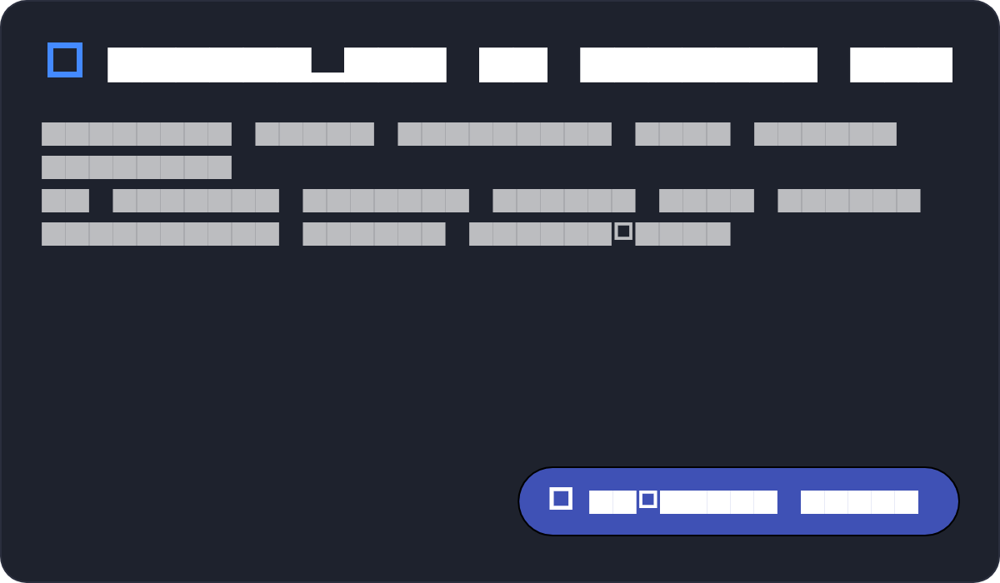

# 📸 Yapay Zeka Ajanları İçin Otomatik Ekran Görüntüsü Alma Rehberi (Screenshot Pipeline)

> **TÜM AI AJANLARI İÇİN STANDART PROSEDÜR:**  
> Kullanıcı dokümantasyonunu zenginleştirmek için geliştirdiğiniz ekranların ekran görüntülerini almak ve dokümanlara işlemek zorunludur.  
> Bu rehber, Flutter ve Web ortamında saniyeler içinde nasıl otomatik ekran görüntüsü alınacağını açıklar.

---

## 📌 1. Neden Otomatik Ekran Görüntüsü?

- Dokümantasyonlar sadece metin olduğunda kullanıcılar ekranı gözünde canlandırmakta zorlanır.
- Yapay zeka ajanları, manuel olarak Windows ekran alıntısı aracı açmaya gerek kalmadan; doğrudan komut satırından **piksel-mükemmel (HD 2x)** ekran görüntüleri üretebilir ve dokümantasyona gömebilir.

---

## 📌 2. Flutter Masaüstü & Mobil Ekran Görüntüleri Alma

Flutter arayüzleri, Flutter'ın yerleşik test motoru (`RepaintBoundary` ve `toImage`) kullanılarak sanal ortamda render edilir.

### Komut:
```powershell
cd makersync_app
flutter test test/doc_screenshot_test.dart
```

### Nasıl Çalışır?
1. Test scripti ilgili ekranı veya widget'ı (Örn: *Ağ Yazıcıları Kartı*, *Baskı Merkezi*, *G-code Gönderici*) 1280x800 çözünürlükte ayağa kaldırır.
2. `RepaintBoundary` bileşeninin anlık görüntüsünü PNG formatında dışa aktarır.
3. Çıktı otomatik olarak `community-hub/docs/assets/screenshots/app/<ekran-adi>.png` yoluna kaydedilir.

---

## 📌 3. Web Platformu (makerspell.com) Ekran Görüntüleri Alma

Web sayfaları, sistemdeki headless Chromium/Edge motoru ve Node.js aracı ile yakalanır.

### Komut:
```powershell
node tools/capture-web-screenshots.mjs <URL> <cikti-dosya-adi.png>
```

### Örnekler:
```powershell
# Ana sayfa:
node tools/capture-web-screenshots.mjs https://www.makerspell.com web-home.png

# Model Arama sayfası:
node tools/capture-web-screenshots.mjs https://www.makerspell.com/browse web-browse.png

# İndirimler (Deals) sayfası:
node tools/capture-web-screenshots.mjs https://www.makerspell.com/deals web-deals.png
```

Çıktı otomatik olarak `community-hub/docs/assets/screenshots/web/<dosya-adi>.png` içerisine kaydedilir.

---

## 📌 4. Ekran Görüntüsünü Dokümantasyona Ekleme

Ekran görüntüsünü aldıktan sonra, ilgili kullanıcı kılavuzu markdown dosyasına (`app-guide/` veya `web-guide/`) şu formatta ekleyin:

```markdown
## 📌 1. Ekran Görünümü


```

Görsel eklendiğinde kullanıcılar ekranın arayüzünü, butonların yerini ve renklerini doğrudan dokümantasyon içerisinde görebilir.

