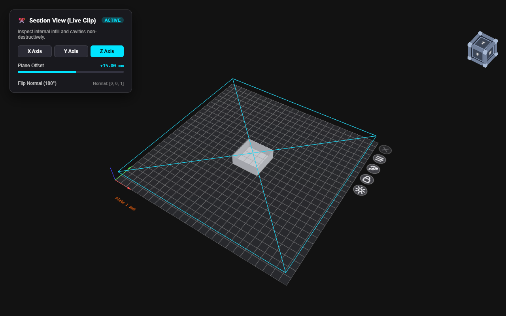
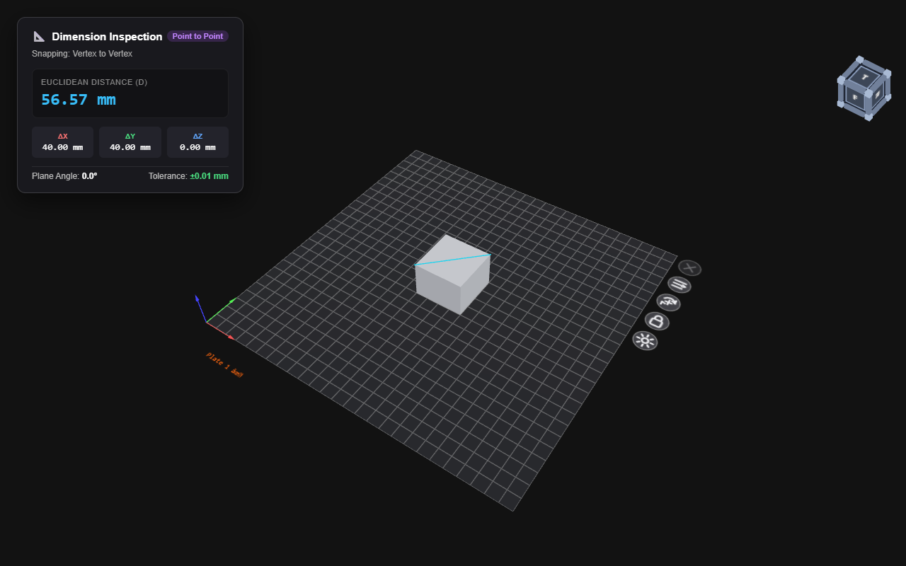

# Kesit Görünümü ve Ölçüm Araçları: İç Boşlukları ve Hassas Ölçüleri İnceleme

Bir projeyi 3D yazıcınıza göndermeden önce iç yapıları incelemek ve kritik mekanik toleransları doğrulamak hayati önem taşır. 3D editör; parça geometrisini değiştirmeyen tahribatsız **Kesit Görünümü** ve görünüm alanında noktalara, kenarlara, yüzeylere ve silindirik deliklere kenetlenerek mesafeleri, boşlukları, açıları ve et kalınlıklarını ölçen gelişmiş **Ölçüm Araçları** sunar.

---

## 1. Kesit Görünümü ve Ölçümü Nerede Bulacaksınız

İnceleme araçlarını iki farklı arayüzden etkinleştirebilirsiniz:

- **Masaüstü bağlam menüsü:** Sahnenin herhangi bir yerine sağ tıklayarak **Kesit Görünümü** panelini açabilir veya **Ölçüm** modunu başlatabilirsiniz.
- **Dokunmatik & Mobil yerleşim:** Editör araç çubuğundaki **Kesit görünümü** veya **Ölçüm** simgelerine dokunun.

Her iki araç da yüklü modellerinizle birlikte çalışır; parça geometrisini kesinlikle bozmaz ve dilimleme ayarlarınızı değiştirmez.

---

## 2. Kesit Görünümünü Kullanma (Canlı Kesit Düzlemi)

**Kesit Görünümü**, modelinizi sanal bir düzlem boyunca kesip açarak iç dolguyu incelemenizi, boşlukları kontrol etmenizi, tahliye deliklerini doğrulamanızı veya iç geçme toleranslarını gözden geçirmenizi sağlar.

### Kesit Ekseni
Modelin hangi eksen boyunca kesileceğini seçin:
- **X ekseni:** Modeli sağdan sola keser (sagital kesit).
- **Y ekseni:** Modeli önden arkaya keser (koronal kesit).
- **Z ekseni:** Modeli baskı tablasına paralel yatay olarak keser (katman katman eksenel kesit).

### Düzlem Ofseti kaydırıcısı
Kesit düzlemini modelin içinde ileri veya geri hareket ettirmek için **Düzlem Ofseti** kaydırıcısını (-150 mm ila +150 mm) sürükleyin.

### Yönü Ters Çevir
Görüş normalini 180 derece tersine çevirmek, ön yarıyı gizleyip modelin karşıt iç yarısını görüntülemek için **Yönü Ters Çevir** seçeneğini açıp kapatın.

### Tahribatsız canlı inceleme
Kesit Görünümü **kesinlikle bir görselleştirme aracıdır**. Modelinizi kesmez, oymaz veya parçalara bölmez; açık bırakılmasının üretilen G-code takım yolları üzerinde sıfır etkisi vardır. Kesiti kaldırmak ve modelin tamamını tekrar görmek için dilediğiniz zaman **Kesit Düzlemini Sıfırla** düğmesine dokunun.

---

## 3. Altı Ölçüm Modu

**Ölçüm** aracı, seçtiğiniz geometrik özelliklerin türüne göre boyutları otomatik olarak hesaplar:

| Ölçüm Türü | Neyi ölçer | Nasıl kullanılır |
| --- | --- | --- |
| **Noktadan Noktaya** | Doğrudan 3D mesafe ve koordinat farkları. | Öklid mesafesini $d$ ve koordinat farklarını ($\Delta X, \Delta Y, \Delta Z$) görmek için iki tepe noktasına (köşeye) tıklayın. |
| **Kenardan Kenara** | İki çizgi arasındaki mesafe ve göreli açı. | İki kenara tıklayarak aralarındaki mesafeyi ve bağıl açıyı $\theta$ (0° ila 180°) görün. |
| **Düzlemden Düzleme** | Dik et kalınlığı veya yüzey aralığı. | İki paralel yüzeye tıklayarak et kalınlığını (kanal genişliği veya dış duvar derinliği gibi) ölçün. |
| **Noktadan Düzleme** | Dik yükseklik veya dikey mesafe. | Bir köşeye ve ardından düz bir yüzeye tıklayarak gerçek dik düşey mesafeyi ölçün. |
| **Noktadan Kenara** | Bir noktanın bir doğruya en kısa mesafesi. | Bir noktaya ve bir kenara tıklayarak en kısa sınır mesafesini bulun. |
| **Çember ve Çap** | Silindirik delik ve pim boyutları. | Çapı ($\varnothing$), yarıçapı ($r$) ve merkez koordinatlarını incelemek için herhangi bir dairesel deliğe veya silindire tıklayın. |

---

## 4. Adım Adım: Modelinizi Ölçme

1. Araç çubuğundan veya sağ tık menüsünden **Ölçüm** aracını başlatın.
2. Görünüm alanında etkileşimli bir yönlendirme belirir: *"Model üzerinde ilk noktayı seçin."*
3. İlk hedef özelliğinize (bir köşe noktası, kenar çizgisi, düz yüzey veya dairesel delik) tıklayın veya dokunun. Vurgulanan bir kenetlenme işareti seçimi onaylar.
4. Yönlendirme güncellenir: *"Şimdi model üzerinde ikinci noktayı seçin."*
5. İkinci hedef özelliğe tıklayın veya dokunun.
6. **Ölçüm Sonucu** kartı anında açılarak şunları gösterir:
   - Ana ölçülen mesafe veya boyut.
   - Paralel olmayan kenarlar veya yüzeyler seçilmişse bağıl **Açı**.
   - **Sonsuz mesafe** (doğruların sonsuz uzantıları arasındaki dik mesafe).
   - Dairesel geometri ölçülmüşse **Merkez** ve çap değerleri.
7. Farklı bir özelliği ölçmek için başka bir noktaya dokunun ya da aracı sıfırlamak için **Temizle** düğmesine basın.

---

## 5. Pratik Mühendislik İpuçları

- **Bağlantı elemanı toleranslarını doğrulama:** Vida yuvaları veya geçme tırnakları tasarlarken nominal delik çapını doğrulamak için deliğin dairesel kenarına tıklayın.
- **Et kalınlığını kontrol etme:** Modelin iç boşluk duvarına ve karşılık gelen dış yüzeye tıklayın. Düzlemden Düzleme ölçümü, dilimlemeden önce minimum duvar kalınlığınızı teyit eder.
- **Eğim açılarını kontrol etme:** Eğimli bir yan yüze ve tabandaki düz yüzeye tıklayarak çıkıntı açılarını doğrulayın ve destek gereksinimini önceden belirleyin.

---

## 6. Sorun Giderme

**Parça görünüm alanında yarısı kesilmiş veya eksik görünüyor.**
Kesit Görünümü şu anda etkindir. Kesit Görünümü panelini açın ve tam görünüme dönmek için **Kesit Düzlemini Sıfırla** düğmesine dokunun.

**Ölçüm aracı yanlış noktaya kenetleniyor.**
Yüzbinlerce üçgenden oluşan yoğun modellerde tepe noktaları birbirine çok yakındır. İmlecin tam hedeflenen köşeye veya kenara kenetlenmesini sağlamak için tıklamadan önce modele yaklaşın (yakınlaştırın).

**Kavisli bir delikte çember çapı algılanmıyor.**
Deliğin gerçek bir silindirik delik veya dairesel yay olduğundan emin olun. Model çok düşük poligon ayarlarıyla dışa aktarılmışsa (daireleri 6 veya 8 kenarlı çokgenlere dönüştürmüşse), araç sürekli bir yay yerine tek tek düz yüzeyleri tanır. Bu durumda karşılıklı iki köşe arasında noktadan noktaya ölçüm yapın.

**Model taşındığında ölçüm kayboluyor.**
Ölçümler sabit koordinatlar arasındaki canlı geometrik sorgulardır. Modeli taşır, ölçekler veya döndürürseniz hatalı boyut okumalarını önlemek için önceki ölçüm otomatik olarak temizlenir.
