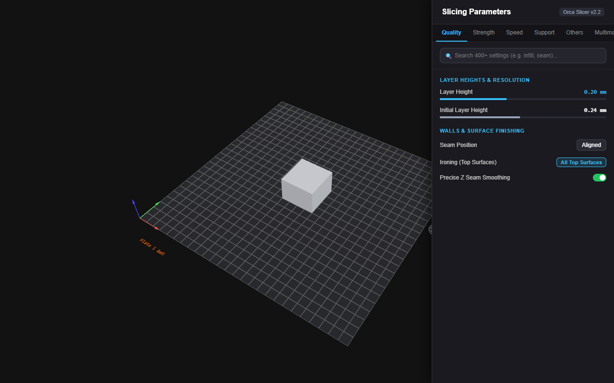

# Dilimleme Parametreleri ve Ayar Arama: 8 Sekmeli Parametreler Paneli

**Parametreler Paneli**, 3D editör içinden 400'den fazla dilimleme ayarı üzerinde doğrudan ve hassas kontrol sağlar. Standart dilimleyici mimarisine uygun sekiz özel sekmede düzenlenen bu panel; katman yüksekliklerinden dolgu desenlerine, soğutma fanlarından çoklu malzeme temizleme kulelerine kadar her şeyi yapılandırmanıza ve anlık arama aracıyla herhangi bir parametreyi milisaniyeler içinde bulmanıza olanak tanır.

---

## 1. Parametreler Panelini Nerede Bulacaksınız

Dilimleme parametrelerine hem masaüstü hem de mobil yerleşimlerden erişebilirsiniz:

- **Masaüstü yerleşimi:** Parametreler paneli ekranın sağ kenarına sabitlenmiş olarak durur. Sekmeleri incelemek için genişletebilir veya 3D görünüm alanını büyütmek için daraltabilirsiniz.
- **Mobil & Dokunmatik yerleşim:** Editör araç çubuğundaki veya alt gezinme çubuğundaki **Parametreler** simgesine dokunarak tam ekran parametre sayfasını açabilirsiniz.

Tablada bir nesne veya parça seçildiğinde panel, genel baskı ayarlarını mı yoksa belirli bir bileşeni mi ayarladığınızı otomatik olarak gösterir.

---

## 2. Sekiz Parametre Sekmesi

Dilimleme parametreleri sekiz sekme altında mantıksal olarak gruplandırılmıştır:

### 1. Kalite (Quality)
Yüzey hassasiyetini, katman çözünürlüğünü ve ince dış detayları yönetir:
- **Katman yükseklikleri:** Ana katman kalınlığı ve tabla yapışması için ilk katman yüksekliği.
- **Çizgi genişlikleri:** Dış duvarlar, iç duvarlar, üst yüzeyler ve dolgu için ekstrüzyon genişlikleri.
- **Dikiş izi yerleşimi:** Katman başlama/bitiş noktalarının hizalanması (Hizalı, En Yakın, Rastgele veya Arka).
- **Ütüleme (Ironing):** Isıtılmış nozulu çok az ekstrüzyonla plastik üzerinden geçirerek en üst düz yüzeyleri pürüzsüzleştirir.

### 2. Mukavemet (Strength)
Baskınızın yapısal rijitliğini, yoğunluğunu ve duvar kalınlığını belirler:
- **Çevre Duvarları:** Modeli saran katı eşmerkezli duvar döngülerinin sayısı.
- **Kabuk katmanları:** İç kısmı koruyan katı üst ve alt yatay katman sayısı.
- **Dolgu yoğunluğu ve desenleri:** Dolgu yüzdesi (%15, %40, %100 gibi) ve iç geometri (Izgara, Cayroid, Petek, Uyarlanabilir Kübik).

### 3. Hız (Speed)
Baskı kafası hareketlerini, ivmelenmeleri ve hızı kontrol eder:
- **Baskı hızları:** Dış duvarlar, iç duvarlar, seyrek dolgu, katı dolgu, köprüler ve çıkıntılar için hareket hızları.
- **İvmelenme ve Sarsıntı (Jerk):** Yüksek hızlı yazıcılarda gölgelenme ve dalgalanma izlerini azaltan hareket dinamikleri.

### 4. Destek (Support)
Çıkıntılı geometri için gerekli feda edilebilir yapıları yapılandırır:
- **Destek tipleri:** Standart doğrusal destekler veya narin detaylara dokunmadan modelin çevresinden dallanan organik Ağaç (Tree) destekler.
- **Eşik açıları:** Destek üretimini tetikleyen çıkıntı açıları (genellikle 45° ila 55°).
- **Arayüz katmanları:** Kolay ayrılma sağlayan, destekler ile model yüzeyi arasındaki yoğun temas katmanları.

### 5. Diğerleri (Others)
Baskı hazırlığı, tabla yapışma yardımcıları ve özel baskı modlarını yönetir:
- **Kenarlık (Brim):** Köşelerdeki kalkmayı önlemek için tabana eklenen ekstra dış hat döngüleri.
- **Fuzzy skin:** Dokulu ve mat bir görünüm için rastgele yüzey salınımı ekler.
- **Vazo modu (Spiral vase):** Geri çekilme olmadan kesintisiz tek çevre duvarlı ekstrüzyon üretir.
- **Baskı sırası:** Tüm modelleri katman katman basma veya her nesneyi tek tek tamamlama seçenekleri.

### 6. Çoklu Malzeme (Multimaterial)
Çoklu filament baskılarını, otomatik renk değişimlerini ve temizleme kulelerini yapılandırır:
- **Boşaltma / Yıkama hacimleri:** Renk karışmasını önlemek için koyu ve açık renkler arasında geçiş yaparken püskürtülen filament miktarı.
- **Temizleme kulesi (Wipe tower):** Filament değişiminden sonra nozulun hazırlandığı ve basıncın dengelendiği kule.

### 7. Soğutma (Cooling)
Parça soğutma hava akışını ve termal dinamikleri yönetir:
- **Fan hızları:** Minimum ve maksimum parça soğutma fanı yüzdeleri.
- **Katman süresi eşikleri:** Bir katman çok hızlı basıldığında baskı hızını otomatik olarak yavaşlatarak erimiş plastiğe katılaşması için yeterli zaman tanır.

### 8. Ayar Ara (Search Settings)
Tüm dilimleme parametrelerini indeksleyen anlık arama paleti. Herhangi bir terimi yazmak, tüm kategorilerdeki eşleşen ayarları doğrudan erişimle anında döndürür.

---

## 3. Ayar Kapsamlarını Anlama

Parametreler paneli tablada neyi seçtiğinize bağlı olarak dinamik olarak uyarlanır:

| Kapsam | Etkin Seçim | Kullanılabilir Sekmeler |
| --- | --- | --- |
| **Genel Ayarlar (Global Preset)** | Hiçbir şey seçili değilken (veya boş tablaya tıklandığında) | Tüm 8 sekme (Kalite, Mukavemet, Hız, Destek, Diğerleri, Çoklu Malzeme, Soğutma, Ayar Ara) |
| **Nesne Ayarları (Object Settings)** | Bir 3D modelin tamamı seçildiğinde | 7 sekme (Kalite, Mukavemet, Hız, Destek, Diğerleri, Çoklu Malzeme, Ayar Ara) |
| **Parça Ayarları (Part Settings)** | Bir alt hacim veya değiştirici seçildiğinde | 5 sekme (Kalite, Mukavemet, Hız, Diğerleri, Ayar Ara) |

### Kullanılabilir sekmeler neden değişir?
- **Soğutma sekmesi Nesne ve Parça kapsamlarında yer almaz:** Soğutma fanı eğrileri ekstrüdere takılı fiziksel filament makarasına uygulanır, bu nedenle yalnızca genel olarak ayarlanabilir.
- **Destek ve Çoklu Malzeme sekmeleri Parça kapsamında yer almaz:** Destek üretimi ve temizleme kulesi planlaması tüm nesnenin bağlamını gerektirir; tek bir alt parça bağımsız olarak kendi temizleme kulesini tetikleyemez.

---

## 4. Hızlı Ayar Arama

Belirli bir ayarı bulmak için sekmeler arasında gezinmek yerine **Ayar Ara** sekmesine geçin veya panelin üstündeki arama çubuğunu kullanın:

1. Arama çubuğuna herhangi bir anahtar kelime yazın (*"gyroid"*, *"dikiş"*, *"brim"*, *"ütüleme"* veya *"fan"* gibi).
2. Sonuçlar siz yazdıkça anında listelenir.
3. Her arama sonucu şunları görüntüler:
   - Kullanıcı dostu ayar etiketi.
   - Hangi sekmeye ait olduğunu gösteren bir etiket (*Mukavemet*, *Kalite* veya *Diğerleri* gibi).
   - Değerin dilimleme davranışını nasıl değiştirdiğini açıklayan bilgilendirici açıklama metni.
4. Bir sonuca dokunmak sizi doğrudan o ayar denetimine götürür.

---

## 5. Ayar Geçersiz Kılmaları ve Dilimleme Önceliği

Bir ayarı **Nesne Ayarları** veya **Parça Ayarları** altında yapılandırdığınızda **yerel bir geçersiz kılma** oluşturursunuz:

- **Öncelik:** Yerel ayarlar genel ayarların önüne geçer. Örneğin, Genel Ayarlarınızda %15 dolgu belirtilmişse ancak mekanik bir dişli nesnesini %50 dolguya ayarlarsanız, yalnızca o dişli %50 yoğunlukta basılır.
- **Seçici özelleştirme:** Yalnızca değiştirmek istediğiniz ayarlara dokunmanız yeterlidir. Dokunulmayan tüm parametreler değerlerini otomatik olarak Genel Ayarlarınızdan devralmaya devam eder.
- **Anında dilimleme güncellemesi:** Herhangi bir parametreyi ayarlamak etkin dilimleme önbelleğini sıfırlar; böylece bir sonraki dilimlenmiş G-code yeni değerleri doğru şekilde yansıtır.

---

## 6. Sorun Giderme

**Soğutma sekmesi panelimde görünmüyor.**
Bir nesne veya parça seçmiş durumdasınız. 3. bölümde açıklandığı gibi, soğutma parametreleri etkin filament profiline uygulanır ve yalnızca **Genel Ayarlar** altında erişilebilir. Genel kapsama dönmek için baskı tablasındaki boş bir alana dokunun.

**Aramam "Ayar bulunamadı" sonucunu verdi.**
Yazımınızı kontrol edin veya alternatif terimler deneyin (örneğin *"duvar"* yerine *"çevre"* veya *"ağaç"* yerine *"destek"* aramayı deneyin).

**Bir nesne ayarını değiştirdim ama dilimlenen model değişmedi.**
Parametreleri düzenledikten sonra tablayı yeniden dilimlediğinizden emin olun. Editör yeni değerinizi anında kaydederken, yazıcınız **Dilimle** düğmesiyle yeniden üretilmesi gereken takım yolunu yürütür.

**Özel ayarlarımı silip varsayılana dönmek istiyorum.**
Nesne veya parça ayarları panelini açın ve değiştirilen değerlerin yanındaki sıfırlama simgesine dokunun. Parametre, varsayılan değerini Genel Ayarlardan devralmaya geri dönecektir.
