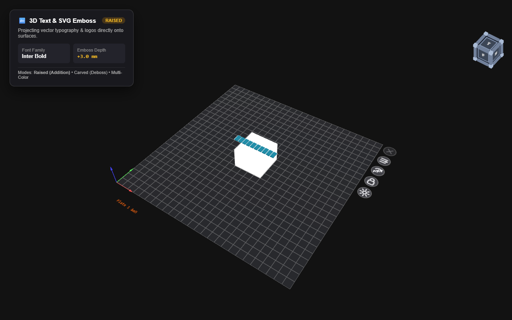

# 3D Metin ve SVG Kabartma: Kabartma ve Oyma Detaylar Ekleme

3D editör; modellerinizin üzerine doğrudan özel yazılar, seri numaraları, üretici logoları ve vektör şekiller eklemenizi sağlar. Ağ geometrinizi değiştirmek için harici CAD yazılımlarına geri dönmek yerine, 3D tipografiyi ve vektör grafikleri doğrudan editör görünüm alanından üretebilirsiniz.

---

## 1. Metin ve SVG Kabartmayı Nerede Bulacaksınız

Kabartma araçlarını iki farklı arayüzden açabilirsiniz:

- **Masaüstü bağlam menüsü:** Hedef nesneye sağ tıklayın ve **3D Yazı Ekle** veya **SVG Kabartma Ekle** seçeneğini seçin.
- **Dokunmatik & Mobil yerleşim:** Nesneyi seçin, editör araç çubuğundaki nesne işlemleri sayfasını açın ve **3D Yazı Ekle** veya **SVG Kabartma Ekle** seçeneğini seçin.

Her iki araç da gerçek zamanlı parametre denetimlerine sahip özel yapılandırma panelleri açar.

---

## 2. Üç Kabartma Modu

Metin veya SVG şekli eklerken şeklin modelle nasıl etkileşime gireceğini seçersiniz:

| Mod | Ne yapar |
| --- | --- |
| **Kabartma (Emboss)** | Model yüzeyinden dışarıya doğru taşan katı bir 3D özellik oluşturur. Modelin basılabilir bir parçası olarak üretilir. |
| **Oyma (Deboss)** | Model yüzeyinin içine doğru kesik atarak harfleri veya çizimi içeriye kazar. Dışarıya malzeme basmak yerine modelden malzeme eksiltir. |
| **Değiştirici** | Geometriyi değiştirmez, ancak şeklin sınırları içinde kalan alana özel dilimleyici ayarları (yoğun dolgu, ekstra duvar veya farklı renk gibi) uygular. |

> [!IMPORTANT]
> Metin ve SVG hacimleri **Destek engelleyici** veya **Destek zorlayıcı** olarak atanamaz. Uygulama bu atamayı kesin olarak engeller; çünkü dekoratif yazılar ve vektör çizimler yüzey detaylandırması veya ayar değişikliği içindir, destek bölgesi sınırları olarak kullanılamaz.

---

## 3. 3D Metni Özelleştirme

**3D Yazı Ekle** paneli eksiksiz tipografi denetimi sunar:

### Metin girişi
Etiketinizi, başlığınızı veya parça numaranızı **Metin** alanına yazın.

### Açık kaynaklı tipografi (6 OFL yazı tipi)
SIL Açık Yazı Tipi Lisansı (OFL 1.1) altında lisanslanmış, kişisel ve ticari baskılarda kısıtlamasız kullanılabilen altı yerleşik açık kaynak yazı tipinden birini seçin:

1. **Inter** — İşlevsel işaretlemeler ve arayüz etiketleri için modern, temiz sans-serif yazı tipi.
2. **Roboto Mono** — Seri numaraları, zaman damgaları ve teknik koordinatlar için tek aralıklı (monospace) yazı tipi.
3. **Bebas Neue** — Belirgin üretici logoları ve büyük başlıklar için kalın, tamamı büyük harfli display yazı tipi.
4. **Playfair Display** — Klasik plaketler, hediyelikler ve sunum baskıları için yüksek kontrastlı zarif serif yazı tipi.
5. **Lobster** — Özel isimler, dekoratif hediyeler ve tabelalar için akıcı el yazısı yazı tipi.
6. **Orbitron** — Mekanik parçalar, kostüm parçaları ve robotik kutuları için geometrik, bilimkurgu esintili yazı tipi.

### Boyut ve derinlik
- **Boyut (2–50 mm):** Yazı karakterlerinin taban yüksekliğini belirler.
- **Derinlik (0,2–20 mm):** Kabartma modunda yazının dışa ne kadar taşacağını, Oyma modunda ise içe ne kadar kesileceğini ayarlar. Okunabilir FDM baskılar için genellikle 0,8 mm ile 1,6 mm arası derinlik idealdir.

### Kavisli yüzeye izdüşür
Etkinleştirildiğinde metin düz bir levha gibi uzamak yerine yuvarlak, silindirik veya organik kıvrımların üzerine tam olarak oturur ve yüzeyi sarar. Küreler, şişeler ve kavisli tutamaklar için bunu kullanın.

Metni modelinize eklemek için **Yerleştir** düğmesine dokunun.

---

## 4. SVG Vektör Kabartmayı Özelleştirme

**SVG Kabartma Ekle** paneli 2D vektör çizimlerinizi fiziksel 3D geometriye dönüştürür:

1. Geçerli vektör XML kodunu (Inkscape, Adobe Illustrator veya Figma'dan kopyalanan) **SVG İçeriği** kutusuna yapıştırın.
2. Modunuzu seçin: **Kabartma (Emboss)**, **Oyma (Deboss)** veya **Değiştirici**.
3. Yükseklik derinliğini denetlemek için **Derinlik (0,2–20 mm)** ayarını yapın.
4. Hedef ağınız kavisliyse veya düzlemsel değilse **Kavisli yüzeye izdüşür** seçeneğini açın.
5. 3D hacmi üretmek için **Yerleştir** düğmesine dokunun.

Vektör yolları pikselli görseller yerine gerçek vektör eğrileri olarak korunur; böylece yüksek çözünürlüklü baskılarda bile keskin kenarlar elde edilir.

---

## 5. Proje Kaydetme ve Kalıcılık

Kabartmalı metin ve SVG hacimleri 3MF proje formatıyla tam entegre çalışır:

- Tipografi ayarları, yazı tipi seçimleri, derinlik parametreleri ve ham SVG vektör yolları doğrudan 3MF arşivine yazılır.
- Projenizi kaydedip kapatıp yeniden açtığınızda metin ve SVG hacimleriniz parametrik özellikleriyle eksiksiz geri yüklenir.
- Dilimleme yapmadan önce dilediğiniz zaman metni düzenleyebilir veya boyutları değiştirebilirsiniz.

---

## 6. Sorun Giderme

**Yazı keskin köşelerde bozuk veya tırtıklı görünüyor.**
Modeliniz 90 derecelik dik köşelere sahipse **Kavisli yüzeye izdüşür** seçeneğini kapatın. Düzlemsel uzatma düz yüzeylerde daha temiz sonuç verir; kavisli izdüşüm ise pürüzsüz ve sürekli hatlar için tasarlanmıştır.

**Oyulan metin önizlemede görünmüyor.**
Oyma yazılar modelin içine doğru kesik atar. Modelinizin duvar kalınlığı belirttiğiniz derinlikten inceyse kesim iç boşluğa taşacaktır. Modelinizin içinin dolu olduğunu doğrulayın ve görünüm alanını açılı olarak inceleyin.

**Uygulama metni bir destek bölgesine dönüştürmeyi reddediyor.**
2. bölümde belirtildiği gibi, metin ve SVG hacimleri destek engelleyici veya destek zorlayıcı yapılamaz. Bir destek bölgesine ihtiyacınız varsa bunun yerine standart bir kutu veya silindir temel şekli ekleyin.

**SVG içeriği reddediliyor veya eklenemiyor.**
SVG içeriğinizin standart kapalı yollar (`<path d="...">`, `<circle>` veya `<polygon>`) içerdiğinden emin olun. SVG içindeki metin etiketleri vektör editöründen dışa aktarılmadan önce yol (outline) haline getirilmelidir. SVG içindeki gömülü pikselli görseller (`<image>`) ve JavaScript betikleri güvenlik nedeniyle yok sayılır ve reddedilir.
