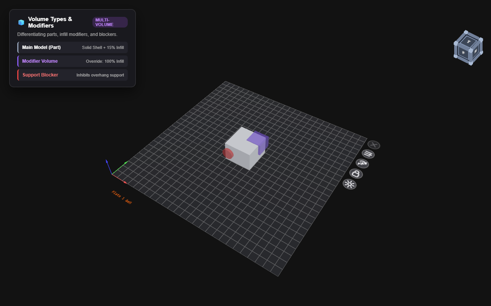

# Hacim Türleri: Parça, Negatif Parça, Değiştirici ve Destek Bölgeleri

3D editördeki her nesne bir veya daha fazla **hacimden** oluşur ve her hacmin, dilimleyiciye görevinin ne olduğunu söyleyen bir **türü** vardır. Beş tür vardır:

| Tür | Ne yapar |
| --- | --- |
| **Parça** | Normal baskı parçası. Dilimlemeye dahil edilir. |
| **Negatif parça** | Çıkarıcı hacim. Parçadan malzeme keser, basılmaz. |
| **Değiştirici** | Ayar bölgesi. Kapladığı alanda dilimleyici ayarlarını geçersiz kılar. |
| **Destek engelleyici** | Destek istenmeyen bölge. Bu hacmin içinde destek üretilmez. |
| **Destek zorlayıcı** | Destek bölgesi. Bu hacmin içinde destek üretilir. |

Yalnızca ilki basılır. Diğer dördü basılan malzemenin nasıl üretileceğini şekillendiren *talimatlardır*: ondan çıkar, farklı davran ya da desteğin nerede büyüyüp büyüyemeyeceğine karar ver.

---

## 1. Hacim Türlerini Nerede Bulacaksınız

Kullandığınız editör yüzeyine göre iki giriş yolu vardır:

- **Editör ızgarası (dokunmatik yerleşim):** nesneyi seçin, ardından editör ızgarasında — seçim için düzenleme eylemlerini listeleyen panelde — **Volume (Beta)** seçeneğini seçin.
- **Bağlam menüsü (masaüstü):** nesneye sağ tıklayın ve **Türü değiştir** seçeneğini seçin.

Hangi yoldan girerseniz girin, seçili nesnenin hacimlerini, her birinin mevcut türüyle listeleyen bir sayfa açılır. Bir hacim seçtiğinizde beş tür, her birinin tek satırlık açıklamasıyla birlikte radyo listesi olarak görünür; yani yukarıdaki tabloyu ezberlemeniz gerekmez.

Belirli bir türde yeni hacimler doğrudan da eklenebilir: nesne menüsünde, metin ve SVG hacimlerinin yanında **Parça ekle**, **Negatif parça ekle**, **Değiştirici ekle**, **Destek engelleyici ekle** ve **Destek zorlayıcı ekle** bulunur. Doğru türde bir hacmi baştan eklemek, genellikle bir parça ekleyip sonra dönüştürmekten daha hızlıdır.

> [!NOTE]
> Hacim türleri Beta özelliğidir: eylem, yalnızca yapınız için etkinleştirildiğinde editör ızgarasında görünür. **Volume (Beta)** yoksa uygulamayı güncelleyin.

---

## 2. Her Tür Baskıya Ne Yapar

### Parça
Varsayılan. Katı, basılan bir hacim. Bir nesnenin her zaman en az bir Parçası olmalıdır — kalan son katı parça başka bir türe dönüştürülemez ve uygulama sizi basılamaz bir nesneyle baş başa bırakmak yerine değişikliği reddeder.

### Negatif parça
Çakıştığı parçalardan *çıkarılan* bir şekildir. Basılmak yerine malzemeyi oyar: bir bloğun içinden silindiri negatif parça olarak geçirin ve bir delik elde edin; bir kutu koyun ve bir boşluk veya açık kanal elde edin.

Ona güvenmeden önce bilmeniz gereken iki şey:

- Oyulmuş bir **boşluk duvar ekler**: dilimleyici deliğin iç yüzeyini basmak zorundadır, bu yüzden içi boşaltılmış bir bölge katı orijinalden *daha fazla* malzeme kullanabilir. Malzemenin gerçekten azaldığı yer, parçayı tamamen kesen kanaldır.
- Kesim yalnızca negatif parçanın diğer hacimlerle **çakıştığı** yerde geçerlidir. Boşlukta süzülen bir negatif parça hiçbir şey yapmaz.

### Değiştirici
**Geometriyi değil ayarları** değiştiren bir bölgedir. İçindeki modele dokunulmaz; değiştiricinin taşıdığı dilimleyici ayarları yalnızca kapladığı alana uygulanır. Tipik kullanım, aksi hâlde dolu bir parçanın içine seyrek dolgu bloğu yerleştirmek veya bir montaj çıkıntısının çevresine farklı duvar sayılı bir bölge koymaktır.

Ayar taşımayan bir değiştirici hiçbir şey değiştirmez. Bölgenin şekli ve konumu tüm hikâyedir: onu taşıdığınızda geçersiz kılınan bölge de onunla birlikte taşınır.

### Destek engelleyici
Destekler için yasak bölge. Otomatik desteklerin üretileceği yerde — bir çıkıntının altında, bir boşluğun içinde — engelleyici "burada değil" der. Görünen bir yüzü veya temiz kalması gereken bir deliği destek uçlarından uzak tutmak için kullanışlıdır.

### Destek zorlayıcı
Tersidir: geometri normalde gerektirmese bile destekler bu hacmin *içinde* üretilir. İnce bir köprüyü, uzun yatay bir pimi veya deneyimden daha iyi yardımla basıldığını bildiğiniz bir bölgeyi güçlendirmek için kullanışlıdır.

> [!TIP]
> Engelleyici ve zorlayıcı yalnızca baskı için otomatik destekler etkinse anlam taşır. Destekler kapalıyken ikisinin de bastıracağı veya zorlayacağı bir şey yoktur.

---

## 3. Bir Hacmin Türünü Değiştirme

1. Nesneyi seçin, editör ızgarasında **Volume (Beta)**'yı açın.
2. Dönüştürmek istediğiniz hacmi seçin.
3. Radyo listesinden yeni türü seçin. Her seçeneğin yanında açıklaması görünür.
4. Onaylayın. Ekranın altında kısa bir **"Hacim türü güncellendi."** mesajı belirir.

İki reddetme içe yerleşiktir ve ikisi de hata değil korumadır:

- **"Bir nesnenin son katı parçası başka bir türe değiştirilemez."** Basılan hacmi kalmayan bir nesne dilimlenemez; bu yüzden son Parça Parça kalır. Gerçekten gitmesini istiyorsanız hacmi dönüştürmek yerine silin.
- **"Metin ve SVG hacimleri destek engelleyici veya zorlayıcı olamaz."** Metin ve SVG şekilleri destek bölgesi olarak davranamaz; amacınızı aynı ayak izine sahip bir kutu veya temel şekle çevirin.

Her değişiklik tek bir geri alma adımıdır, bu yüzden yanlışlıkla yapılan bir dönüştürme kolayca geri alınır.

---

## 4. Kaydetme, Yeniden Açma — ve Dürüst Bir Sınır

Hacim türü değişiklikleri **bellekteki sahneye anında** uygulanır: proje açık kaldığı sürece nesne listesi, dilimleme girdisi ve yapılan her yeni dilimleme yeni türü yansıtır.

Ancak mevcut Beta'da hacim türü **henüz kaydedilen 3MF proje dosyasına yazılmaz**. Sayfa bunu doğrudan söyleyerek uyarır:

> **"Bu hacim türü henüz 3MF'ye aktarılmıyor, bu yüzden G-code'u değiştirmez."**

Bunun pratikteki anlamı:

- Türlerinizi ayarlayın, dilimleyin, baskıya gönderin — o oturum boyunca her şey çalışır.
- Projeyi kaydedin, kapatın, sonra yeniden açın; hacim türleri kaydedilen eski değerlerine dönmüş olur. Yeniden dilimlemeden önce tipleri tekrar uygulayın.
- Dışa aktarma desteği gelene kadar tür değişikliklerini oturum başına bir adım olarak görün. Sayfadaki uyarı bandı gerçek kaynaktır: bandı gösterildiği sürece tür dosyayla birlikte taşınmaz.

---

## 5. Sorun Giderme

**Volume (Beta) eylemi editör ızgarasında yok.**
Bu yetenek yapınızda etkin değildir. Uygulamayı güncelleyip tekrar kontrol edin.

**Bir negatif parça hiçbir malzeme kesmedi.**
Kesmek için basılan bir hacimle çakışmalıdır — boşlukta tek başına duran bir negatif parça hiçbir şey yapmaz. Ayrıca gerçekten nesnenin içinde olduğunu, yalnızca yakınında olmadığını ve kaydedilip yeniden açılan bir proje için 4. bölümdeki bandın devrede olmadığını doğrulayın.

**Oymadan sonra daha az malzeme bekliyordum ama baskı ağırlaştı.**
Bu boşluk etkisidir: oyulan alanın iç duvarları gerçek basılan yüzeydir. Amaç malzeme çıkarmaksa parçayı tamamen kesin.

**Bir destek engelleyici destekleri durdurmadı.**
Baskı için otomatik desteklerin hiç değilse etkin olduğunu ve engelleyici hacmin, desteklerin göründüğü bölgeyle gerçekten çakıştığını kontrol edin. Hiçbir şey eklemeyen bir zorlayıcı için de aynı kontroller geçerlidir.

**Projeyi yeniden açtıktan sonra tür eski haline döndü.**
Şimdilik beklenen bir durum — 4. bölüme bakın. Yeni oturumda türleri tekrar uygulayın; hiçbir şey bozulmadı.

**Uygulama değişikliğimi son katı parça ile ilgili bir mesajla reddetti.**
Nesne başına en az bir Parça tutun. Baktığınız parçayı dönüştürmek istiyorsanız önce yeni bir hacim ayırın.

**Geri al, önceki türü getirmedi.**
Türü radyo listesinden elle geri alın. Değişikliğin kendisi tek bir geri alma adımıdır; eski yapılarda tür değeri geri oynatılmayabilir ve her hâlde en hızlı düzeltme yeri bu sayfadır.
