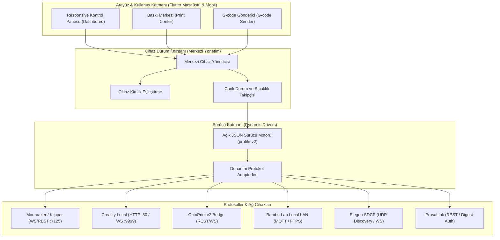

# 🖨️ 3D Yazıcı Entegrasyonu & Bağlantı Arayüzleri Mimarisi

MakerSpell ekosistemi, farklı marka ve üreticilere ait yüzlerce 3D yazıcı modelini tek bir merkezden keşfetmek, telemetrisini izlemek, dosyalarını yönetmek ve baskı süreçlerini güvenle yürütmek üzere tasarlanmış **hibrit ve genişletilebilir bir bağlantı mimarisine** sahiptir.

---

## 📌 1. Temel Mimari Prensipleri

MakerSpell'in yazıcı entegrasyonu iki katmandan oluşur:

1. **Deklaratif JSON Tabanlı Sürücüler (`profile-v2`):** Yeni bir yazıcı modelini desteklemek veya arayüzünü özelleştirmek için uygulama kaynak kodunu derlemek gerekmez. JSON profili; ağ kanallarını (`channels`), endpoint operasyonlarını (`operations`), telemetri haritalamalarını (`state`), buton ve kontrol aksiyonlarını (`actions`) ve ekran düzenini (`ui`) bildirir.
2. **Denetlenmiş Temel Taşıyıcılar (Transports):** Ağ soketleri, HTTP bağlantıları ve ikili (binary) haberleşme; güvenlik testlerinden geçmiş çekirdek adaptörler (`MoonrakerTransport`, `CrealityLocalTransport`, `OctoPrintTransport`, `BambuTransport` vb.) üzerinden yürütülür.
3. **Safe-Mode (Fiziksel Güvenlik):** Yalnızca laboratuvarda fiziksel olarak test edilip onaylanan cihazlar (`Creality K1`, `Snapmaker U1`, `Creality Hi / Hi Combo`) doğrudan uzaktan baskı başlatma yetkisine sahiptir. Topluluk cihazları katı `UPLOAD_ONLY` kuralına tabidir.

---

## 📌 2. Bağlantı Yaşam Döngüsü

Bir yazıcı MakerSpell ağına dahil olduğunda şu aşamalardan geçer:

1. **Keşif (Discovery):** mDNS (`_printer._tcp`, `_octoprint._tcp`, `_moonraker._tcp`, `_creality._tcp`) veya yerel alt ağ IP/port taraması ile tespit edilir.
2. **Probing (Kimlik Doğrulama):** Cihazın açık portuna hafif bir test isteği (probe) atılır. Yanıttaki model adı veya sistem imzası çözülür.
3. **Kararlı Kimlikleme (Stable Identity):** MAC adresi, seri numarası veya cihaz UUID'si üzerinden benzersiz bir `stableId` üretilir. IP adresi değişse bile yazıcının geçmişi ve ayarları korunur.
4. **Profil Eşleştirme:** Cihaz modeline en uygun `profile-v2` JSON sürücüsü dinamik olarak yüklenir.
5. **Telemetri & Canlı Takip:** Nozul/tabla sıcaklıkları, baskı ilerlemesi, kalan süre, fan hızları ve kamera akışı arayüze reaktif olarak aktarılır.
6. **Dosya Transferi & Yazdırma:** Dilimlenen G-code dosyası hedefe iletilir ve izin durumuna göre yazdırma tetiklenir veya operatör onayı beklenir.

---

## 📌 3. Doküman Bölümleri

- [Safe-Mode Güvenlik Protokolü](file:///D:/YazilimProgramlama/3DEticaretOtomasyon/community-hub/docs/printers/safe-mode-protocol.md)
- [Ağ Keşfi ve Kararlı Kimlik (stableId) Mantığı](file:///D:/YazilimProgramlama/3DEticaretOtomasyon/community-hub/docs/printers/network-discovery.md)
- [Taşıma Katmanları (Transports) & Protokoller](file:///D:/YazilimProgramlama/3DEticaretOtomasyon/community-hub/docs/printers/transport-adapters.md)
- [Çok Renkli Sistemler (Creality CFS, Snapmaker AMS)](file:///D:/YazilimProgramlama/3DEticaretOtomasyon/community-hub/docs/printers/filament-ams-cfs.md)
- [JSON Sürücü Spesifikasyonu (profile-v2)](file:///D:/YazilimProgramlama/3DEticaretOtomasyon/community-hub/docs/schemas/profile-v2-specification.md)
