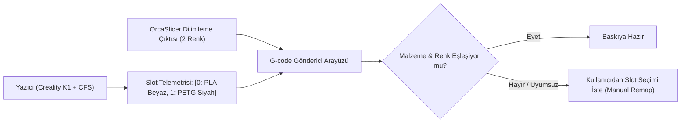

# 🎨 Çok Renkli Sistemler (Creality CFS, Snapmaker AMS) Entegrasyonu

Modern 3D yazıcılar çok renkli ve çok malzemeli baskı yeteneklerine (AMS - Automatic Material System, CFS - Creality Filament System vb.) sahiptir. MakerSpell, bu sistemlerin yuva (slot) durumlarını, malzeme türlerini, renk kodlarını ve eşleştirmelerini dinamik olarak yönetir.

---

## 📌 1. Filament Yuvası Parametreleri

Kullanıcı arayüzünde her bir filament bobini aşağıdaki bilgilerle görselleştirilir:
- **Yuva Numarası:** `Slot 1`, `Slot 2`, `Slot 3`, `Slot 4`.
- **Malzeme Türü:** PLA, PETG, ABS, TPU, PA-CF vb.
- **Renk Göstergesi:** Bobinin gerçek rengini yansıtan renk paleti ikonu.
- **Doluluk Durumu:** Yuvada takılı filament var mı yoksa yuva boş mu?
- **Kalan Miktar:** Tahmini kalan filament ağırlığı (gram).
- **Etiket:** "CFS Slot 1", "Harici Makara" veya kullanıcı tarafından atanan özel ad.

---

## 📌 2. Dilimleme & G-code Gönderiminde Filament Eşleştirme

Bir 3D model dilimlendiğinde, dilimleyici (OrcaSlicer) çıktısında modelin hangi renk/malzeme ile basılması gerektiği belirtilir (Örn: `Filament 1: PLA Siyah`, `Filament 2: PLA Kırmızı`).

G-code Gönderici (`GcodeSenderDialog`) ekranında:
1. Seçilen yazıcının bağlı bir CFS/AMS ünitesi olup olmadığı kontrol edilir.
2. Yazıcıdan güncel slot telemetrisi istenir.
3. Modeldeki filament gereksinimleri ile yazıcıdaki yuvalar otomatik eşleştirilir.
4. Eşleşmeyen veya eksik malzeme varsa kullanıcıya görsel bir seçim tablosu sunulur.

---

## 📌 3. Hata Yönetimi ve İzolasyon

- **CFS Okuma Hatası:** Eğer yazıcı açık ancak CFS/AMS ünitesi kapalı veya bağlantı kopuksa, tüm arayüz kilitlenmez. Sadece filament eşleştirme kartında `"Could not read CFS slots from <ip>"` uyarısı ve bir `Retry` butonu gösterilir.
- **Harici Makara Desteği (Spool Holder):** CFS/AMS olmayan cihazlarda veya doğrudan harici makaradan basılacak işlerde sistem tekli yuva (`slotLabel: "External spool"`) moduna düşer.
