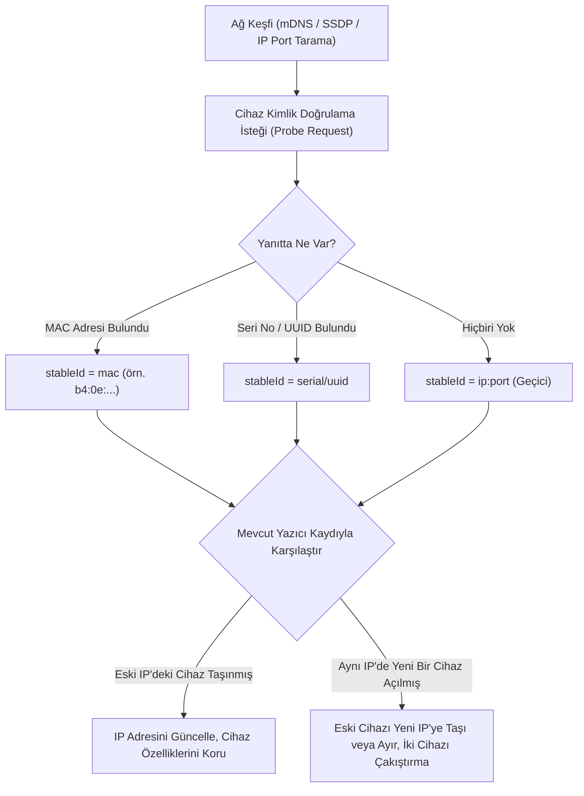

# 🌐 Ağ Keşfi & Kararlı Kimlik (stableId) Mantığı

Ev ve atölye ortamlarında 3D yazıcılar genellikle DHCP üzerinden dinamik IP adresi alır. Cihazlar veya modem kapatılıp açıldığında IP adresleri yer değiştirebilir (örneğin daha önce K1'in kullandığı `192.168.1.105` adresi, bir sonraki açılışta Snapmaker U1'e atanabilir).

MakerSpell, bu durumun cihaz karışıklığına yol açmasını engellemek için **Kararlı Kimlikleme (`stableId`)** ve **Akıllı Ağ Keşfi (Network Discovery)** protokolünü geliştirmiştir.

---

## 📌 1. Kararlı Kimlik (`stableId`) Nedir?

`stableId`, bir yazıcının ağ üzerindeki IP adresinden bağımsız olarak sahip olduğu fiziksel kimlik kodudur.

### Öncelik Sıralaması (Nasıl Belirlenir?):
1. **Fiziksel MAC Adresi:** Ağ kartının veya Wi-Fi yongasının benzersiz MAC adresi (`b4:0e:xx:yy:zz`).
2. **Cihaz Seri Numarası:** Yazıcı yazılımının veya anakartının bildirdiği seri no (örneğin Creality `K1Max-123456789`).
3. **Klipper UUID:** Moonraker API tarafından üretilen tekil makine UUID'si (`printer.info.instance_id`).
4. **Fallback (Yedek):** Yukarıdakiler alınamazsa taranan ilk `ip:port` kombinasyonu geçici olarak kullanılır; ancak ilk başarılı probe isteğinde kalıcı kimliğe terfi ettirilir.

---

## 📌 2. Dinamik IP Değişimi & Çakışma Yönetimi

### Sorun Senaryosu:
Dün `192.168.1.105` adresinde **Snapmaker U1** vardı. Bugün modem kapatılıp açıldı ve `192.168.1.105` adresini **Creality K1** aldı. Snapmaker ise `192.168.1.111` adresine geçti.

### MakerSpell Çözümü:
1. **Kimlik Odaklı Karşılaştırma:** Cihazlar sadece IP adresine göre değil, sahip oldukları donanımsal `stableId` üzerinden eşleştirilir.
2. **Akıllı Slot Güncelleme:** Tarama sırasında `192.168.1.105` adresine test isteği atıldığında gelen kimlik `Creality K1` ise:
   - Eski `Snapmaker U1` cihazının kaydı ezilmez veya ismi yanlışlıkla K1'e dönüştürülmez.
   - Snapmaker cihazı `192.168.1.111` adresinde keşfedildiğinde IP'si otomatik olarak güncellenir.
   - `192.168.1.105` adresine ise temiz bir Creality K1 cihazı tanımlanır.
3. **Özellik İzolasyonu:** Eski cihazın model bilgisi, filament durumu veya bağlantı parametreleri yeni IP'deki cihaza kesinlikle aktarılmaz. Her cihaz kendi donanım kimliğiyle izole kalır.

---

## 📌 3. Desteklenen Keşif Protokolleri

1. **mDNS (Multicast DNS / Zeroconf):**
   - `_moonraker._tcp.local` (Klipper / Voron / RatRig)
   - `_octoprint._tcp.local` (OctoPrint cihazları)
   - `_creality._tcp.local` ve `_cxswbox._tcp.local` (Creality K1, Ender-3 V3, Hi)
   - `_bambulab._tcp.local` (Bambu Lab P1/X1/A1)
2. **SSDP (Simple Service Discovery Protocol):**
   - UPnP tabanlı yazıcı servisleri için multicast arama.
3. **Alt Ağ Port Taraması (Fallback Polling):**
   - mDNS paketlerini engelleyen karmaşık Wi-Fi ağlarında kullanıcının yerel alt ağı (`192.168.1.0/24`) 80, 7125, 8899, 9999 gibi bilinen yazıcı portları üzerinden taranır.
