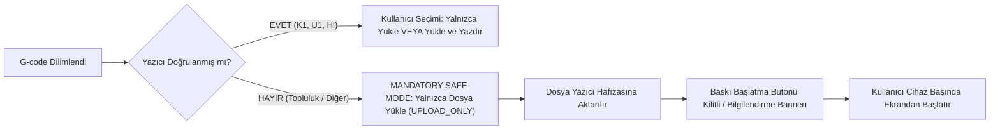

# 🛡️ Safe-Mode Donanım Güvenlik Protokolü (Hardware Safety Standard)

> [!CAUTION]
> **Fiziksel Güvenlik Önceliği:** 3D yazıcılar yüksek sıcaklıklara (300°C+ nozul, 100°C+ tabla) ulaşan ve yüksek hızlı mekanik hareketlere sahip fiziksel cihazlardır. Hatalı bir ağ komutu, yangın veya mekanik hasar riski doğurabilir. MakerSpell mimarisi "Önce Güvenlik" (Safety First) prensibiyle tasarlanmıştır.

---

## 📌 1. Doğrulanmış Donanım (Verified Hardware)

Geliştirici ekibi tarafından fiziksel olarak bizzat test edilen ve iki yönlü tam kontrol yetkisi verilen donanımlar şunlardır:

| Cihaz Ailesi | Destek Durumu | İzin Verilen Eylemler | Güvenlik Seviyesi |
| :--- | :--- | :--- | :--- |
| **Creality K1 / K1 Max / K1C** | 🟢 **Verified** | Telemetri, Dosya Yükleme, Uzaktan Başlatma, Eksen Hareketi | Seviye 1 (Tam Doğrulama) |
| **Creality Hi / Hi Combo** | 🟢 **Verified** | Telemetri, CFS Çok Renk Kontrolü, Uzaktan Başlatma | Seviye 1 (Tam Doğrulama) |
| **Snapmaker U1 / Artisan** | 🟢 **Verified** | Telemetri, Takım Değiştirme, Dosya Yükleme, Başlatma | Seviye 1 (Tam Doğrulama) |

Bu cihazlar haricindeki **tüm marka ve modeller varsayılan olarak "Topluluk / Deneysel Donanım"** kategorisindedir.

---

## 📌 2. Topluluk Donanımlarında Zorunlu Safe-Mode (`UPLOAD_ONLY`)

Bambu Lab, Anycubic, Voron, Elegoo, Prusa ve genel Klipper yazıcılar topluluk profili ile eklendiğinde **Safe-Mode** devreye girer:



### Safe-Mode Kapsamındaki Kısıtlamalar:
1. **`auto_start = false` Zorunluluğu:** G-code gönderme API'sinde `startPrint` bayrağı asla `true` olarak gönderilemez.
2. **Yalnızca Yükleme (`UPLOAD_ONLY`):** Dosya yazıcının yerel depolama alanına (`/local/`, `/sdcard/`, `virtual_sdcard` vb.) yüklenir.
3. **Fiziksel Başlatma:** Operatör, yazıcının yanına giderek tablanın temiz olduğunu, yapışma yüzeyini ve filament durumunu kontrol ettikten sonra baskıyı fiziksel ekrandan başlatır.
4. **Isıtma ve Hareket Koruması:** Cihaz durumu `printing` veya `busy` iken harici eksen hareket veya manuel sıcaklık komutları arayüzden kilitlenir.

---

## 📌 3. JSON Profilinde Safe-Mode Bildirimi

Bir profilin Safe-Mode kapsamında kalması için `permissions` dizisinde `printStart` izni yer almamalı veya `verification` bloğunda `safeMode: true` belirtilmelidir:

```json
{
  "id": "community.generic-klipper.safe",
  "version": "1.0.0",
  "identity": {
    "name": "Generic Klipper (Safe Mode)",
    "status": "community"
  },
  "permissions": [
    "statusRead",
    "fileListRead",
    "fileUpload",
    "cameraRead"
    // DİKKAT: "printStart" ve "deviceControl" yetkileri verilmemiştir!
  ],
  "verification": {
    "safeMode": true,
    "warningMessage": "Bu yazıcı topluluk tarafından test edilmektedir. Güvenliğiniz için baskıyı cihaz üzerinden başlatınız."
  }
}
```

---

## 📌 4. Topluluk Onayı (Community Verification) Süreci

Topluluk tarafından sağlanan bir profilin `communityVerified` seviyesine yükseltilebilmesi için:
- En az **5 bağımsız kullanıcı** tarafından başarılı baskı teyidi verilmelidir.
- Telemetri ve sıcaklık okumalarının güvenilir çalıştığı kanıtlanmalıdır.
- Acil durdurma (Emergency Stop / M112) aksiyonunun gecikmesiz çalıştığı doğrulanmalıdır.
