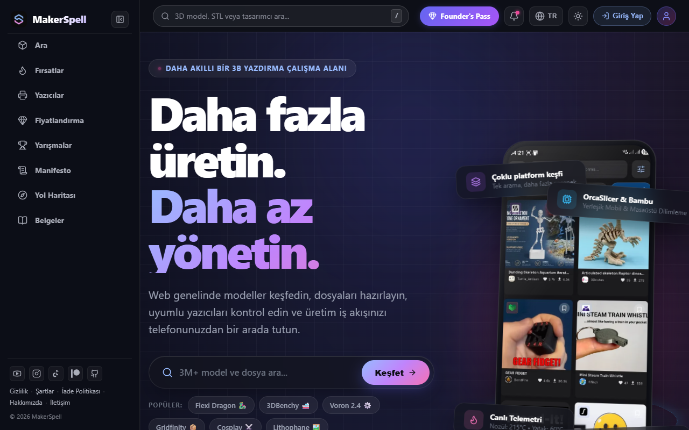

# 🌐 MakerSpell Web Platformu Kullanım Kılavuzu

MakerSpell Web platformu ([makerspell.com](https://www.makerspell.com)), dünyadaki 26 farklı 3D model deposunu tek bir noktada toplayan, donanım indirimlerini listeleyen ve küresel tasarım yarışmalarını takip eden kapsamlı bir ekosistemdir.

---

## 🌟 Web Platformunun Temel Modülleri

1. **🔎 Ortak Model Arama Motoru (`/browse`):**
   Printables, Thingiverse, MakerWorld, Cults3D, Thangs ve 20+ platformdaki milyonlarca modeli aynı anda arayın, ücretsiz/ücretli durumuna göre filtreleyin.
2. **🏷️ 3D İndirimler & Kuponlar (`/deals`):**
   En popüler 3D yazıcılar, filamentler, yedek parçalar ve reçineler için güncel indirimleri, kupon kodlarını ve mağaza kampanyalarını yakalayın.
3. **🏆 Topluluk Tasarım Yarışmaları (`/contests`):**
   Farklı platformların düzenlediği 3D tasarım yarışmalarını, ödül havuzlarını ve son başvuru tarihlerini tek bir takvimden inceleyin.
4. **👑 Kurucu Üyelik & Avantajlar (`/pricing`):**
   Gelişmiş arama filtreleri, reklamsız deneyim ve öncelikli donanım desteği sunan MakerSpell üyelik seçenekleri.

