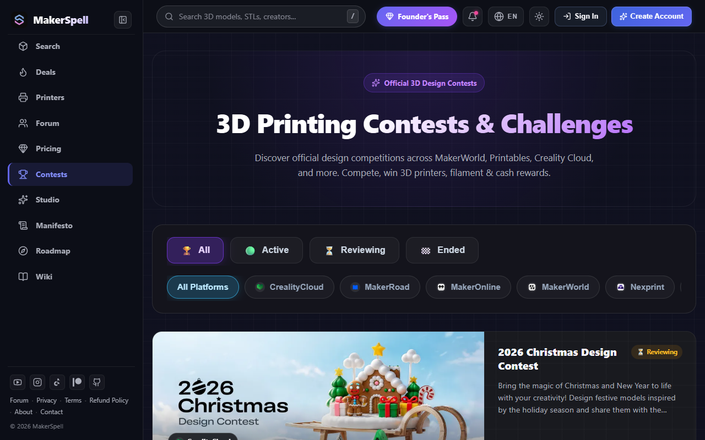

# 🏆 Topluluk Tasarım Yarışmaları & Ödüller Rehberi

MakerSpell Contests ([makerspell.com/contests](https://www.makerspell.com/contests)), küresel 3D model platformlarının (Printables, CrealityCloud, MakerWorld vb.) düzenlediği yarışmaları tek bir takvimde toplar.

---

## 1. Yarışma Kartlarını İnceleme

Her yarışma kartında aşağıdaki kritik bilgiler yer alır:
- **Yarışmanın Teması ve Başlığı:** (Örn: *Desk Organization*, *Halloween Props*).
- **Düzenleyen Platform:** Hangi platformun ev sahipliği yaptığı.
- **Kalan Süre / Son Başvuru Tarihi:** Başvuruların ne zaman kapanacağı.
- **Ödül Havuzu:** 1., 2. ve mansiyon ödülleri (Örn: 3D yazıcı hediyesi, hediye çeki, filament setleri).

---

## 2. Katılım ve Detaylar

Bir yarışmaya katılmak veya kurallarını görmek için karta tıkladığınızda:
- Yarışmanın detaylı katılım şartları, lisans kuralları ve jüri kriterleri listelenir.
- **"Yarışmaya Katıl"** butonu sizi doğrudan ilgili platformun resmi başvuru sayfasına yönlendirir.

