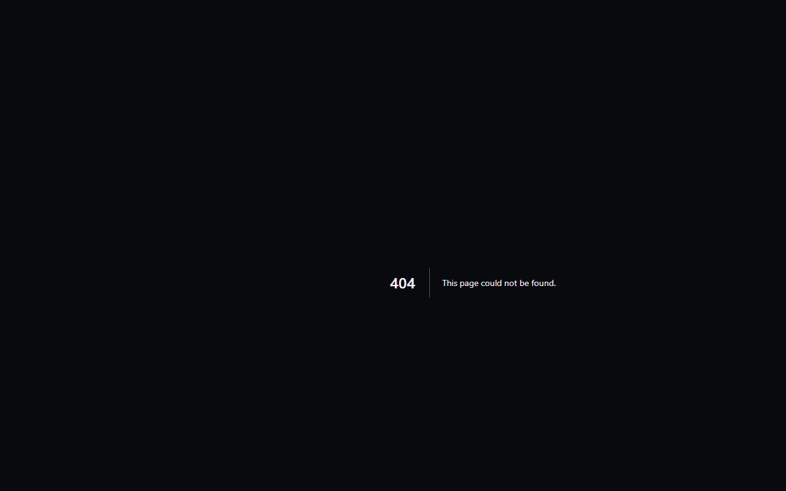

# 🖨️ Açık Protokol Donanım Sürücüleri Portalı

[makerspell.com/community-printers](https://www.makerspell.com/community-printers) adresi, topluluk tarafından test edilen tüm 3D yazıcı sürücülerinin web üzerindeki vitrinidir.

---

## 1. Web Portalının Sağladığı İmkânlar

- **Canlı Sürücü Kataloğu:** Creality, Snapmaker, Bambu Lab, Klipper/Moonraker, Prusa ve Anycubic modelleri için hazırlanmış açık JSON sürücülerini inceleyebilirsiniz.
- **Topluluk Doğrulaması:** Hangi sürücünün kaç kullanıcı tarafından onaylandığını ve güvenilirlik puanını görebilirsiniz.
- **Tek Tıkla Kopyala & İndir:** Sürücü JSON dosyasını doğrudan panoya kopyalayabilir veya indirip kendi uygulamanıza aktarabilirsiniz.
- **Güvenlik Durumu:** Cihazın tam doğrulanmış mı yoksa Safe-Mode (Upload-Only) kapsamında mı olduğunu şeffafça takip edebilirsiniz.

